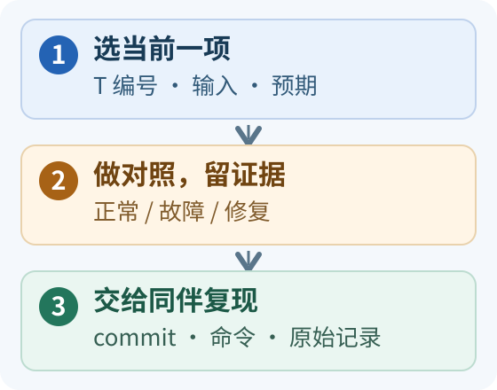

# 实践任务：选当前一项，交一份可复现的证据

<small>整理与维护：24cst朱鑫鹏</small>

先确认自己正在做哪一项，再看它的输入、任务和验收。**一次完成一个当前任务**；下面的入口帮助你找到题目，先修和硬门槛仍按各项正文执行。

## 我现在该做哪项？

| 我现在的状态 | 打开这一项 | 先看懂什么，再开始做 |
|---|---|---|
| 新终端里还不能稳定运行教学节点 | [T0：开发环境](#t0s0) | 包从哪里构建、当前终端 source 了哪套 install |
| T0 已通过，开始写通信节点 | [T1：通信、参数与 Action](#t1launch-actions1) | 发布/订阅端点怎样对应，取消请求与最终状态有什么区别 |
| 按周任务进入 S4，准备实现搜索 | [T5：能解释的 A*](#t5-as4) | 小地图上路径代价怎么算，再补核心逻辑、独立实现 |

**5 分钟准备**：选中当前项，在报告中先写“T 编号、固定输入、预期结果”三行；然后展开该项核对交付和验收，再运行。运行后补实际观察、证据路径和结论。完整格式与评分在下一节，**≥80 分且该项全部硬门槛通过才过关**。

准备实车任务时，直接查 [T8 的前置硬门槛](#t8s6)：必须先通过 T0–T7，并满足负责人确认、停止链和现场值守等条件。图中流程是提交方法，不是已通过考核的记录。

<link rel="stylesheet" href="../visuals/reader.css">

## 手册范围与配套材料

本手册与[学习路线](../onboarding/learning-route.md)配套。作业交付到新人的练习仓库或队伍指定分支；本知识库记录题目、模板与结论，不直接存大 bag、PCD、build/install/log。以下数值是**教学验收门槛**，不是 Navigation-2027 已取得的性能，也不替代队内实车安全标准。

不知道如何开始时，先做[源码导读 R1–R5](reading-labs.md)，其中给出输入、问题、推导和参考答案；按[逐周任务单](../onboarding/weekly-plan.md)安排工作。通过当期必修后可选[自学专题](../self-study/README.md)的离线项目，额外项目不替代 T8/T10 实车验收。

配套[教学工作区](../training/workspace.md)给出可运行基线；[标准合成包](../training/datasets.md)可直接做运动/时间/TF 前置练习。[Topic 完整案例](../debug-real/case-topic-mismatch.md)对应 T1，[速度缓存案例](../debug-real/case-stale-command.md)对应 T7/T9。合成包不满足 T3–T4 真实 LiDAR/IMU 定位输入要求，相关验收仍需队内数据。

## 统一交付格式与评分

一份报告要让别人重走你的判断。例如“收到 0 条”只是现象；“发布端全名为 `/nav_training/sequence`，订阅端为 `/sequence`；改相对名并重启后收到连续序号”才有根因与验证。教学 [resolve_topic 与 run_topic][task-topic]能先练这个因果，但它只比较字符串，不模拟 DDS；正式 T1 还要补实际端点和接收日志。证据写清来自源码推断、教学模型还是 ROS 运行，读者才能知道结论能用到哪一步。

每次提交必须包含：代码/配置 commit、系统和依赖版本、输入数据标识与校验值、完整命令、预期、实际观察、原始证据路径、结论、回退步骤、未验证项。代码改动附 diff，参数实验附改前/改后有效参数；截图要标注 frame、单位和时间段。

每项按 100 分：结果与接口正确 40，证据与可复现 25，排障解释 20，代码/记录与回退 15。**≥80 分且该项所有硬门槛通过才过关。** 抄教程能跑但解释不了消息与因果不通过；环境缺资产则记“待资源”，不记失败。修改后重新提交该项，不要求无意义地重做所有课程。

共用硬门槛：不能伪造运行结果；不能把回放当闭环；不能绕过停止/值守流程；不能将教学故障注入真实在运动的系统。触发时暂停对应实验，补齐证据或安全条件后重考。

## T0：新终端可复现的开发环境（S0）

**为何这样考**：同一命令在不同终端结果不同，常常是环境路径不同。`colcon list` 只发现包，编译才产生目标，source 才让当前 shell 找到安装结果。沿 [loam_interface/CMakeLists.txt][task-cmake]找到共享库和组件可执行入口，再用 `ros2 pkg prefix`核对成品来源；如果它指向另一套 install，就先解释 overlay，而不是修改源代码。新终端复现检验的是你能否把隐含环境写进步骤。

**输入**：普通 Ubuntu 22.04 机器、Humble、[环境页](../onboarding/environment.md)。**任务**：talker/listener、小空包编译、建立 Git 分支，修改 README 并发 PR/提交评审。用 `colcon list` 静态盘点本队工程，指出完整运行的外部依赖。

**交付**：环境报告、构建日志、运行步骤、Git diff/commit。**验收**：同伴新开终端按步骤能运行教学节点；能指出包来自哪个 install；在 15 分钟内定位一次未 source 或错误 overlay。**常见错误**：把“包能列出”当成构建成功、提交 build/install/log。完整比赛工程缺包不阻塞 T0。

## T1：通信、参数、launch 与 Action（S1）

**先做一个预测**：5 Hz 的理想发送间隔是 0.2 s，10 Hz 是 0.1 s；60 秒计数约为 300 与 600，窗口边界会影响具体条数。教学 [SequencePublisher][task-sequence]的参数控制定时器，[startup_parameter][task-startup]把参数声明为启动时只读，所以改启动值要重启，不应把运行中设置被拒绝误当故障。再读 [Fibonacci.execute][task-action]，看取消如何从请求变成最终终态；“发出请求”只是过程证据。

**输入**：T0 的 `nav_training`。**任务**：自写 pub/sub，消息有序号；发布频率可配置；用 launch 加 namespace/remap。每次运行 60 秒记录发送与接收计数。设置一次错 Topic、一次不兼容 QoS，用 CLI 定位后修改教学节点配置/代码并重启验证。另用官方教学 Action 完成目标接受、反馈、取消和结果。

**交付**：节点源代码、CMake/package.xml、launch、参数、端点信息、故障记录与 Action 状态。**验收**：5 Hz 和 10 Hz 两组输出的观测速率在设定值 ±10% 内；若机器负载造成偏差，必须找到证据并重新取得可用基线。解释消息丢失/计数差异；两种故障均能在 15 分钟内定位并修复；Action 取消得到取消状态而不是只关客户端。**常见错误**：Topic 可见就断言通信成功、Goal accepted 就称任务完成。

## T2：全向运动与 TF（S2）

**把模型讲白**：车体速度是“相对自己往前/往左”，世界位置是“相对固定地面走到哪”。yaw=π/2 时，车体 `(0.2,0)` 旋转成世界 `(0,0.2)`；这一步正确，后面五秒一米才有意义。教学 [integrate_body][task-core]还处理恒定体速度下的圆弧积分，[IdealModel.tick][task-model]将同一结果填入 Odometry 和 TF。注意：只发送一次命令会受超时限制，五秒运动例需要持续提供有效输入；不能把超时停车的 0.1 m 误判为积分算错。

**输入**：独立教学速度 Topic、理想模型，无硬件。**任务**：实现[二维模型](../ros2-tf/README.md)，发布匹配的 Odometry/TF，并处理第一帧、无效 dt、时间回跳和输入超时。

**测试集**：

| 用例 | 输入与预期 |
|---|---|
| 直行 | yaw=0，vx=0.2 m/s，5 s；x≈1 m，y≈0 |
| 侧移 | yaw=0，vy=0.2 m/s，5 s；y≈1 m，x≈0 |
| 纯旋转 | wz=0.2 rad/s，5 s；位置不变，yaw≈1 rad |
| 朝向转换 | 初始 yaw=π/2，vx=0.2 m/s，5 s；沿世界 +y 走约 1 m |
| 组合运动 | vx、vy、wz 同时非零；与独立计算的固定步长参考轨迹比较 |

**验收**：使用程序确定的实际输入时间/固定 dt，前四例位置误差 ≤0.02 m、角误差 ≤0.02 rad；组合例注明步长并与更细步长参考比较，不能仅目测。TF 和 Odometry 同一时间戳的位姿一致；输入超时阈值自行声明（教学建议 0.5 s），超时后模型停止推进。修复一例 frame 断链和一例时间错误，区分两者。**交付**：代码、计算说明、结果表、TF 图与恢复步骤。不要把理想模型精度解释为实车定位精度。

## T2 巩固：从节点练习到轻量巡逻

用[轻量巡逻综合任务](../training/patrol-workshop.md)回答一个完整问题：“给定几个点，怎样按序移动、途中等待障碍、汇报进度，最后交结果？”它把 T1 的通信/Action 和 T2 的运动、时间边界接起来。先用固定离线场景理解状态；再由已具备 Humble 环境的学生实现隔离 ROS 多节点系统，提交通信图、反馈、结果、日志与取消/断流记录。

离线能解释状态，不记为真实 DDS 或 Action 已通过。ROS 版按该页接口和分层清单验收，取消、停止和断流均为必达；不能靠删除所有速度输出来通过停止检查，正常巡逻也要成立。此任务是 T1–T2 的巩固材料，T8 实车资格和原来的运动/TF 门槛继续按本页执行。

## T3：真实数据流与 bag 体检（S3）

**怎样解释结果**：Topic 消息数大于零，最多证明包里有记录；算法是否消费了它，还要查类型、QoS、时间和回调。到 [Livox 预处理][task-preprocess]看逐点时间单位，再到 [sensor_scan_generation 的同步入口][task-sync]看它需要里程计与点云成对进入。假设两端分别有 100 条，却无法形成需要的时间配对，输出仍可能空；因此体检必须把“一路是否有数据”和“多路能否一起使用”分开。

**输入**：负责人提供固定 bag、消息定义、外参/模型、采集说明；没有时先完成源码图和 T1 的教学 bag。

**任务**：为 LiDAR/IMU/关节/TF/里程计逐项记录完整 Topic、类型、frame、时间源、消息数、stamp 间隔的中位数/p95/最大值、间断时间段和 QoS；画节点图、Topic 图、TF 发布权图。给出每种数据是谁产生、谁消费、异常会影响哪层。

**验收**：关键输入全部被覆盖；报告中“数据不存在”和“算法没启动”可区分；同伴可从时间戳定位同一异常区间。对错误 QoS/遗漏 TF/停住的 clock 三类抽两题，20 分钟内定位到证据支持的原因。**常见错误**：只提交一张 RViz 截图、把 `hz` 当全部时间质量。

## T4：定位与地图的可重复实验（S3）

**怎样解释差异**：两次轨迹很接近叫重复一致，不等于位置真实准确。若没有真值，不能把两条轨迹相差 0.02 m 写成“定位误差 2 cm”。顺着 [performRegistration][task-gicp]观察 `previous_result_t_` 初值、收敛判断和成功后更新，再读 `publishTransform`：这个发布函数不以“本轮配准成功”为前提。结果应同时展示点云对齐、变换变化、日志和重复条件，TF 存在只占其中一项。

**输入**：T3 合格数据、配套 PCD、YAML+图像、有效参数。**任务**：分别说明建图和已有地图定位的启动分支；重跑 Point-LIO/small_gicp 时只回放所需输入。相同条件完整重跑两次，记录预热区间、TF 校正、漂移/轨迹差异、CPU/内存和日志。给定正确与有偏差的 initialpose，比较收敛过程；有偏差的输入只在隔离回放中进行。

**验收**：地图各文件存在且校验值已登记，坐标对齐有证据；能解释 odom 连续漂移与 map 校正；配准不收敛时明确记录失败，而非以“还在发 TF”判成功。有测量真值才报告绝对误差，否则只报告相对一致性和观测。**交付**：两次完整报告、一组初始化对照、可复现命令。bag 倍速受代码墙钟差分影响时标注限制，不为追求一致强行调大滤波参数。

## T5：能解释的 A*（S4）

**先手算一次**：四邻接单位代价，起点 `(0,0)`、终点 `(2,1)`，无遮挡时最短三步、代价 3；起点本身不额外计一步。h=0 去掉目标估计，得到可比较的 Dijkstra 基线。无解时队列耗尽应返回明确失败，不能用空路径同时表达“起终点相同”和“没找到路”。最后到本队 [planner_server/GridBased][task-planner]核对插件、方向桶和运动模型，解释教学二维节点 `(x,y)`遗漏了什么。

**输入**：自己制作的固定小栅格地图和起终点。**任务**：实现四邻接 A*，输出路径、代价、扩展数量与耗时。允许八邻接扩展，但必须定义禁止穿角策略。

具体操作按[A* 两步练习](../training/astar-workshop.md)：阶段 A 在待填写框架中补三处核心逻辑，降低包结构和算法同时未知的负担；阶段 B 在个人仓库独立实现同一接口，再跑固定案例和独立最优代价检查。导师可以换一张地图或起终点，要求学生先推演再运行。提交参考实现运行结果只能证明环境可用，不能当成自己的算法交付。

**硬门槛**：至少六类测试全部通过：可达绕障、无解、起点/终点越界、起点/终点占据、起终点相同、窄通道；八邻接另测对角穿角。逐步验证路径相邻关系和碰撞；在小图上与 Dijkstra/h=0 参照的最优代价一致。返回失败不能无限循环。**交付**：算法代码、固定输入、自动检查输出、可视化及局限说明。**口试**：当前队伍使用什么 Planner？为什么此作业不等于实现了 Smac Hybrid？

## T6：地形、Costmap 与规划对照（S4）

先读[可重复实验与对照图](../training/controlled-experiments.md)，练习把“图变了”写成“唯一改动让哪种坐标或估计量改变”。几何示例提供可手算答案，便于验证读图方法；正式 T6 仍以本关自己的输入和有效参数为准。

**把对照归因到一层**：教学假设中通道宽 0.5 m、圆半径 0.2 m，静态几何余量总共只有 0.1 m；缩半径让路径通过只是改了机器人模型，不能证明车更能走。先读 [terrain_analysis 的离地高度][task-terrain]，再读 [障碍层 intensity 过滤][task-layer]：一个点不再被标记与旧障碍被清除是两件事。报告注明格子变化发生在标记、清除还是膨胀，路径变化才有可解释的起点。

**输入**：同一地图/场景和固定起终点，使用无底盘输出的隔离环境。**任务**：基线加三组单因素实验，分别检查 footprint/半径、膨胀、地形 intensity/障碍清除；参数组内不可同时改变定位外参或控制增益。

**验收**：每组重复三次，报告所有结果；有效参数确认加载到正确节点；能从输入点→地形点→Costmap 格子→路径解释至少一处变化。记录规划成功数、耗时、路径长度；无闭环时不计算到达率。能说明无路径来自哪一层，恢复基线后同伴可复现。**常见错误**：缩小 footprint 换取“能通行”、调 controller 试图修错地图、清图后不查障碍为何复现。

## T7：Nav2 到串口的完整链路（S5）

**把观察接成链**：控制器输出 `(0.2,0,0)`，在 yaw=π/2、spin=0.5 的教学输入下，fake 变换预测为 `(0,-0.2,0.5)`。沿 [navigation_launch 的 remap][task-navigation]定位平滑前后 Topic，再到 [transformVelocity 与缓存][task-fake]核对这组数。报告中的每个速度都要注明 frame、采样时刻和来源；否则“前面是零，后面非零”可能既有自旋叠加，也有不同事件时刻，不能直接跳到单一结论。

**输入**：已验收的隔离仿真或无驱动接口观察环境、[源码证据页](../system/nav2-and-control-evidence.md)。**任务**：追踪 NavigateToPose→BT→GridBased→FollowPath→三个速度 Topic→外部接收者；记录生命周期、目标反馈/结果/取消。比较参数文件与运行快照，完成一次参数/launch 小改动并回退。

**必须解释**：

1. global/local Costmap、Planner、Controller、behavior、velocity_smoother 各负责什么；smoother_server 和 velocity_smoother 的区别。
2. OmniPid 的 `enable_rotation=false` 与最终自旋为何可同时出现；哪个帧对应哪个速度。
3. 默认组合/非组合分支的 remap 差异，为什么最终消费者必须确认。
4. 零输入、取消目标、发送断流在当前 fake_vel_transform/串口缓存下分别可能发生什么。

**验收**：每段接口都有发布者/消费者/类型与证据，明确标注待实车端；不能把未收到数据说成零命令。至少修复一个错 namespace/错配置加载的隔离故障；停止路径未通过时，结论写“不可进入运动测试”，这也是正确完成 T7。

## T8：陌生故障诊断与实车准入（S6）

**为何分两部分**：离线诊断验证你能定位原因，实车记录验证真实设备对接口的反应。教学 [CacheModel.step][task-cache]可以说明零命令与旧缓存的事件顺序，却没有串口、固件、惯性和机械制动。盲测先按端点→时间/TF→状态/地图→输出的证据推进；实车再把软件发布、底盘接收、物理停止分别记录。无消息不能填作“速度等于零”，未知硬件行为应交给对应负责人确认。

**前置硬门槛**：T0–T7 通过，负责人补齐设备/地图/接口清单，按[实车流程](../debug-real/README.md)确认急停、驱动使能、最终停止路径、单一控制权和测试区域。至少一名值守人员在场。

第一部分是**不动真车的盲测**。导师从错 namespace、QoS 不匹配、漏静态 TF、错误 use_sim_time、地图不存在、lifecycle 未激活、起点占据、速度接收者错误中随机选三类，至少跨两个系统层。每题 20 分钟内给出层级判断和至少两条支持/排除证据，30 分钟内恢复可恢复的软件故障；不允许无目的多参数试错。硬件故障题可用及时升级与完整证据作为正确处置。

第二部分是**低速、有人值守的实车任务**：前进、侧移、旋转、目标到达、目标取消、停止后重新启动；不在实车运动中故意撞击、搬动或制造错 TF。先进行停止链路台架验证，之后才放开运动。每类至少三次，所有停止检查均须通过；没有通过就中止并登记，不能用平均成绩抵消。

**交付**：盲测诊断记录、实际有效参数、最终 Topic/底盘接收证据、实车检查单和维护者签字。速度上限、停车距离/时间、定位误差阈值由设备负责人依据实测填写并在测试前冻结；空白则不能做相应运动验收。

## T9：一项真实代码改动（S7）

**让修改能被审查**：以重复 stamp 为例，先固定输入证明原逻辑怎样处理它，再定义拒绝、重置或等待哪种行为符合接口。教学 [replay_motion.compare][task-replay]明确拒绝非严格递增输入，是可供阅读的一个选择；它不代表生产节点也必须照搬。回归要覆盖坏样本和正常连续样本，输出能解释、改动能回退，才算处理了问题；单次不再报错不能排除悄悄算错。

**输入**：维护者选定的独立小问题与可复现输入。可选课题：诊断日志补充、参数有效性检查、时间戳处理、超时/缓存问题的隔离修复。不要让新人首项任务重写 LIO 或更换整套 Planner。

**任务**：改前复现→解释根因→写最小改动→覆盖原故障的回归→运行相邻正常场景→提交 PR 与回退说明。确切断流停机逻辑需要与串口/电控共同定义，不独自决定固件行为。

**验收**：实际代码编译和相关检查通过；原故障前后证据完整；维护者能审查风险；不能只改注释就声称修复。若暂时无实车，以离线回归通过并标注“待上车”交付，不能取得比赛运行认证。自定义 Nav2/BT 插件为完成该关后的可选专项。

## T10：比赛演练与模块交接（S7）

**交接写到哪个细节**：把一次失败写成“规划失败→全局清图→重试仍失败→进入外层恢复”，比“Nav2 自动恢复失败”更方便下一人定位。对照 [单点 BT][task-tree]中的内外 RecoveryNode 和端口名，在记录里保留具体 Goal、状态和日志时间段。教学十次任务即使都成功，也只能说明这组冻结场景的表现；交接还要写清输入、启动分支和未覆盖场景，维护者据此决定后续岗位。

**输入**：已冻结代码、地图、参数、硬件编号及值守岗位表。**任务**：完成一轮开机→状态检查→初始化→任务序列→受控目标失败→诊断/恢复→继续任务→关机与资料归档。比赛状态接口只依据已实现的 Goal/反馈/取消协议，不编造低血量回家等现成功能。

**建议教学门槛**：固定十次目标任务，成功至少九次；全部保留，失败也必须归因。该门槛仅判断是否掌握实验流程，正式比赛可靠性指标另由队伍制定；停止要求仍为全部通过。交接给另一名同学，按说明能复现已定义场景；维护者确认后安排比赛岗位。

## 结业记录表

复制以下表格到个人记录，结果使用“通过/补做/待资源/待实车”；不能提前勾选。

| 任务 | 输入/配置版本 | 证据或 PR | 分数与硬门槛 | 验收人/日期 | 未验证项 |
|---|---|---|---|---|---|
| T0–T2 | 待记录 | 待记录 | 待验收 | 待记录 | 待记录 |
| T3–T4 | 待记录 | 待记录 | 待验收 | 待记录 | 待记录 |
| T5–T7 | 待记录 | 待记录 | 待验收 | 待记录 | 待记录 |
| T8 | 待记录 | 待记录 | 待验收 | 待记录 | 待记录 |
| T9–T10 | 待记录 | 待记录 | 待验收 | 待记录 | 待记录 |

求助时采用[问题记录模板](../maintenance/README.md)。报告“不知道，但已排除这些原因，需要该接口负责人确认”比无证据修改更符合工程要求。

[task-topic]: https://github.com/Navigator-Vision-Algorithm-Team/knowledge-base/blob/main/training/cases/run_case.py#L42-L64
[task-sequence]: https://github.com/Navigator-Vision-Algorithm-Team/knowledge-base/blob/main/training/ros2_ws/src/nav_training/nav_training/sequence.py#L10-L39
[task-startup]: https://github.com/Navigator-Vision-Algorithm-Team/knowledge-base/blob/main/training/ros2_ws/src/nav_training/nav_training/runtime.py#L8-L11
[task-action]: https://github.com/Navigator-Vision-Algorithm-Team/knowledge-base/blob/main/training/ros2_ws/src/nav_training/nav_training/fibonacci_server.py#L29-L61
[task-core]: https://github.com/Navigator-Vision-Algorithm-Team/knowledge-base/blob/main/training/ros2_ws/src/nav_training/nav_training/core.py#L29-L109
[task-model]: https://github.com/Navigator-Vision-Algorithm-Team/knowledge-base/blob/main/training/ros2_ws/src/nav_training/nav_training/ideal_model.py#L57-L80
[task-cache]: https://github.com/Navigator-Vision-Algorithm-Team/knowledge-base/blob/main/training/cases/run_case.py#L67-L129
[task-replay]: https://github.com/Navigator-Vision-Algorithm-Team/knowledge-base/blob/main/training/tools/replay_motion.py#L14-L45
[task-cmake]: https://github.com/Navigator-Vision-Algorithm-Team/Navigation-2027/blob/183a4109b0de2030bb8970a54654937c8b039ba9/ros_ws/src/pb2025_sentry_nav/loam_interface/CMakeLists.txt#L26-L33
[task-preprocess]: https://github.com/Navigator-Vision-Algorithm-Team/Navigation-2027/blob/183a4109b0de2030bb8970a54654937c8b039ba9/ros_ws/src/pb2025_sentry_nav/point_lio/src/preprocess.cpp#L94-L122
[task-sync]: https://github.com/Navigator-Vision-Algorithm-Team/Navigation-2027/blob/183a4109b0de2030bb8970a54654937c8b039ba9/ros_ws/src/pb2025_sentry_nav/sensor_scan_generation/src/sensor_scan_generation.cpp#L41-L85
[task-gicp]: https://github.com/Navigator-Vision-Algorithm-Team/Navigation-2027/blob/183a4109b0de2030bb8970a54654937c8b039ba9/ros_ws/src/pb2025_sentry_nav/small_gicp_relocalization/src/small_gicp_relocalization.cpp#L134-L192
[task-planner]: https://github.com/Navigator-Vision-Algorithm-Team/Navigation-2027/blob/183a4109b0de2030bb8970a54654937c8b039ba9/ros_ws/src/pb2025_sentry_nav/pb2025_nav_bringup/config/reality/nav2_params.yaml#L469-L504
[task-terrain]: https://github.com/Navigator-Vision-Algorithm-Team/Navigation-2027/blob/183a4109b0de2030bb8970a54654937c8b039ba9/ros_ws/src/pb2025_sentry_nav/terrain_analysis/src/terrain_analysis.cpp#L485-L515
[task-layer]: https://github.com/Navigator-Vision-Algorithm-Team/Navigation-2027/blob/183a4109b0de2030bb8970a54654937c8b039ba9/ros_ws/src/pb2025_sentry_nav/pb_nav2_plugins/src/layers/intensity_obstacle_layer.cpp#L403-L444
[task-navigation]: https://github.com/Navigator-Vision-Algorithm-Team/Navigation-2027/blob/183a4109b0de2030bb8970a54654937c8b039ba9/ros_ws/src/pb2025_sentry_nav/pb2025_nav_bringup/launch/navigation_launch.py#L253-L340
[task-fake]: https://github.com/Navigator-Vision-Algorithm-Team/Navigation-2027/blob/183a4109b0de2030bb8970a54654937c8b039ba9/ros_ws/src/pb2025_sentry_nav/fake_vel_transform/src/fake_vel_transform.cpp#L93-L154
[task-tree]: https://github.com/Navigator-Vision-Algorithm-Team/Navigation-2027/blob/183a4109b0de2030bb8970a54654937c8b039ba9/ros_ws/src/pb2025_sentry_nav/pb2025_nav_bringup/behavior_trees/navigate_to_pose_w_replanning_and_recovery.xml#L5-L38
