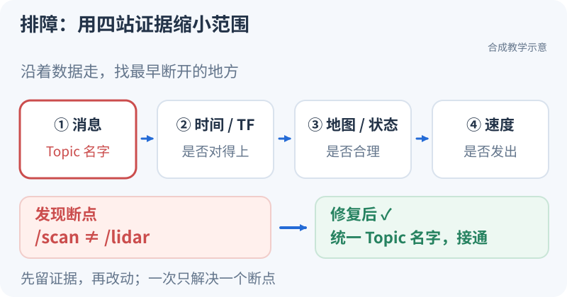

# Debug：用三条记录找到断点

<small>整理与维护：24cst朱鑫鹏</small>

**本节练排障取证**：发送端还在工作，接收端却没有消息，怎样把“收不到”变成一个可验证的原因？只改订阅名字，比较正常、故障、修复后的两端 Topic 名和计数。

<iframe src="../visuals/playground.html?scene=messages" loading="lazy" width="100%" height="620" style="border:0;border-radius:12px" title="故障观察：Topic名字不同时谁还在发送"></iframe>

[单独打开演示](../visuals/playground.html?scene=messages)

## 现在试一下：留下正常、故障、修复三条记录（5分钟）

每种状态选好名字后，先点“重播”，再点三次“单步”。把你看到的两端全名、发送数和接收数写下来。下面是演示的预期，提交时写自己的实际观察。

| 记录 | 发送端 → 接收端 | 发送 / 接收预期 |
|---|---|---|
| 正常：名字相同 | `/goal` → `/goal` | 3 / 3 |
| 故障：名字不同 | `/goal` → `/goals` | 3 / 0 |
| 修复：改回名字相同 | `/goal` → `/goal` | 3 / 3 |

**先解释再动手**：故障时发送没有停止，改变接收名字后接收恢复，这两条证据怎样支持“断点在名称匹配”？演示只隔离这一项；真实 ROS 仍需核对类型、QoS 和发现/网络。

**下一步就做这一题**：[有 Topic 却收不到消息](case-topic-mismatch.md)。把刚才的三条观察接到固定输入、完整命令和原始日志；案例使用另一组 Topic 名，按实际全名记录。查真实链路时再展开下面的诊断卡。实车仍按 T8 的资料与无驱动验收、负责人确认停止链路、低速值守运动考核推进；浏览器练习不授予上车资格。

<div data-nav-visuals="需要时查看：排障步骤静态图"></div>



<link rel="stylesheet" href="../visuals/reader.css">
<script src="../visuals/reader.js" defer></script>

<div data-nav-fold></div>

## 从浏览器练习到实车，边界是什么？

原课程：**Debug、实车调试与比赛流程**。

Debug 从 S1 开始。实车按 T8 的前置资料与无驱动验收、负责人确认停止链路、低速值守运动考核三个步骤推进，全部通过后才取得实车调试资格。目标是先判断故障层级、获取证据、做最小修正、恢复并回归。以下命令为 Humble/Bash 观察示例；命名空间按实际运行值修改。当前主机未接 ROS 和机器人，本页不是实车验收记录。

完整教学案例：[有 Topic 却收不到消息](case-topic-mismatch.md)、[零命令后旧速度再次输出](case-stale-command.md)。两篇均配独立可执行模型、固定输入、证据、诊断过程和回归；案例一另有真实 ROS 教学 launch。它们不是实车事故记录。

## 零基础先读命令，再按故障查

1. [Debug 代码详解：零基础新人版](command-guide.md)：先认识 shell、节点/进程/组件、Topic/TF/Action，再逐项解释命令参数与输出；包含采集脚本带读和只读练习。
2. [Debug 排查手册](runbook.md)：按重复导航、点云/时间、TF、Goal、串口、定位、避障、云台等现象，依次检查、判断、处理与复查。
3. [只读诊断采集脚本](assets/collect_navigation_debug.sh)：默认检查当前已 source 的环境；可显式指定工作空间/命名空间，不发运动命令。

两份材料以本队 Navigation-2027 为学习主线，具体旧路径、自动初始化、碰撞保护开关和独立串口诊断则来自 2026-09 本地化 PB2025 案例，已单独标注。读历史成功记录不能替代本次部署与[源码基线](../system/nav2-and-control-evidence.md)登记。

## 1. “机器人不动”按依赖检查

导航像一条接力链：目标先变成路径，路径再变成速度，最后才由接口送到底盘。前一棒没有交出去，后一棒即使程序还活着也没有工作可做。因此排查的第一件事是找到“最后一段有正确输出”和“紧接着第一段没有正确输出”，把大问题缩成一个模块的问题。

例如 RViz 已显示路径，`cmd_vel_controller` 有 `linear.x=0.2`，`cmd_vel_nav2_result` 也有数据，而 `cmd_vel` 没有。这时重点是速度转换的输入和同步条件。先读 [ros_ws/src/pb2025_sentry_nav/pb2025_nav_bringup/launch/navigation_launch.py][velocity-launch] 中控制器与 smoother 的 remap，再读 [ros_ws/src/pb2025_sentry_nav/fake_vel_transform/src/fake_vel_transform.cpp][velocity-callback] 的回调：非零速度可能先存入缓存，等 odometry 与 local_plan 配对后才发布。这个例子是排查思路，`0.2 m/s` 是示意读数。

先确认应该运动以及底盘允许运动，再分层。安全状态不明时先停止，不继续发送试探性命令。

| 层级/现象 | 证据 | 下一步判断 |
|---|---|---|
| 无节点/找不到包 | 启动日志、`ros2 pkg prefix`、`ros2 node list` | 环境/overlay/launch/外部依赖；先读第一条错误 |
| 节点在但数据不通 | `ros2 node info`、`topic list -t`、`topic info --verbose` | namespace、消息类型、QoS、ROS domain/网络发现 |
| TF/定位失效 | TF 图、指定时间查询、stamp、传感器数据、配准日志 | 断链、错时、外参、输入中断、地图不匹配；不靠反复 initialpose 掩盖 |
| Goal 没进系统 | Action server、目标接受/反馈/result/cancel | 目标 frame、namespace、server 状态；发送成功不等于执行成功 |
| 没有规划路径 | planner lifecycle、请求结果、起终点、global costmap | 起点占据、unknown、无通路、TF、规划超时 |
| 有路径无跟踪输出 | controller lifecycle、FollowPath 结果、local costmap、progress/goal checker | 跟踪条件或控制失败；不是先换 Planner |
| 有上游速度无最终速度 | 三段速度 Topic、fake frame/odom/local_plan、日志 | remap、转换条件、同步输入、组件分支 |
| 最终速度存在但底盘不执行 | 最终订阅者、串口连接/接收统计、驱动使能、固件状态 | 软件命令/协议/电控边界；交给对应负责人共同验证 |
| 取消后仍运动 | 最终速度、cmd_spin、自旋偏置、缓存、串口输出/固件看门狗 | 不把取消 Action 或上游零命令等同物理急停 |

出现 CPU/内存/磁盘压力，记录进程级占用、队列和日志时间，再判断性能瓶颈。`top`/`htop`、`df -h`、`free -h` 是基础；gdb、core dump、profiling 在明确崩溃/热点后使用。

## 2. 本队只读诊断卡

下面的命令分别回答“谁在运行、谁与谁连接、是否进入工作状态、现在用的是什么配置”。不要把它们当作十几条必须背下来的咒语。例如 `topic info` 显示一个 publisher，却没有 `echo` 输出，只能证明创建了发布端点；接着检查回调的输入是否到达。若 lifecycle 为 `inactive`，先查配置失败的日志，而不是继续寻找速度。

```bash
export ROBOT_NS=/red_standard_robot1
ros2 node list
ros2 component list
ros2 node info "$ROBOT_NS/fake_vel_transform"
ros2 lifecycle get "$ROBOT_NS/planner_server"
ros2 lifecycle get "$ROBOT_NS/controller_server"
ros2 action list -t
ros2 action info "$ROBOT_NS/navigate_to_pose"
ros2 topic info "$ROBOT_NS/cmd_vel_controller" --verbose
ros2 topic info "$ROBOT_NS/cmd_vel_nav2_result" --verbose
ros2 topic info "$ROBOT_NS/cmd_vel" --verbose
ros2 param get "$ROBOT_NS/controller_server" use_sim_time
ros2 param dump "$ROBOT_NS/controller_server"
ros2 param dump "$ROBOT_NS/fake_vel_transform"
```

如果节点名字不同，用 list 结果替换；普通节点不一定支持 lifecycle。`lifecycle get` 是观察，不能为了消除报错就手动激活所有节点。有效参数要同 launch 参数、YAML 来源和 commit 一起记录。

在 RViz 同时看 TF、地图、注册点云、terrain_map、global/local Costmap、规划路径和机器人足迹。遇到错位，先验证 Fixed Frame 和时间；不要只凭点云“看起来像”判断定位正确。

把输出写成一句可检查的话：“在 10 秒窗口内，控制器 active，上游速度有数据，最终速度没有；转换节点订阅全名与发布全名一致，下一步检查同步输入。”比“ROS 看起来正常”更容易让导师接着查。节点与组件的来源可从 [ros_ws/src/pb2025_sentry_nav/pb2025_nav_bringup/launch/navigation_launch.py][component-launch] 的组件列表逐项对应。

## 3. 将真实风险转成隔离故障题

故障题的价值是让原因与现象一一对应。只改一个 remap，若计数从 5/5 变成 0/5、恢复后又回到 5/5，就有证据支持名称错误；若同时改 namespace、QoS 和类型，就无法知道哪项真正起作用。表中的“恢复”也属于实验：修复必须消除原症状，并保留正常输入的行为。

| 题目 | 实验环境和注入方式 | 必须观察/恢复 |
|---|---|---|
| Namespace 错误 | 教学节点或无驱动 launch 修改一个 remap | 发布/订阅完整名，恢复该 remap 后重试 |
| TF 缺边 vs 错时 | 缺边使用从未发布过的新教学 frame；错时用指定消息时刻查询；停发另作为数据陈旧题 | 区分不存在、过期和已缓存的 latest；恢复唯一发布者并重新查询 |
| QoS 不兼容 | 教学 pub/sub 改可靠性 | 端点 offered/requested 区别与修复后计数 |
| 时钟错误 | 隔离回放用 sim time 但不给 clock | 参数与 clock 来源，恢复统一时间后重启有状态节点 |
| 地图/生命周期错误 | 使用配置副本，把地图指到不存在路径或保持未激活 | 首条错误、map_server/planner 状态，恢复正确资产/生命周期 |
| 速度缓存/自旋 | 输出只接观察器，先非零再零/断流/取消 | 三段速度、cmd_spin、同步输入与最终输出；复现后方能设计修复 |

故障题不可在比赛生产运行配置上制造；独立 ROS domain 之外，还要确保没有实车串口/驱动/跨域桥接。原始 bag 的速度消息不得回放到执行端。具体缓存/自旋证据见[源码审查](../system/nav2-and-control-evidence.md)。

## 4. 实车运动前检查单

软件上的“零速度”与轮子停稳之间还有转换、串口和固件。以本队源码为例，[ros_ws/src/pb2025_sentry_nav/fake_vel_transform/src/fake_vel_transform.cpp][velocity-formula] 会把 `spin_speed_` 加到输入角速度；当 spin 为 `0.5 rad/s` 时，全零输入仍可算出 `0.5 rad/s` 的角速度。这个算式解释了为什么验收必须看最终指令和底盘状态，不能只盯 Nav2 的停止消息。

负责人和新人共同填写[基线登记](../maintenance/README.md)。必须明确：

1. 哪台机器人、底盘/雷达/云台安装、软件 commit、依赖版本、地图与外参；实际串口包来自哪里。
2. 硬件急停、驱动使能、人工接管方式；谁持有急停、谁观察机器人、谁记录。
3. 当前运动命令的唯一控制权，手柄/导航/串口/决策是否争抢；最终 Topic 的发布者和消费者是否符合登记。
4. 硬件负责人事先确认低速上限、空场边界、最大允许停车时间/距离；文档不把仓库默认速度当作已许可值。
5. 雷达、IMU、关节与 TF 数据正常，定位初始化与地图对齐，足迹正确，导航节点生命周期正常。
6. 最终停止链已经完成无驱动台架观察和受控验证，所有输出（包括自旋）可归零/禁止执行；初始旋转偏置与旧缓存不会重新驱动车辆。

停止链没通过，先完成问题复现与修复，不能以“速度很低”继续运动测试。

## 5. 分步上车顺序

每一步只增加一种新不确定性。无驱动观察先确认“前进”的数值和坐标含义；单自由度运动再确认硬件方向；点对点导航才同时引入规划与跟踪。比如侧移指令与实物反向时，先在单自由度阶段处理坐标或协议，不带着这个问题进入窄通道。每步记录开始时间、结束时间和停止结果，下一步才能沿用已取得的证据。

| 步骤 | 操作 | 通过证据 |
|---|---|---|
| A 无驱动观察 | 驱动不使能，运行传感器/定位与接口观察；确认最终指令含义 | 三段 Topic、TF、串口接收日志，正确的坐标和单位 |
| B 停止路径 | 按设备负责人安排验证正常停止、取消、输入断流、人工接管及硬件急停 | 最终输出、底盘状态和停车时间/距离记录；不是只看上游 Twist |
| C 单自由度低速 | 有人值守，分别前进、侧移、旋转；每次后停稳 | 正方向、限速、状态反馈和停止全部正确 |
| D 简单导航 | 固定开阔场地点对点→转弯→窄通道，逐步增加难度 | 目标结果、跟踪/定位误差与所有失败记录 |
| E 障碍/恢复 | 在已验收场景放置静态障碍，再引入可控移动障碍；先停再改变配置 | 清除/重规划/失败恢复可解释，保持安全距离 |
| F 比赛演练 | 冻结配置后执行任务序列、恢复和交接 | [T10](../assignments/README.md)完整报告 |

需要重新摆放机器人时先停止任务、禁用驱动并确认静止，再由值守人员操作。定位失效测试先在回放/仿真完成；实车不通过撞击、遮挡高速运动雷达或运行中搬车制造故障。

## 6. 比赛调试要能交接

交接的目标是让第二个人能在同一版本重现你的判断。例如“在 14:03:12 目标被接受，14:03:15 控制器报进展失败，随后进入恢复；附件有该区间速度和日志”，接班者可以沿时间找原因。只有“它刚才不走，重启好了”，既找不到触发条件，也不知道问题会不会在下一轮回来。

比赛前冻结一套可回退版本，包含地图校验值、外参、启动命令、有效参数、接口依赖和测试报告。检查开机耗时、初始化、重启、Goal 切换、运行资源及日志容量；不要临赛切换算法或更新全部依赖。

比赛决策的边界是 Goal 输入、反馈、结果、取消、失败处理和控制权。当前 BT XML 主要负责导航重规划与恢复，不等于完整比赛状态机。若实际系统已有比赛状态节点，维护者需补充精确来源和接口，再提升为必学内容。

出现故障：先确保停止/接管，记时间与现象，保存关键日志和短 bag，再按表定位；只改变一个已证实相关的因素。恢复后必须重做原任务和停止检查。不能将“重启后能跑”当作已找到根因，记录中分开写临时恢复和根因修复。

毕业标准见 [T8–T10](../assignments/README.md)。独立诊断不取消实车值守要求。

[velocity-launch]: https://github.com/Navigator-Vision-Algorithm-Team/Navigation-2027/blob/183a4109b0de2030bb8970a54654937c8b039ba9/ros_ws/src/pb2025_sentry_nav/pb2025_nav_bringup/launch/navigation_launch.py#L160-L236
[component-launch]: https://github.com/Navigator-Vision-Algorithm-Team/Navigation-2027/blob/183a4109b0de2030bb8970a54654937c8b039ba9/ros_ws/src/pb2025_sentry_nav/pb2025_nav_bringup/launch/navigation_launch.py#L253-L286
[velocity-callback]: https://github.com/Navigator-Vision-Algorithm-Team/Navigation-2027/blob/183a4109b0de2030bb8970a54654937c8b039ba9/ros_ws/src/pb2025_sentry_nav/fake_vel_transform/src/fake_vel_transform.cpp#L93-L133
[velocity-formula]: https://github.com/Navigator-Vision-Algorithm-Team/Navigation-2027/blob/183a4109b0de2030bb8970a54654937c8b039ba9/ros_ws/src/pb2025_sentry_nav/fake_vel_transform/src/fake_vel_transform.cpp#L147-L154
