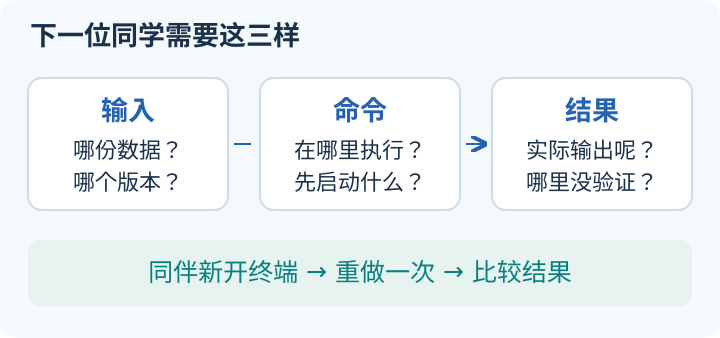

# 资料、模板与知识库维护

<small>整理与维护：24cst朱鑫鹏</small>

做完实验，先别急着写“成功了”。试着把电脑交给同伴：**他能找到同一份输入，执行同一条命令，看见你说的结果吗？** 这一页帮你把刚才的操作整理成下一位同学能用的记录。



## 先交一份能复现的小记录（5分钟）

1. 打开[实验记录空白模板](assets/experiment-record.txt)，复制到自己的练习仓库。今天先填“输入、命令、预期、实际”四项。
2. 选一个已经完成的小练习，例如[前进 1 米的离线重算](../training/datasets.md)，把完整命令和终端原文贴进去；没有做的部分写“未运行”。
3. 请同伴从新终端照着做。他卡住的那一步，就是需要补写的前置条件。

可以这样开始，下面的“实际”应换成你自己运行的输出：

```text
任务：从速度重算前进轨迹（合成数据，普通 Python）
工作目录：本地 knowledge-base 仓库根目录
输入：training/datasets/synthetic-v1/forward/ground_truth.csv
命令：python training/tools/replay_motion.py training/datasets/synthetic-v1/forward/ground_truth.csv
预期：51 个样本，持续 5 秒，最终 x 约为 1 米，passed 为 true
实际：粘贴自己的完整输出，注明运行日期和 Python 版本
未做：ROS 回放、真实雷达定位、实车运动
```

如果你是本次开课的负责人，用另一份[资源交接模板](assets/resource-handoff.txt)记录代码、地图、数据和领取位置。下面的版本登记、外队资料和发布规则，按需要展开查。

<link rel="stylesheet" href="../visuals/reader.css">
<script src="../visuals/reader.js" defer></script>
<div data-nav-fold="需要时再查：模板、资源、归档和发布规则。"></div>

## 这份维护说明怎样使用

知识库要让下一届找到入口、完成实验、复现错误，而不只是积累链接。当前新增专题放在 `docs/navigation/`，复用原 Linux/Git 页面，保留开源项目合集和既有路径。目录按课程专题合并，避免先建二十个空目录。

## 目录与归档规则

目录是给读者安排下一步用的。原理放课程页，能运行的输入与代码放教学目录，真实异常的证据放对应案例；这样新人遇到“Topic 能看到但没有消息”，可以从概念跳到实验，再对照排查手册。若把三种内容混在一份很长的 README，读者既找不到解释，也不知道哪段命令能执行。

```text
docs/navigation/
├─ README.md                       学习入口与资源边界
├─ onboarding/                     最终路线、16周任务单、环境基础
├─ system/                         系统地图、固定版本源码证据
├─ ros2-tf/                        通信、TF、时间、全向运动
├─ sensor-lio/                     传感器、LIO、建图、重定位
├─ planning/                       环境表达、Costmap、规划
├─ nav2/                           Nav2、控制、BT、接口
├─ debug-real/                     Debug、实车、比赛流程
├─ assignments/                    任务与统一考核、带解答源码练习
├─ self-study/                     基础、数学定位、规划控制、ROS2系统
├─ training/                       教学代码入口、合成数据、验证状态
├─ simulation/                     统一仿真建设与验收
└─ maintenance/                    资源、模板、维护规则
```

课程模块统一包含：目标、前置、核心概念、真实代码/接口、分级要求、实践任务、验收、常见错误、参考和适用版本。后续常见错误按“现象—证据—根因—修复—回归—适用 commit”形成独立页；数量少时先放在相应专题，不建立空目录。

仓库根 `training/` 存原有可执行教学代码与小型合成数据；`docs/navigation/training/` 存对应教程，`assets/` 存本次新增的轻量练习脚本、固定输入和合成图。synthetic-v1 有解析来源、校验值、生成器和回归，见[数据包](../training/datasets.md)。大体积实车 bag 仍走队内数据存储。`.gitattributes` 保留数据原始字节，跨 Windows/Linux checkout 不改换行以免破坏 SHA256。

具体例子：名称错配教程是[案例 1](../debug-real/case-topic-mismatch.md)，模型是 [training/cases/run_case.py](https://github.com/Navigator-Vision-Algorithm-Team/knowledge-base/blob/main/training/cases/run_case.py#L42-L64)，固定输入是 [training/cases/inputs/topic-mismatch.json](https://github.com/Navigator-Vision-Algorithm-Team/knowledge-base/blob/main/training/cases/inputs/topic-mismatch.json)。教程负责解释“相对名为何跟随 namespace”，代码负责执行投递条件，输入负责让每个人比较同样的 5 条消息。归档时保留这三个入口，读者就能检查结论从哪里来。

## 教学资料：每个链接都要对应一个任务

资源要解决眼前的学习问题。例如学 QoS 时，任务是比较一个发布端提供的可靠性和订阅端要求的可靠性，再判断是否兼容；不必先完整读完所有 DDS 资料。给链接同时给“读哪一段、回答什么、交什么结果”，比告诉新人“这些网站都很好”更容易开始学习。

完整的指定章节、先修、学时、跳过范围与离线项目已拆到[自学与进阶导航](../self-study/README.md)。下面保留常用速查入口；新人按周选读，不以收藏链接数量作为学习进度。

| 资源 | 指定用途 | 任务与版本边界 |
|---|---|---|
| [MIT Missing Semester](https://missing.csail.mit.edu/) | Shell、Git、调试工具选读 | T0；不要求完整刷课 |
| [Learn Git Branching](https://learngitbranching.js.org/?locale=zh_CN) | HEAD、分支、merge 可视化 | T0；用练习仓库操作 |
| [LearnCpp](https://www.learncpp.com/) | 类/引用/指针/标准库查询 | T1/T9；不是进入 ROS 的前置全集 |
| [鱼香《动手学 ROS2》](https://fishros.com/d2lros2/#/) | 中文通信、包、参数与 launch 的辅助解释 | 当前入口标注 Foxy 版；T0–T2 可参考概念，安装/API/命令以 Humble 官方原文为准，不跟随降版 |
| [ROS2 官方 Humble 教程源码](https://github.com/ros2/ros2_documentation/tree/humble/source/Tutorials) | CLI、C++ 节点、Action、tf2 的准确说明 | T1–T3；官网受限时可读官方源码 |
| [Humble QoS](https://github.com/ros2/ros2_documentation/blob/humble/source/Concepts/Intermediate/About-Quality-of-Service-Settings.rst) | offered/requested 与兼容性 | T1/T3 |
| [tf2 Debug 教程](https://github.com/ros2/ros2_documentation/blob/humble/source/Tutorials/Intermediate/Tf2/Debugging-Tf2-Problems.rst) | frame 与时间问题分离 | T2/T8 |
| [ROS 时间设计](https://design.ros2.org/articles/clock_and_time.html) | 系统/steady/ROS time、回跳 | T2–T4 |
| [REP-103](https://github.com/ros-infrastructure/rep/blob/master/rep-0103.rst)、[REP-105](https://github.com/ros-infrastructure/rep/blob/master/rep-0105.rst) | 单位、坐标系、map/odom 语义 | T2/T3，不能覆盖本队 TF 实现 |
| [PythonRobotics](https://github.com/AtsushiSakai/PythonRobotics) | 选 Dijkstra/A* 动画后自己实现 | T5；其他算法按专题选读 |
| [Nav2 Humble 源码](https://github.com/ros-navigation/navigation2/tree/humble) | 现用服务器/插件概念和接口 | T5–T9；安装版本需另记录 |
| [Humble Controller 接口](https://github.com/ros-navigation/navigation2/blob/humble/nav2_core/include/nav2_core/controller.hpp) | setPlan 与 computeVelocityCommands | T9 进阶；现行 Rolling 接口不同 |
| [Humble RPP](https://github.com/ros-navigation/navigation2/blob/humble/nav2_regulated_pure_pursuit_controller/README.md)、[Humble MPPI](https://github.com/ros-navigation/navigation2/blob/humble/nav2_mppi_controller/README.md) | 对比全向支持和适用边界 | 了解/专项，不替代本队 OmniPid 必学 |
| [PolarBear 仿真上游](https://github.com/SMBU-PolarBear-Robotics-Team/rmu_gazebo_simulator) | 参考已有仿真组件维护 | 由负责人做兼容性验收，见[仿真页](../simulation/README.md) |

核对日期 2026-09-14。外部教程只作学习资料，本队实际组件由固定 commit 的代码与运行快照证明。部分旧 Nav2 `.html` 链接已变更；优先使用官方 Humble 仓库核对 API，本机 `--help` 和有效参数决定命令是否适用。

## 这次从其他队伍借鉴了什么

我们把公开培训材料中的教学方法接到本队既有任务，具体实现与合成输入独立编写。外队技术选型和课时不直接作为本队配置或要求；既有 16 周路线、Point-LIO/small_gicp 和实车考核仍是课程依据。

| 原始入口 | 读哪里、借鉴什么 | 本队落地 |
|---|---|---|
| [AIM 26–27 导航路线](https://github.com/unnc-aim/aim-2627-rookie-courses/blob/main/Computing/Navigation/README.md) | 从基础、核心到项目，先安排先修再串成任务 | 在现有周计划增加衔接入口，不新增多机器人必修 |
| AIM 25–26 [ROS2 巡逻作业](https://github.com/unnc-aim/aim-2526-ros2-coursework) | 用多节点任务串联 Topic、Service、Action、参数和 launch；旧届仓库仅作设计参考 | [轻量巡逻](../training/patrol-workshop.md)，取消与断流列入必达项 |
| AIM 25–26 [导航期末作业](https://github.com/unnc-aim/aim-2526-navigation-final-assessment) | 从 A* 框架的核心 TODO 开始，降低同时学习算法和 ROS 包结构的负担 | [先补框架、再独立实现](../training/astar-workshop.md)，使用独立最优代价检查 |
| [SAS 导航新人培训手册](https://gitee.com/ucas-sas-robot-team/Algorithm-Group-Training/blob/master/%E5%AF%BC%E8%88%AA%E6%96%B0%E4%BA%BA%E5%9F%B9%E8%AE%AD.md) | 系统数据流、TF 外参、地图 origin 与参数对照的提问方式 | [固定几何实验](../training/controlled-experiments.md)，使用本队坐标和代码入口；FAST-LIO/CAN 不转成本队必修 |
| [上海交大交龙滤波培训](https://sjtu-robomaster-team.github.io/vision-learning-6/) | 先展示含噪位置差分造成速度抖动，再讲滤波 | [同一位置输入的差分/Kalman 对照](../training/controlled-experiments.md)，公开模型、噪声与初值 |

选资料时继续检查“新人能否预测、操作、解释、复现”，避免只增加链接总数。新资产先用知识库相对下载链接；发布后再补真实 GitHub 提交链接，不沿用外队的本地磁盘路径。

## 开课前由负责人补齐的资源

有些材料新人无法靠看代码补出来：机器人真正装了哪个串口包、地图是否匹配场地、谁持有急停，都依赖队内实际部署。负责人先把这些条件交付清楚，课程中的命令才有确定对象。表中的 P0 是会阻塞核心实验的条件，P1 是进入相应场景前必须完成的条件，P2 则让教学能持续交给下一届。

配套代码、标准合成包和两个教学故障案例已建入口，状态见[验证记录](../training/validation.md)。下表列的实测材料仍需队内建立，不是假定已存在的下载入口；负责人在首次授课前指定具体姓名、存储位置和截止日期。

| 优先级/责任角色 | 交付材料 | 最小验收 |
|---|---|---|
| P0 导航维护者 | 实际运行的仓库、commit、依赖锁定、overlay 顺序、launch 命令和参数快照 | 一台干净 Ubuntu/Humble 机器可复现；确认是否有未提交本地修改 |
| P0 导航+自瞄/串口+电控负责人 | 外部串口包、协议、Topic/TF/关节状态、控制权、超时/停车约定 | 最终命令与底盘接收一致；停止链路逐项通过 |
| P0 定位维护者 | 配套 YAML+图像+PCD、模型/外参及校验值 | 路径可解析，地图坐标对齐，启动无资产缺失 |
| P0 教学/定位维护者 | 一段静止、一段运动、一段典型故障 bag；消息定义、QoS、TF、基线 | 新人可回放同一异常；不含密钥等无关数据 |
| P1 场地/设备负责人 | 值守时段、硬件急停方式、低速上限、停止时间/距离阈值 | T8 开始前填妥；未填不开展运动测试 |
| P1 仿真维护者 | 统一模型/世界/时间单位、地图、依赖和启动入口 | 按[仿真验收](../simulation/README.md)通过后才能称为统一训练环境 |
| P2 导师 | 盲测题库、评分样例、合格作业、常见错误条目 | 下一届导师无需口头补完所有步骤 |

地图和 bag 存队伍指定数据盘/对象存储；知识库只存 manifest 和可访问入口。现阶段不虚构 URL，也不把数百 MB 数据塞进普通 Git。

例如源码能证明 [standard_robot_pp_ros2-main/src/standard_robot_pp_ros2.cpp](https://github.com/Navigator-Vision-Algorithm-Team/Navigation-2027/blob/183a4109b0de2030bb8970a54654937c8b039ba9/standard_robot_pp_ros2-main/src/standard_robot_pp_ros2.cpp#L103-L111) 订阅相对 `cmd_vel`，却不能证明机器人当前启动了它。串口负责人需要补“实际启动命令、namespace、包来源、最终订阅全名和接收证据”。这份交付把源码知识接到现场条件上，避免新人用另一种实现的接口做实验。

## 可复制的版本与资源登记模板

版本登记是在给结果写“身份证”。同样的启动命令，在不同 commit、地图或 overlay 下可能得到不同结果；文件名相同也不保证内容相同。比如两人都有 `map.pcd`，一个来自旧场地，一个来自新场地，记录路径不足以区分，SHA256 就能检查字节是否一致。校验值证明内容相同，不证明地图坐标已经正确，这仍需运行验收。

```text
实验编号 / 日期 / 操作人 / 复核人：
机器人编号 / 硬件与驱动使能状态：
Ubuntu / ROS_DISTRO / RMW_IMPLEMENTATION / ROS_DOMAIN_ID：
导航仓库 URL / branch / commit / git status：
外部串口与消息包 URL / commit / overlay 来源：
Nav2、Livox SDK、small_gicp、仿真器等安装版本：
namespace / TF topic / use_sim_time / clock 来源：
完整启动命令 / 有效参数快照位置：
模型 / 外参 / 地图 YAML+图像+PCD 路径与 SHA256：
输入 bag ID / 存储入口 / SHA256 / 消息包与 QoS：
只读回放或闭环实车 / 预热与测试时间区间：
速度限值 / 停车时间与距离阈值 / 值守与急停负责人：
结果、证据路径、未验证项与回退版本：
```

SHA256 可用 `sha256sum FILE` 计算；填真实值。bag manifest 还要列 Topic、类型、数量、时长、原始/算法输出分类、TF 发布者和回放白名单，避免重算时同时发布旧结果。

填写时尽量保存机器输出：commit 用实际 `git rev-parse HEAD`，有效参数来自本次 `ros2 param dump`，地图校验值来自实际文件。空白项写“待取得，负责人某某”，不要把源码默认值代填为运行值。例如 [ros_ws/src/pb2025_sentry_nav/pb2025_nav_bringup/config/reality/nav2_params.yaml](https://github.com/Navigator-Vision-Algorithm-Team/Navigation-2027/blob/183a4109b0de2030bb8970a54654937c8b039ba9/ros_ws/src/pb2025_sentry_nav/pb2025_nav_bringup/config/reality/nav2_params.yaml#L137-L149) 写有初始化自旋参数，但实际内部状态还可能受 Topic 更新；这两个来源要分别记录。

## 可复制的问题/实验记录模板

好记录要让别人能走完你的因果链。“0.3 秒收到零，缓存仍为 0.2，0.4 秒同步回调又输出 0.2”说明为什么要清缓存；“停车不对，改了几个参数”则无法复核。下面的模板把现象、证据、判断和改动分开，防止先入为主的解释被当成事实。

```text
标题与适用代码版本：
预期行为 / 实际现象 / 首次异常时间：
最小复现命令与输入：
观察证据（日志原文、端点/QoS、stamp、TF、有效参数）：
已排除的原因及依据：
当前判断 / 尚不确定的边界 / 需要哪个负责人：
唯一修改因素与代码/配置 diff：
改后结果、重复次数、失败样本：
临时恢复步骤 / 根因修复 / 回退步骤：
原任务与停止路径是否回归 / 未做的测试：
```

以[旧速度重发案例](../debug-real/case-stale-command.md)为例，唯一改动是零命令后让缓存失效，回归同时检查“停止后无重发”和“新命令后能恢复”。如果现场只是重启后恢复，就填在临时恢复栏；只有触发条件、代码路径和同输入回归都得到支持，才写根因修复。无法验证的底盘停车仍单列未做测试。

## 更新与发布

维护知识库也要沿依赖传播修改。若某个输入 Topic 改名，受影响的至少包括系统链路表、课程示例、诊断命令和作业验收；只改一处会让新人照着旧名字检查。维护者可以从真实订阅创建位置开始，搜索知识库中的同名接口，再逐项确认哪些材料依赖它。

维护者每次变更启动入口、插件、Topic、TF、地图、串口或 ROS 版本，必须同步修订系统表、相关课程和受影响作业；课程明确保存审查基线。只把实测结果写入“运行已确认”，源码推断继续标注待验证。

按仓库现有流程向 main 提交 PR。检查相对链接、代码来源、命令前置和 MkDocs 构建；新页面须进入 `mkdocs.yml` 的导航。main 合入后由现有 GitHub Actions 发布网站，不手工修改生成的 `site/` 文件。

本地验证示例：`python -m mkdocs build --strict --site-dir ../knowledge-base-preview`，在仓库目录运行，将输出放到仓库外；不向训练材料提交临时构建产物。必要的旧页面错误修订应局部进行，保持原有入口可用。

发布前再让一位未参与修改的人按页面完成最小练习：他能否找到前置、打开源码蓝色链接、读懂示例输出并写出判断。如果能构建网站却无法完成这些动作，说明链接或讲解还需要补齐；如果实验未运行，就继续标注待验证，不能通过润色文字把状态升级为已确认。
