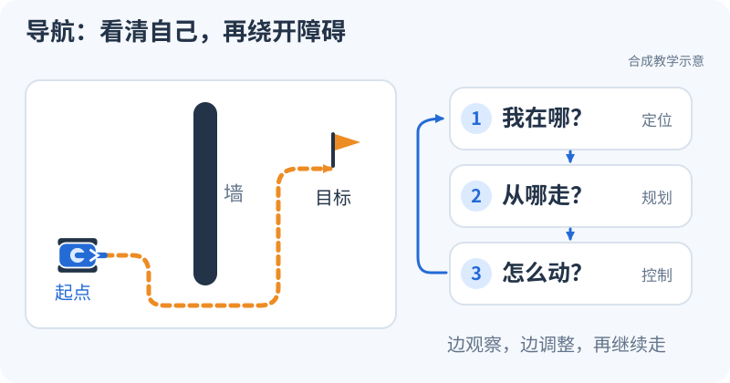

# 给小车两个目标点，它怎样走过去又停下来？

<small>整理与维护：24cst朱鑫鹏</small>

**先看一个任务**：让教学小车依次去两个点，途中亲手按一次取消，观察“收到目标”和“任务结束”有什么区别。

<div data-nav-visuals="补充：查看定位、规划与控制的分工"></div>



<iframe src="../visuals/playground.html?scene=patrol" loading="lazy" width="100%" height="620" style="border:0;border-radius:12px" title="两点巡逻：观察目标、反馈与取消后的终态"></iframe>

[单独打开演示](../visuals/playground.html?scene=patrol)

## 现在试一下：到点一次，取消一次（5分钟）

1. 点“开始巡逻”，看小车依次走向两个目标，留意反馈中的目标索引和距离。
2. 点“重播新任务”，再点“开始巡逻”；趁它还在走，点“取消任务”。
3. 观察速度、位姿和最终状态。取消以后继续看一会儿，确认新消息不会让旧任务重新出发。

**预期**：正常任务最终为 `SUCCEEDED`；取消任务最终为 `CANCELED`，速度归零，位姿保持。目标被接受只是开始，最终结果才回答这一趟是否完成。

这是普通浏览器里的教学任务模型。它帮助你认识目标、反馈和终态；下方源码章节才讨论本队真实 Nav2、BT、规划器和速度链。演示没有运行生产 BT，也不代表真实小车已完成停车验收。

**看懂了再往下读**：先读“从目标到最终速度”认出每一棒；需要查本队实际配置时，再读启动链和插件。想自己把刚才的任务接成 ROS 节点，去[轻量巡逻练习](../training/patrol-workshop.md)。

<link rel="stylesheet" href="../visuals/reader.css">
<script src="../visuals/reader.js" defer></script>

<div data-nav-fold></div>

## 本队真实Nav2用哪套代码？

原课程：**真实 Nav2 与控制链**。

本页对齐队伍确认的 Navigation-2027 主仓库，审查提交为 `183a4109b0de2030bb8970a54654937c8b039ba9`。先能解释一条目标如何变成最终底盘速度，再进行调参和换算法。源码定位、启动条件与未解决的问题集中在[Nav2 与控制接口证据页](../system/nav2-and-control-evidence.md)。本轮只完成静态审查，没有编译、ROS运行或实车验证；下列命令和实验供 Ubuntu / ROS 2 Humble 训练环境执行。

## 学完应能交付什么

1. 标出真实 launch、有效参数、插件 ID 和 TF/话题命名空间，区分“源码有”“配置加载”“运行已激活”。
2. 从目标、规划、控制、平滑、坐标变换一直追到最终 `cmd_vel`，指出每一段消息的发送者和接收者。
3. 解释自旋、恢复、取消目标、消息中断如何影响输出，提交有时间序列证据的停车边界说明。
4. 在不改参数的情况下定位一次“有目标却不动”或“障碍物没进 costmap”，把缺失部署依赖明确记录出来。

先修能力：能在 Ubuntu/Humble 中使用工作区环境、理解 topic/action/service、读取 Odometry/Path/Twist，能检查 map/odom/机器人坐标系。这里直接使用仓库实例，不重复通用 ROS 入门课。

先想一个完整任务：机器人在 `(0,0)`，目标是地图里的 `(2,1)`。客户端交出目标，导航系统决定路径；机器人每次只执行一小段速度，再根据新位姿/障碍重新计算。导航因此不是“发一次坐标，电机自己走过去”，也不是只要规划线画出来就成功。你应能在同一条任务时间线上找出目标接受、路径更新、控制输出、最终结果这四个时刻。

## 1. 先读启动链

真实入口是 `pb2025_nav_bringup/launch/rm_navigation_reality_launch.py`，默认 namespace 为 `red_standard_robot1`，参数来自 `config/reality/nav2_params.yaml`，`use_composition=True`。入口包含 Livox、bringup、手柄和默认开启的 RViz；机器人描述发布受 `use_robot_state_pub` 控制。`bringup_launch.py` 在 SLAM/定位间二选一，但始终包含 `navigation_launch.py`。

默认 Nav2 组件包括 controller、planner、smoother、behavior、bt_navigator、waypoint_follower、velocity_smoother，并用生命周期管理器管理。`fake_vel_transform`、loam_interface、sensor_scan_generation、terrain_analysis 也由 navigation launch 加载。**建图模式不等于关闭导航或禁止速度输出。**完整证据见[启动边界](../system/nav2-and-control-evidence.md#1)。

参数阅读顺序应为：启动命令覆盖值 → 被包含的 launch → 参数重写/namespace → YAML → 插件实现 → 运行时 `ros2 param get`。例如 reality YAML 的 costmap 原文写 `use_sim_time: true`，bringup 会按入口参数重写，不能只凭那一行判断实车时钟错误。

### 1.1 节点存在、组件加载、生命周期激活分别说明什么

组件是可以装进同一进程容器的节点实现；它减少进程边界，却仍然有自己的节点名与接口。Lifecycle（生命周期）把准备和正式工作拆成阶段：configure读取参数并建立资源，activate进入工作状态，deactivate退出工作。只在 `node list` 看见controller_server，不能证明它已能执行FollowPath；还要查询它是否active及相关action状态。

主仓库路径 `ros_ws/src/pb2025_sentry_nav/pb2025_nav_bringup/launch/navigation_launch.py` 的[生命周期名单 L42–50](https://github.com/Navigator-Vision-Algorithm-Team/Navigation-2027/blob/183a4109b0de2030bb8970a54654937c8b039ba9/ros_ws/src/pb2025_sentry_nav/pb2025_nav_bringup/launch/navigation_launch.py#L42-L50)和[组件加载 L253–342](https://github.com/Navigator-Vision-Algorithm-Team/Navigation-2027/blob/183a4109b0de2030bb8970a54654937c8b039ba9/ros_ws/src/pb2025_sentry_nav/pb2025_nav_bringup/launch/navigation_launch.py#L253-L342)可以对照着画。自定义控制器的真实路径 `ros_ws/src/pb2025_sentry_nav/pb_omni_pid_pursuit_controller/src/omni_pid_pursuit_controller.cpp` 中，[`activate/deactivate` L190–216](https://github.com/Navigator-Vision-Algorithm-Team/Navigation-2027/blob/183a4109b0de2030bb8970a54654937c8b039ba9/ros_ws/src/pb2025_sentry_nav/pb_omni_pid_pursuit_controller/src/omni_pid_pursuit_controller.cpp#L190-L216)实际启停local_plan等发布器和动态参数回调。把阶段与具体资源连起来，生命周期就不只是要背的状态名。

一个典型反例是“容器里已加载Planner，但未active，客户端一直等导航”：先记component与lifecycle查询，再查初始化日志和action服务端。此时调整路径代价没有解决“服务端尚未准备工作”的问题。源码加载名单给出预期，运行查询给出此刻状态，两者一起用。

## 2. 必学、了解与进阶

| 优先级 | 本仓库对象 | 学到什么程度 |
| --- | --- | --- |
| 必学 | launch、namespace、TF、生命周期 | 能说明默认组件分支，找到三个速度话题的remap；知道节点存在与active不同 |
| 必学 | `nav2_smac_planner/SmacPlannerHybrid` / `GridBased` | 理解当前DUBIN搜索、可通行代价、最小转弯半径和内部平滑；能定位规划失败证据 |
| 必学 | `pb_omni_pid_pursuit_controller::OmniPidPursuitController` / `FollowPath` | 读前视点→PID→曲率/接近减速→x/y输出；解释0.5 m/s参数和rotation关闭的作用范围 |
| 必学 | StaticLayer、IntensityObstacleLayer、InflationLayer | 找到terrain_map来源、PointCloud2的intensity过滤、清除与标记、0.2 m机器人半径和0.7 m膨胀半径 |
| 必学 | 两份BT XML、SimpleProgressChecker、SimpleGoalChecker | 能沿成功/失败分支走读；解释3 Hz重规划、清图、重试和自由方向恢复；知道xy容差0.15 m与yaw容差6.28 rad |
| 必学 | VelocitySmoother、fake_vel_transform、底盘接口边界 | 区分限速/加速度平滑、坐标变换、自旋叠加；验证最终输出，找实际串口实现 |
| 了解 | SimpleSmoother、WaitAtWaypoint、Spin/Wait/AssistedTeleop等 | 虽配置或加载，当前默认BT并未调用独立SmoothPath、Spin、Wait等节点。能查到即可 |
| 进阶 | IntensityVoxelLayer、替换规划器/控制器、编写自定义BT与插件 | 先完成当前系统验收再对照实验；不能把库中存在的插件写成默认配置 |

实际插件、源码函数与 XML 的对应关系见[插件证据](../system/nav2-and-control-evidence.md#2-nav2)。当前默认局部控制器不是DWB、TEB、MPPI或标准RPP。控制器日志字符串中出现其他名称，也不能替代plugin参数和导出类的证据。

### 2.1 ID 是调用名字，plugin 是实现类

可以把 `GridBased` 理解为规划岗位的名字，`nav2_smac_planner/SmacPlannerHybrid`是这个岗位实际聘用的算法；`FollowPath`同理。BT用ID发请求，YAML把ID对应到实现类。你换YAML里的plugin，BT未必需要换ID；但把BT里的ID改成配置里不存在的名称，就可能找不到对应插件。

沿真实路径 `ros_ws/src/pb2025_sentry_nav/pb2025_nav_bringup/config/reality/nav2_params.yaml` 的[FollowPath L315–366](https://github.com/Navigator-Vision-Algorithm-Team/Navigation-2027/blob/183a4109b0de2030bb8970a54654937c8b039ba9/ros_ws/src/pb2025_sentry_nav/pb2025_nav_bringup/config/reality/nav2_params.yaml#L315-L366)和[GridBased L468–503](https://github.com/Navigator-Vision-Algorithm-Team/Navigation-2027/blob/183a4109b0de2030bb8970a54654937c8b039ba9/ros_ws/src/pb2025_sentry_nav/pb2025_nav_bringup/config/reality/nav2_params.yaml#L468-L503)各找出列表名、ID、类名、两项影响行为的参数，再去XML找同ID。这样读一次，后续遇到网上“Nav2默认控制器”的教程就能判断是否适用于本队。

### 2.2 行为树负责“做什么、失败后怎么办”

BT每次tick检查当前任务：节点返回RUNNING（还在做）、SUCCESS（完成）或FAILURE（失败）。路径和目标放在共享数据中，XML里的 `{path}`、`{goal}`是这些数据的引用。BT不会代替Planner搜索路线，它调用Planner；也不会代替Controller算速度，它调用FollowPath。

主仓库路径 `ros_ws/src/pb2025_sentry_nav/pb2025_nav_bringup/behavior_trees/navigate_to_pose_w_replanning_and_recovery.xml` 的[真实片段 L8–23](https://github.com/Navigator-Vision-Algorithm-Team/Navigation-2027/blob/183a4109b0de2030bb8970a54654937c8b039ba9/ros_ws/src/pb2025_sentry_nav/pb2025_nav_bringup/behavior_trees/navigate_to_pose_w_replanning_and_recovery.xml#L8-L23)可按下面路线读：

```text
RateController(hz=3) → 规划子任务（失败后清global costmap，再重试）
                  path → FollowPath（失败后清local costmap，再重试）
更外层失败 → GoalUpdated检查 / 轮流清图与BackUp恢复
```

这张图是解释XML的简化示意，省略具体重试计数，不能当作另一份可运行BT。`hz=3`主要限制规划子树成功后再次发起的节奏，目标间隔约0.333 s；首次立即tick，子树处于RUNNING时则随父树继续tick直到完成。因此不能把3 Hz当作所有规划分支tick的硬上限，也不保证规划会在0.333 s内完成。控制器频率20 Hz约每0.05 s计算一次，也不等于整套系统只有一个20 Hz定时器。

这一例外可在Nav2依赖路径 `nav2_behavior_tree/plugins/decorator/rate_controller.cpp` 的 [Humble RateController::tick](https://github.com/ros-navigation/navigation2/blob/humble/nav2_behavior_tree/plugins/decorator/rate_controller.cpp#L34-L75)核对：条件包含首次执行、子节点RUNNING和周期已到三种情况，SUCCESS后才重设计时起点。读XML中的频率时要连同这个装饰节点实现一起看。

场景推演：箱子出现使当前控制判断碰撞，FollowPath失败，树尝试清局部图并重试；如果箱子仍在观测里，下一轮会重新标记，不会因“清了图”就永久消失。外层恢复还可能调用BackUp。具体失败触发顺序和时间需要日志验证，不能把纸面推演写成实测轨迹。

### 2.3 三种“平滑”各改哪种东西

Planner内部的 `smooth_path`处理几何路径；独立 `smoother_server`也是路径服务，需要BT/客户端实际调用；`velocity_smoother`处理Twist变化，目的在于速度与加速度约束。前两者输出仍是“路”，后者输出是“运动指令”。当前BT没有SmoothPath节点，所以看到smoother_server启动，不表示这次任务走过独立路径平滑。

真实配置路径 `ros_ws/src/pb2025_sentry_nav/pb2025_nav_bringup/config/reality/nav2_params.yaml` 的[Planner平滑 L497–503](https://github.com/Navigator-Vision-Algorithm-Team/Navigation-2027/blob/183a4109b0de2030bb8970a54654937c8b039ba9/ros_ws/src/pb2025_sentry_nav/pb2025_nav_bringup/config/reality/nav2_params.yaml#L497-L503)与[两个smoother设置 L505–571](https://github.com/Navigator-Vision-Algorithm-Team/Navigation-2027/blob/183a4109b0de2030bb8970a54654937c8b039ba9/ros_ws/src/pb2025_sentry_nav/pb2025_nav_bringup/config/reality/nav2_params.yaml#L505-L571)需要分开圈。比如路径拐角尖锐是几何问题，连续两个速度从0.1跳到0.5 m/s是时间变化问题；不要看到名字都有smoother就混着调。

## 3. 从目标到最终速度

以下是默认实车组件分支。所有相对topic/action名通常加 `/red_standard_robot1/`；frame名保持 `map`、`odom`、`gimbal_yaw`、`gimbal_yaw_fake`。

```text
navigate_to_pose (nav2_msgs/action/NavigateToPose)
       ↓ bt_navigator：仓库指定的BT XML
ComputePathToPose → planner_server：GridBased / SmacPlannerHybrid
       ↓ path
FollowPath → controller_server：OmniPidPursuitController
       ↓ cmd_vel_controller (geometry_msgs/msg/Twist)
velocity_smoother
       ↓ cmd_vel_nav2_result (geometry_msgs/msg/Twist)
fake_vel_transform ← odometry / local_plan / cmd_spin
       ↓ cmd_vel (geometry_msgs/msg/Twist)
实际部署的串口/底盘接口 → 下位机 → 车体

behavior_server：BackUpFreeSpace
       └─ cmd_vel_nav2_result → fake_vel_transform（绕过velocity_smoother）
```

手柄也是控制来源：默认 `auto_control` 把平移操作转换成 NavigateToPose，manual模式才直接发Twist。松开使能键时，代码会取消此前目标并向最终cmd_vel发一次零速度。它与fake_vel_transform共同发布最终话题，当前启动链未见速度仲裁器。不能把一条零消息当作持续停车保证。

控制器 `enable_rotation=false` 时只保证它自己输出的angular.z为0；fake_vel_transform还会加上默认 `init_spin_speed=0.5`。对于里程计yaw=π/2、输入vx=0.2、vy=0，转换后应为vx≈0、vy≈-0.2；输入全零时仍可能输出wz=0.5。具体公式、同步缓存与停机风险见[速度与TF证据](../system/nav2-and-control-evidence.md#3-tf)及[风险R3–R7](../system/nav2-and-control-evidence.md#4)。

BackUpFreeSpace会向自由空间方向输出x/y，名字不代表固定倒车。默认树请求速度1.0 m/s、距离1.0 m，而FollowPath的0.5 m/s限制不约束该行为。VelocitySmoother配置的x/y各轴2.5 m/s上限也不是整车所有来源共有的限速，更不能直接读成平面合速度上限。

### 3.1 控制器怎么把“前面一个点”变成x/y速度

前视点（lookahead point）是路径上用来引导当前运动的一个点，不一定是最终目标。看太近容易频繁追小偏差，看太远可能忽略附近弯曲；本仓库开启随速度变化的前视距离。若输入速度模长0.2 m/s、lookahead_time=1 s，原始距离为0.2 m，经过0.5～1.0 m范围截断，得到0.5 m，而不是照抄静态 `lookahead_dist=2.0`。

主仓库真实路径 `ros_ws/src/pb2025_sentry_nav/pb_omni_pid_pursuit_controller/src/omni_pid_pursuit_controller.cpp` 建议按函数调用顺序读：

| 函数与位置 | 本次应回答的问题 |
|---|---|
| [`transformGlobalPlan` L288–349](https://github.com/Navigator-Vision-Algorithm-Team/Navigation-2027/blob/183a4109b0de2030bb8970a54654937c8b039ba9/ros_ws/src/pb2025_sentry_nav/pb_omni_pid_pursuit_controller/src/omni_pid_pursuit_controller.cpp#L288-L349) | 如何找到附近路径、转到机器人参考系、裁掉已走过部分并发布local_plan？ |
| [`getLookAheadDistance` L472–483](https://github.com/Navigator-Vision-Algorithm-Team/Navigation-2027/blob/183a4109b0de2030bb8970a54654937c8b039ba9/ros_ws/src/pb2025_sentry_nav/pb_omni_pid_pursuit_controller/src/omni_pid_pursuit_controller.cpp#L472-L483)与[`getLookAheadPoint` L363–390](https://github.com/Navigator-Vision-Algorithm-Team/Navigation-2027/blob/183a4109b0de2030bb8970a54654937c8b039ba9/ros_ws/src/pb2025_sentry_nav/pb_omni_pid_pursuit_controller/src/omni_pid_pursuit_controller.cpp#L363-L390) | 距离如何截断，路径不足够长时选哪里？ |
| [`computeVelocityCommands` L237–253](https://github.com/Navigator-Vision-Algorithm-Team/Navigation-2027/blob/183a4109b0de2030bb8970a54654937c8b039ba9/ros_ws/src/pb2025_sentry_nav/pb_omni_pid_pursuit_controller/src/omni_pid_pursuit_controller.cpp#L237-L253) | 如何把前视点分解成距离/方向、PID速度和减速约束？ |
| [`isCollisionDetected` L451–469](https://github.com/Navigator-Vision-Algorithm-Team/Navigation-2027/blob/183a4109b0de2030bb8970a54654937c8b039ba9/ros_ws/src/pb2025_sentry_nav/pb_omni_pid_pursuit_controller/src/omni_pid_pursuit_controller.cpp#L451-L469) | 查的是什么代价，落到图外时怎样返回？ |
| [`computeVelocityCommands` L258–277](https://github.com/Navigator-Vision-Algorithm-Team/Navigation-2027/blob/183a4109b0de2030bb8970a54654937c8b039ba9/ros_ws/src/pb2025_sentry_nav/pb_omni_pid_pursuit_controller/src/omni_pid_pursuit_controller.cpp#L258-L277) | 10点抽样与碰撞异常如何影响最后输出？ |

一个可手算的例子：前视点在控制器参考系中为 `(0.3,0.4) m`，距离 `hypot=0.5 m`，方向单位向量 `(0.6,0.8)`。若此步经过全部限制后的标量速度是0.5 m/s，第270–271行分解成 `vx=0.5×0.6=0.3`、`vy=0.5×0.8=0.4 m/s`。两个分量都小于0.5，合速度正好0.5；不能把x/y各自达到0.5误当作总速度仍为0.5。

### 3.2 PID三项各看哪种误差

P看当前误差，I累计过去误差，D看误差变化。此处平移PID的输入是前视点距离相对0的误差，不是直接把“目标x”和“当前位置x”独立送给两个轴PID。真实路径 `ros_ws/src/pb2025_sentry_nav/pb_omni_pid_pursuit_controller/src/pid.cpp` 的[`PID::calculate` L22–56](https://github.com/Navigator-Vision-Algorithm-Team/Navigation-2027/blob/183a4109b0de2030bb8970a54654937c8b039ba9/ros_ws/src/pb2025_sentry_nav/pb_omni_pid_pursuit_controller/src/pid.cpp#L22-L56)先算误差、积分、变化率，合成后限幅并记住本次误差。

用默认20 Hz（dt=0.05 s）、Kp=3、Ki=0.1、Kd=0.3和新PID的初始历史0，第一步距离误差0.5 m：P=1.5，积分累积0.025，I=0.0025，D=`0.3×(0.5−0)/0.05=3.0`，合计4.5025，经0.5上限截断为0.5 m/s。随后还要做曲率与接近目标减速，所以上一节“最终标量速度0.5”的例子额外假设这些缩放本步为1。这是对代码的假设输入推演，不是实车调参结果。

再问“到没到”和“还在动吗”：xy容差0.15 m检查目标附近位置；yaw容差6.28 rad约一圈，不能作为严格朝向验收；进度检查配置要求在10 s范围内相对检查参考位置有0.5 m位移。例如一直极慢移动0.02 m/s，10 s仅0.2 m，即使不是完全静止也可能触发无进度判断。配置路径见本页2.1；触发时间和机器人实际行为需运行记录，不把这个假设算例写成已经观察到的失败。

### 3.3 为什么旋转之后“前进”会变成负y

控制器当前参考系为 `gimbal_yaw_fake`，fake节点用机器人在odom中的yaw将速度转到实际接口方向。转换用的是反向旋转：yaw=90°、输入 `(0.2,0)` 时，输出 `(0,−0.2)`。这与S2里“把车体速度转到世界坐标”的正向旋转方向相反，二者回答不同问题。应先标明输入/输出参考系，再判断正负号。

真实路径 `ros_ws/src/pb2025_sentry_nav/fake_vel_transform/src/fake_vel_transform.cpp` 的[`transformVelocity` L147–154](https://github.com/Navigator-Vision-Algorithm-Team/Navigation-2027/blob/183a4109b0de2030bb8970a54654937c8b039ba9/ros_ws/src/pb2025_sentry_nav/fake_vel_transform/src/fake_vel_transform.cpp#L147-L154)可逐行手算：第151行wz加自旋，第152行x取 `vx·cos+vy·sin`，第153行y取 `−vx·sin+vy·cos`。同文件[`publishTransform` L135–144](https://github.com/Navigator-Vision-Algorithm-Team/Navigation-2027/blob/183a4109b0de2030bb8970a54654937c8b039ba9/ros_ws/src/pb2025_sentry_nav/fake_vel_transform/src/fake_vel_transform.cpp#L135-L144)发布负yaw虚拟TF，与这条转换一起解释。

### 3.4 恢复速度与普通跟踪走的是不同路径

BackUpFreeSpace从Costmap寻找自由方向，再将请求速度按该方向分解。假设选中90°、请求1.0 m/s，就得到x≈0、y≈1.0；它并不是“x固定为−1.0”。主仓库路径 `ros_ws/src/pb2025_sentry_nav/pb_nav2_plugins/src/behaviors/back_up_free_space.cpp` 的[`onRun` L87–104](https://github.com/Navigator-Vision-Algorithm-Team/Navigation-2027/blob/183a4109b0de2030bb8970a54654937c8b039ba9/ros_ws/src/pb2025_sentry_nav/pb_nav2_plugins/src/behaviors/back_up_free_space.cpp#L87-L104)选择方向并存x/y，随后[`onCycleUpdate` L128–155](https://github.com/Navigator-Vision-Algorithm-Team/Navigation-2027/blob/183a4109b0de2030bb8970a54654937c8b039ba9/ros_ws/src/pb2025_sentry_nav/pb_nav2_plugins/src/behaviors/back_up_free_space.cpp#L128-L155)检查位移、碰撞并发布。

把速度检查画成两行：普通跟踪经过smoother，恢复直接到 `cmd_vel_nav2_result`，两者再进fake。这个分支由真实路径 `ros_ws/src/pb2025_sentry_nav/pb2025_nav_bringup/launch/navigation_launch.py` 的[组件remap L300–328](https://github.com/Navigator-Vision-Algorithm-Team/Navigation-2027/blob/183a4109b0de2030bb8970a54654937c8b039ba9/ros_ws/src/pb2025_sentry_nav/pb2025_nav_bringup/launch/navigation_launch.py#L300-L328)决定。验收最大速度时必须包含恢复，而不能只测FollowPath再称为整条输出链限速通过。

## 4. 在部署机做只读诊断

以下命令用于已经按队伍流程启动的 Ubuntu / ROS 2 Humble 系统。先进入实际 `Navigation-2027/ros_ws`，加载环境；不要在Windows本地审查目录执行ROS命令。`timeout`结束订阅时返回124是预期的采样结束，不表示ROS节点崩溃。

```bash
source /opt/ros/humble/setup.bash
source install/setup.bash

ros2 pkg prefix pb2025_nav_bringup
ros2 pkg prefix rm_serial_driver
ros2 pkg prefix standard_robot_pp_ros2
ros2 pkg prefix pb_rm_interfaces
ros2 node list
ros2 component list
ros2 action list -t
ros2 lifecycle get /red_standard_robot1/controller_server
ros2 lifecycle get /red_standard_robot1/planner_server
ros2 lifecycle get /red_standard_robot1/bt_navigator
```

先保存成功结果和明确错误。README要求的rm_serial_driver在当前源码克隆中未找到；部署机可能通过其他overlay提供，也可能缺失。包路径是定位部署来源的证据，不要为让命令通过而临时混装另一份串口实现。

核对有效参数与话题连接：

```bash
ros2 param get /red_standard_robot1/controller_server controller_plugins
ros2 param get /red_standard_robot1/controller_server FollowPath.plugin
ros2 param get /red_standard_robot1/controller_server FollowPath.enable_rotation
ros2 param get /red_standard_robot1/planner_server GridBased.plugin
ros2 param get /red_standard_robot1/local_costmap/local_costmap use_sim_time
ros2 param get /red_standard_robot1/fake_vel_transform init_spin_speed
ros2 param get /red_standard_robot1/pb_teleop_twist_joy_node control_mode
ros2 node info /red_standard_robot1/fake_vel_transform

ros2 topic info /red_standard_robot1/cmd_vel_controller --verbose
ros2 topic info /red_standard_robot1/cmd_vel_nav2_result --verbose
ros2 topic info /red_standard_robot1/cmd_vel --verbose
ros2 topic info /red_standard_robot1/terrain_map --verbose
ros2 topic info /red_standard_robot1/serial/gimbal_joint_state --verbose
ros2 topic info /serial/gimbal_joint_state --verbose
```

`init_spin_speed`是初始化参数；收到cmd_spin后，成员变量会变化，但源码没有把参数同步更新。运行时只读param结果不能代表当前spin值，必须同时查cmd_spin来源与实际输出。

分别采样速度、里程计与TF（需要对齐时在不同终端同时运行）：

```bash
timeout 8s ros2 topic echo /red_standard_robot1/cmd_vel_controller
timeout 8s ros2 topic echo /red_standard_robot1/cmd_vel_nav2_result
timeout 8s ros2 topic echo /red_standard_robot1/cmd_vel
timeout 8s ros2 topic hz /red_standard_robot1/odometry
timeout 8s ros2 topic hz /red_standard_robot1/local_plan
timeout 8s ros2 topic hz /red_standard_robot1/terrain_map
timeout 8s ros2 run tf2_ros tf2_echo map gimbal_yaw_fake --ros-args \
  -r /tf:=/red_standard_robot1/tf -r /tf_static:=/red_standard_robot1/tf_static
timeout 8s ros2 run tf2_ros tf2_echo gimbal_yaw gimbal_yaw_fake --ros-args \
  -r /tf:=/red_standard_robot1/tf -r /tf_static:=/red_standard_robot1/tf_static
```

没有消息时按上游逐段检查，不能马上归因于PID。Twist没有header时间戳，以上终端输出不足以精确判断时延；时序考核需要同步记录消息接收时间，例如在训练日志或rosbag记录中保留时间轴。本轮没有实际采集这些数据。

读命令输出时应带着一个具体问题。`node info`问“它接哪条线”；`topic info --verbose`问“线上谁发谁收、类型与QoS”；`param get`问“此刻加载了哪个设置”；`lifecycle get`问“服务端能否工作”；`tf2_echo`问“工具在当前时间能否找到空间关系”。一个命令不会同时证明所有层。

例如发现controller速度有、最终速度无，先保存三条速度Topic的端点，确认smoother输入确实是 `cmd_vel_controller`；若fake输入已到，再检查odometry/local_plan同步与回调分支。真实阅读位置是 `ros_ws/src/pb2025_sentry_nav/fake_vel_transform/src/fake_vel_transform.cpp` 的[`cmdVelCallback/syncCallback` L93–132](https://github.com/Navigator-Vision-Algorithm-Team/Navigation-2027/blob/183a4109b0de2030bb8970a54654937c8b039ba9/ros_ws/src/pb2025_sentry_nav/fake_vel_transform/src/fake_vel_transform.cpp#L93-L132)。不要把两次不同时间的终端截图拼成一次确定的时序结论。

| 现象 | 下一项只读检查 | 应提交的证据 |
| --- | --- | --- |
| 有目标、无路径 | action名称/状态、planner生命周期、map→gimbal_yaw_fake、global costmap | action/server名称、状态、TF和错误日志 |
| 有路径、无controller速度 | FollowPath状态、controller生命周期、进度检查、碰撞异常、local costmap | BT失败位置和对应消息时间 |
| 有controller速度、无最终速度 | smoother连接、fake的odometry/local_plan同步、namespace、多个publisher | 三段速度话题的类型和连接表 |
| 最终有速度、车不动 | 实际串口节点、订阅话题、包路径、协议/使能/下位机回传 | 导航输出与底盘回传的边界；缺少信息如实记录 |
| 零输入但仍有旋转 | cmd_spin来源、fake参数与最终输出、其他cmd_vel发布者 | 上游全零与最终wz的对照 |
| RViz中有点云，costmap无障碍 | terrain_map的PointCloud2字段、intensity/高度范围、TF、订阅者与QoS | 原始字段与实际costmap障碍的对应 |

## 5. 隔离训练实验与考核

### 实验A：还原默认启动图

只读文件和运行图，提交一张带消息类型的接口表，解释slam切换、use_composition切换、namespace和参数重写。及格要求是区分默认组件分支与非组件分支的behavior remap差异，并指出串口不是由实车导航入口启动。证据页R1/R5可作为检查项，不能只照抄节点列表。

完成方法是先给普通跟踪和恢复各画一条线，再把组件分支换成普通Node分支，逐项对照remap。若两张图终点不同，就在接口表写出具体话题，而不是“基本一样”。主仓库路径 `ros_ws/src/pb2025_sentry_nav/pb2025_nav_bringup/launch/navigation_launch.py` 的[非组件behavior/bt部分 L191–212](https://github.com/Navigator-Vision-Algorithm-Team/Navigation-2027/blob/183a4109b0de2030bb8970a54654937c8b039ba9/ros_ws/src/pb2025_sentry_nav/pb2025_nav_bringup/launch/navigation_launch.py#L191-L212)与本页3.4组件链接是对照入口。

### 实验B：在独立训练机验证坐标变换与自旋

只运行fake_vel_transform，不启动导航、串口、自瞄或电机。训练机不连接底盘，使用组内分配且不与实车共用的ROS_DOMAIN_ID；所有实验终端必须相同。下面87只是示例值。这是发布合成消息的实验，不属于上一节只读诊断。

Ubuntu / ROS 2 Humble终端1，进入已编译的ros_ws后：

```bash
source /opt/ros/humble/setup.bash
source install/setup.bash
export ROS_DOMAIN_ID=87
ros2 run fake_vel_transform fake_vel_transform_node --ros-args \
  -r __ns:=/nav_training -r /tf:=tf -r /tf_static:=tf_static \
  -p robot_base_frame:=gimbal_yaw -p fake_robot_base_frame:=gimbal_yaw_fake \
  -p odom_topic:=odometry -p local_plan_topic:=local_plan \
  -p input_cmd_vel_topic:=cmd_vel_nav2_result -p output_cmd_vel_topic:=cmd_vel \
  -p cmd_spin_topic:=cmd_spin -p init_spin_speed:=0.5
```

终端2加载同一环境并设置同一ROS_DOMAIN_ID，然后观察输出：

```bash
ros2 topic echo /nav_training/cmd_vel
```

终端3加载同一环境并设置同一ROS_DOMAIN_ID，先发里程计初始化方向，再发零速度：

```bash
ros2 topic pub --once /nav_training/odometry nav_msgs/msg/Odometry \
  "{header: {frame_id: odom}, child_frame_id: gimbal_yaw, pose: {pose: {orientation: {w: 1.0}}}}"
ros2 topic pub --once /nav_training/cmd_vel_nav2_result geometry_msgs/msg/Twist \
  "{linear: {x: 0.0, y: 0.0}, angular: {z: 0.0}}"
ros2 topic pub --once /nav_training/cmd_spin example_interfaces/msg/Float32 "{data: 0.0}"
ros2 topic pub --once /nav_training/cmd_vel_nav2_result geometry_msgs/msg/Twist \
  "{linear: {x: 0.0, y: 0.0}, angular: {z: 0.0}}"
```

**源码预测，尚未实测：**第一次零Twist后输出wz=0.5；cmd_spin设0以后再次发零Twist，输出wz=0。cmd_spin消息本身不触发输出。进阶变体：将里程计四元数设为z≈0.70710678、w≈0.70710678，再发vx=0.2，预期vx≈0、vy≈-0.2。不要把这个只测fake节点的结论写成整车停车验证。

每次操作前先在纸上填“当前yaw、spin、输入Twist、预测输出”，再执行并填实测值。第一条odometry让角度先有定义；cmd_spin只改 `spin_speed_`，最后一条Twist才触发零速度分支发布。这样如果结果不符，你可以指出是消息未到、角度未初始化、另有发布者，还是代码/环境版本不同，而不是笼统写实验失败。预测依据是本页3.3真实函数。

### 实验C：同步、缓存和停车边界

继续使用独立训练域，以同时间戳的Odometry/Path合成输入，覆盖：有local_plan→非零Twist缓存→零Twist→继续成对发布Odometry/Path；再分别中断cmd_vel、local_plan、odometry。每一步记录时间、三个输入与最终输出。要检查旧平移是否被再次发送，区分“没有输出”“输出全零”“输出含自旋”。该实验验证证据页R3/R4的待核实路径，不能预填结果。

为什么要按这个顺序：local_plan回调记“控制器最近活跃”；活跃时非零Twist可能只存进 `latest_cmd_vel_`；零Twist直接发布，却不替换这份缓存；下一对同步输入又可能取旧缓存。源码的0.5 s检查依据是local_plan活跃时间，不是命令年龄，也不是独立定时发送零命令的看门狗。将每次缓存改变与每次发布分开记，会比只看最后一帧更容易解释异常。函数路径见本页4的回调链接，详细时间线见[证据页](../system/nav2-and-control-evidence.md)。

整车阶段另由队伍现有上车流程测试取消目标、松开手柄、串口中断和下位机超时。通过标准需要最终消息与车体运动同时证明停止，记录延迟、固件/驱动版本及测试条件。本仓库C++串口发送路径会反复发送缓存，固件看门狗未知，单测fake节点不能覆盖这个边界。

### 实验D：一次可解释的导航失败

优先在已验收的隔离仿真中，用固定地图和固定起终点观察规划失败、局部障碍和恢复。若使用实车训练场，先完成 [T8 前置与停止链路确认](../debug-real/README.md)，并在值守下进行，不能把本节当作绕过准入的入口。记录GridBased/FollowPath/BackUp的触发顺序、costmap变化及最终速度。一次只改变一个参数；先做基础记录，再比较路径长度、到达误差、失败原因、最大最终速度和恢复行为。恢复是自由方向移动，必须纳入速度考核。

## 6. 验收清单

| 交付件 | 合格标准 |
| --- | --- |
| 启动与接口表 | 包含有效namespace、运行参数、生命周期、消息类型、TF发布者，以及真实串口来自哪个仓库/overlay |
| 插件阅读记录 | 能由BT ID找到实际类和参数；分清独立smoother、规划器内平滑与velocity smoother |
| 控制实验记录 | 用数据说明yaw变换、自旋叠加、零命令与缓存时序；未做实车测试必须标明 |
| 故障定位报告 | 从现象定位到具体链路；有源码行、运行证据与仍缺失的信息 |
| 边界说明 | 不把“有源码/节点启动/规划成功/最终零命令”替代“完整实车系统验证”；指出未闭合的串口、决策和停车部分 |

`nav.py`、`nav_run.sh`、`to_home.sh`、`to_center.sh`只是辅助入口，其中存在消息类型、namespace或持续发布问题，详见证据页R10/R11。当前审查未找到默认启动的比赛策略状态机；新人应先掌握NavigateToPose的目标、反馈、结果与取消契约，再接实际决策端。

交付件可以围绕同一个任务组织，而不是六份互不相关截图：目标A发出→action接受→GridBased路径→FollowPath速度→fake最终输出→结果/取消；每一段标出真实消息名、时间与源码入口。若止于离线阅读，就提交这条链的纸面推导，并明确哪些端点和硬件没有观测。评审能由你的记录复核因果关系，才算掌握系统。

进一步学习可选[全向 PID 与算法对照项目](../self-study/planning-control.md)、[Action/BT/并发与性能专题](../self-study/ros2-systems.md)。零速度、自旋和缓存的逐步推导见[源码练习 R2](../assignments/reading-labs.md)。
