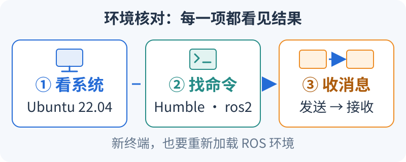

# 开始 ROS2 前，先核对环境三件事（S0）

<small>整理与维护：24cst朱鑫鹏</small>

按图从左向右检查：**系统对得上，终端找得到 ROS，两个官方节点能通信。** 本页命令使用 Ubuntu 22.04 的 Bash 终端。



## 跟图核对：每一项都有结果（约5分钟）

1. **看系统**：执行 `cat /etc/os-release`，找到 Ubuntu 和 `22.04`。把版本写进自己的环境记录。
2. **看当前终端**：执行 `source /opt/ros/humble/setup.bash`，再执行 `echo "$ROS_DISTRO"` 和 `command -v ros2`；应看到 `humble` 和一个 `ros2` 路径。
3. **看双终端通信**：第一个终端运行 `ros2 run demo_nodes_cpp talker`；另开终端，重新执行上一步的 `source`，再运行 `ros2 run demo_nodes_py listener`。观察接收数字是否持续增长。

**预期**：记录中有系统版本、ROS 发行版与路径、几行递增的接收输出。找不到 `setup.bash` 或 `ros2` 时，先按[第1节的官方安装入口](#minimal-environment)补齐，再开新终端核对。

**通过后再继续**：第2节创建自己的小包，第3节检查本队工程；每一步都确认“终端实际找到哪一份包”。

<link rel="stylesheet" href="../../visuals/reader.css">
<script src="../../visuals/reader.js" defer></script>

<div data-nav-fold></div>

## 真正打开终端时，用什么环境？

原课程：**S0：环境与工程基础**。

目标：在普通开发机建立最小可工作的 ROS2 环境，并能读懂项目如何构建。前置：会安装软件和打开终端。本页命令面向 **Ubuntu 22.04 / ROS2 Humble / Bash**，不是 Windows PowerShell 命令。Windows 可用虚拟机完成基础课；网口雷达、串口、Gazebo 图形性能和 DDS 跨机发现需要在队伍批准的 Linux 环境单独验证。

## 1. 先建立最小环境 <span id="minimal-environment"></span>

先把开发环境看成三层：操作系统提供进程、文件和网络；ROS2 提供消息通信和运行工具；工作区放我们自己的包。安装 ROS 并不会让终端自动知道所有个人工程，后面的 `source` 就是在当前终端加载“到哪里找包、程序和库”的信息。它影响这个 shell 及其启动的子进程，新开的终端需要重新加载。

第一次让 `talker` 和 `listener` 通信，是为了把问题缩到最小：两个官方节点都不需要地图、雷达或电机。如果这一对都不通，先处理环境、发现域和网络；如果这一对能通而导航节点不能通，再看导航包和具体接口。这样的先后顺序能减少一次排查里同时出现的未知量。

沿用[Linux 基础](../../Linux教学/2.0Linux基础.md)、[配套练习](../../Linux教学/2.1Linux基础配套练习.md)、[SSH](../../Linux教学/3.ubuntu-ssh-guide.md)与[Git](../../git教学/1.git下载和如何使用github.md)。原 Ubuntu 安装占位页已转为本课入口；准确安装步骤见下方官方版本文档。

ROS 安装按[官方 Humble 安装文档](https://docs.ros.org/en/humble/Installation/Ubuntu-Install-Debs.html)进行，若网页无法访问可读[官方 Humble 文档源码](https://github.com/ros2/ros2_documentation/blob/humble/source/Installation/Ubuntu-Install-Debs.rst)。操作系统、软件源和依赖版本以安装日官方说明为准；不混装其他 ROS 发行版来绕过错误。

安装完成后，在新终端检查：

```bash
cat /etc/os-release
source /opt/ros/humble/setup.bash
echo "$ROS_DISTRO"
command -v ros2
ros2 --help
ros2 pkg prefix demo_nodes_cpp
ros2 run demo_nodes_cpp talker
```

另开终端，同样 source 后执行 `ros2 run demo_nodes_py listener`，应持续收到递增数据。ROS2 CLI 不应靠 `ros2 --version` 判断发行版；看 `ROS_DISTRO`、包版本和环境报告。需要完整报告时使用已安装的 `ros2 doctor --report`。

## 2. 小工作区先于完整比赛工程

`colcon` 负责按依赖顺序组织多个包的构建；每个 C++ 包内部通常再由 CMake 负责“编译哪些源文件、链接哪些库、把结果安装到哪”。源码能编译和程序能被 ROS 找到是两步，所以构建完还需要安装和加载环境。目录作用与 [Humble 的 colcon 教程](https://github.com/ros2/ros2_documentation/blob/humble/source/Tutorials/Beginner-Client-Libraries/Colcon-Tutorial.rst)一致：

| 目录 | 白话解释 | 遇到问题去哪里看 |
|---|---|---|
| `src/` | 自己维护的配方和原料 | 改源文件、依赖声明、配置 |
| `build/` | 编译过程中产生的中间结果 | 第一处编译或链接错误 |
| `install/` | 给运行工具查找的已安装结果 | launch 实际读取的文件、可执行入口、包来源 |
| `log/` | 这次构建发生了什么的记录 | 保存失败命令和日志以供复现 |

例如，源码中的 `rate_hz` 已改成 5，而运行仍是 10，可能是启动了另一工作区安装的同名包，也可能参数被 launch 覆盖。`--symlink-install` 会对支持的资源使用符号链接以方便开发，不能据此保证所有文件修改都立即生效；先用 `ros2 pkg prefix` 找到当前包，再检查安装文件和最终参数。

安装开发工具后创建自己的练习包：

```bash
sudo apt install build-essential cmake git python3-colcon-common-extensions python3-rosdep
mkdir -p ~/nav_training_ws/src
cd ~/nav_training_ws/src
ros2 pkg create --build-type ament_cmake nav_training --dependencies rclcpp std_msgs
cd ~/nav_training_ws
colcon build --symlink-install --packages-select nav_training
source install/setup.bash
ros2 pkg prefix nav_training
```

此时是空包骨架，T1 再添加可运行节点。能说明 `src`、`build`、`install`、`log` 的作用；`source /opt/ros/humble/setup.bash` 是基础环境，`source install/setup.bash` 是本工作区 overlay。修改参数文件后既要确认源文件，也要确认 launch 实际读取的安装路径。

## 3. 获取并检查本队工程

这里的 Git commit 可以理解为这次实验的“配方编号”。今天和同伴拿着不同编号的源码，即使运行同一条命令，也可能得到不同节点、参数和结果。记录 `git rev-parse HEAD` 加 `git status --short`，分别说明基线版本和有没有额外未提交改动；只写“最新版”无法让别人重复你的实验。

```bash
mkdir -p ~/projects
cd ~/projects
git clone https://github.com/Navigator-Vision-Algorithm-Team/Navigation-2027.git
cd Navigation-2027
git rev-parse HEAD
git status --short
git submodule status --recursive
cd ros_ws
colcon list
```

记录实际 commit，并与[审查基线](../README.md)比较。新人练习用自己的分支；不要把生产机器拉到最新主分支来试错。`colcon list` 只证明包能被发现，不证明依赖完整或能编译。

初始化 rosdep 数据库只需由环境维护者执行一次 `sudo rosdep init`；之后普通用户执行 `rosdep update`。在工作区使用：

```bash
rosdep check --from-paths src --ignore-src --rosdistro humble
rosdep install --from-paths src --ignore-src --rosdistro humble -y
```

这只覆盖已声明且有规则的依赖。未解析的键、源码库和模型资源必须记录，不使用一长串 `--skip-keys` 将错误隐藏。环境齐备后才尝试 `colcon build --symlink-install --packages-up-to pb2025_nav_bringup`，保留第一处失败日志；完成后 source 安装目录，用 `ros2 pkg prefix pb2025_nav_bringup` 确认包来源。**这是一条构建检查路径，本次未在 ROS 环境验证可成功构建。**

## 4. 当前代码不能当作开箱即用教学包

| 静态审查事项 | 新人应做的检查 | 负责人需要补齐 |
|---|---|---|
| README 要求 `rm_serial_driver`，当前导航树中未找到该包 | `colcon list` 和 `ros2 pkg prefix rm_serial_driver`；确认来自哪个 overlay | 实际自瞄/串口仓库 commit、启动命令、消息协议与 Topic |
| 根目录还有 `small_gicp`、`standard_robot_pp_ros2-main` 等，不能假设 `ros_ws/src` 会自动发现 | 查看目录、CMake 查找和实际安装来源 | 按各依赖文档建立单独可复现安装步骤；不能把不同串口实现随意互换 |
| 默认 world 与 README 示例不保证有完整地图 | 同时检查 YAML、图像、PCD 的真实路径和坐标关系 | 一套有版本、校验值、采集说明的地图包 |
| 已有仿真包，但有外部模型/PCD/版本依赖 | 阅读[仿真章节](../simulation/README.md) | 由老成员维护统一环境，避免新人各自搭一套 |
| reality YAML 与最终参数存在 launch 替换 | 用 `--show-args`、`ros2 param dump` 和包来源比较 | 发布一份实际运行命令及有效参数快照 |

基础学习不要因完整比赛工程的缺包而停住。继续 T0–T2、A* 和静态源码追踪，待训练材料齐备再做完整链路。

## 5. 编程只学本周用得到的部分

读一个包时，先读“身份证”和“启动入口”，再进算法。`package.xml` 声明包和依赖，构建文件决定如何安装，launch 组合节点并传参数，最后才是回调中的处理。可以先用现成 Python 教学包练这个顺序，避开一开始就被长篇 C++ 滤波实现淹没：

1. 路径 `training/ros2_ws/src/nav_training/package.xml`：[依赖声明](https://github.com/Navigator-Vision-Algorithm-Team/knowledge-base/blob/main/training/ros2_ws/src/nav_training/package.xml)。找消息包和构建类型；依赖声明不是安装成功的证明。
2. 路径 `training/ros2_ws/src/nav_training/setup.py`：[安装资源与 console_scripts](https://github.com/Navigator-Vision-Algorithm-Team/knowledge-base/blob/main/training/ros2_ws/src/nav_training/setup.py#L10-L28)。`sequence_publisher = nav_training.sequence:publisher_main` 把运行名连到 Python 模块中的函数，不是要你寻找一个同名 `.py` 文件。
3. 路径 `training/ros2_ws/src/nav_training/nav_training/presets.py`：[节点和参数的组合](https://github.com/Navigator-Vision-Algorithm-Team/knowledge-base/blob/main/training/ros2_ws/src/nav_training/nav_training/presets.py#L10-L28)。追踪 `rate_hz` 如何从启动参数变成浮点节点参数。
4. 路径 `training/ros2_ws/src/nav_training/nav_training/sequence.py`：[定时器与回调](https://github.com/Navigator-Vision-Algorithm-Team/knowledge-base/blob/main/training/ros2_ws/src/nav_training/nav_training/sequence.py#L10-L39)。找到读取频率、建立定时器、发送消息三步，并解释 `1.0 / rate` 的单位是秒。

若设为 5 Hz，目标周期就是 `1/5=0.2 s`，理想情况下 2 秒约触发 10 次。实际调度和观察窗口会影响计数，因此记录窗口和测得频率，再解释偏差，不能只对照屏幕上有没有 `10`。

具体章节、预计投入、停止条件与带数值答案的小练习见[基础自学手册 F1–F6](../self-study/foundations.md)。按[周任务单](weekly-plan.md)逐步补齐，不要求先刷完整套 C++ 或 Python 课程。

| 能力 | 必须能做的事 | 对应代码阅读 |
|---|---|---|
| C++ | 读懂类、构造函数、引用、容器、智能指针、lambda/std::bind、回调；知道对象生命周期 | `loam_interface.cpp` 的订阅、发布和 TF 查询 |
| CMake | 添加 executable、ament 依赖、install 目标，说明头文件与库链接错误 | 小练习包→真实 package.xml/CMakeLists.txt |
| Python | 读参数、函数、类和脚本入口，不必先学完整语言课程 | reality launch 的参数与 IncludeLaunchDescription |
| Git | diff→分支→commit→push→PR；冲突时保留双方意图；用 revert 回退已共享提交 | 一项文档修订或隔离实验配置修改 |
| 工程观察 | 读第一条编译错误、保存命令、定位包来源、查看日志/CPU/内存/磁盘 | 后续所有任务 |

## 验收与常见错误

完成 [T0](../assignments/README.md)：同伴在新终端按 README 能复现；提交不包含 build/install/log、密钥或大 bag；能解释一次 source/包来源错误。常见失败是打开新终端未 source、在错误目录编译、混用多个工作区、改了源码配置但运行另一份安装。先确认这些，再处理算法问题。

下一步：[S1–S2 ROS2、TF、时间与运动](../ros2-tf/README.md)。

需要一套现成可运行的小系统时，使用[配套教学工作区](../training/workspace.md)。它的包名也为 `nav_training`，采用 ament_python；与本页自建 C++ 练习包使用不同工作区和终端，不同时叠加 source。
