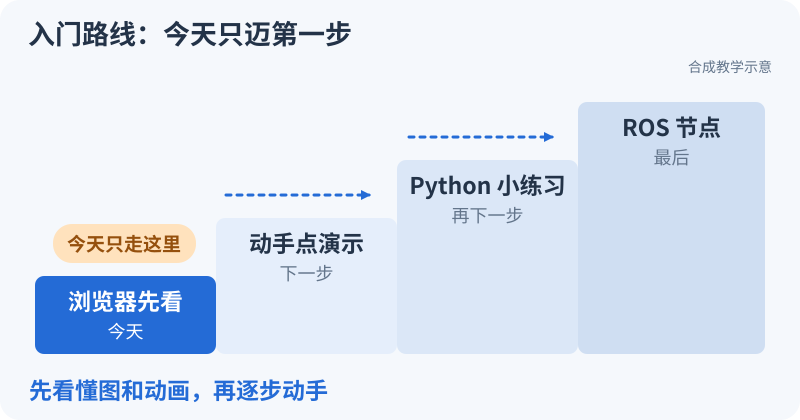

# 导航组大一新人培训路线：按本队工程学习

<small>整理与维护：24cst朱鑫鹏</small>

**今天先走第一步就够了。** 先在浏览器里看懂一个变化，再装环境、写小程序，最后才接完整导航系统。

还没开始的同学，先去[图形演示](../visuals/playground.html?scene=overview)让小车走到旗子；玩过以后再到[环境课](environment.md)。下面是整学期的地图，用到哪一关就展开哪一关，不用今天全部读完。

<link rel="stylesheet" href="../../visuals/reader.css">

## 这条路线学什么

适用对象：零导航经验的大一新人。主仓库为 [Navigation-2027，审查基线 183a410](https://github.com/Navigator-Vision-Algorithm-Team/Navigation-2027/tree/183a4109b0de2030bb8970a54654937c8b039ba9)。这是对原稿的工程化修订：保留“尽早动手、Debug 优先、稳定性优先”，把通用算法清单改为本队代码和能力门槛。源码证据见[系统地图](../system/README.md)，每关任务见[考核手册](../assignments/README.md)。

## 原稿哪些保留、哪些调整

先用一个场景理解这次调整：RViz 中能看到机器人，点一个目标却没有运动。原因可能是目标没被接受、服务器没激活、地图把起点判为障碍，也可能是速度发布到了无人订阅的 Topic。它们都不是“导航算法不够高级”。新人需要先把一条消息从入口追到出口，才能决定该学哪段理论。例如 [loam_interface 的构造与订阅][route-loam]只有几十行，已能练习参数、Topic、回调和坐标四件事；这是第一块能读懂的真实工程。

| 原稿内容 | 审查结论与调整 | 对本队的原因 |
|---|---|---|
| 工程基础先行，C++ 随用随学 | 保留这个原则，落实为最小编译与协作任务；加入 Python/launch 阅读 | 主工程同时有 C++ 组件、Python launch 与顶层 Python 辅助脚本 |
| 熟悉完整导航理论后才进入队内代码 | 改为 S0 看目录和入口，S1 读一个小节点，S3 后追完整链路 | 避免学完通用课程仍不知道本队节点是什么；不要求一开始读完 LIO |
| Debug 早学，但等级在“能开发”之后 | 修正为“观察并排障 → 修改并回归 → 负责模块” | Debug 是每关交付，不是最后一门课 |
| 固定 map→odom→base_link→lidar→imu | 改成发布权表；本队涉及 base_footprint、chassis、gimbal_yaw、front_mid360、gimbal_yaw_fake | 雷达在模型中挂在云台；旋转关节和虚拟导航帧都不能省略 |
| LIO/SLAM 泛讲，FAST-LIO 与 Point-LIO 并列 | Point-LIO 配置、输出和异常必学；small_gicp/initialpose 必学；FAST-LIO 对比了解 | 当前启动链使用 Point-LIO 与 small_gicp_relocalization |
| 地图、Nav2、Costmap、Controller 多次分散 | 合并依赖顺序：输入/TF → 地图/地形/足迹 → 规划 → 控制 → BT 恢复 | 错地图、错地形输入不能靠 Controller 调参补救 |
| BFS→Dijkstra→A* 的建议顺序与编程训练 | 进一步明确 BFS/Dijkstra 看懂，必做一份带边界检查的 A*；解释当前 Smac Hybrid 的 DUBIN 约束 | 保留算法训练，但不能把二维 A* 作业冒充实际 Planner |
| 建议实现 Pure Pursuit，后续学习其他控制器 | 调整为优先全向几何跟踪/PID 与 OmniPidPursuitController；其他控制器了解/进阶 | 横移 vy 与旋转解耦是实际接口问题，差速 Pure Pursuit 不覆盖全部能力 |
| 常见 Costmap 层都必学 | Static、IntensityObstacleLayer、Inflation 必学；Voxel/IntensityVoxel 了解 | 当前 reality YAML 的加载列表才是判断依据；terrain_map intensity 有地形语义 |
| BT 用低血量回家等例子作为工程主线 | 先读实际重规划/清图/BackUp XML，再学决策→Action 边界 | 本库未验证完整比赛决策状态机；不能把例子写成已有功能 |
| 仿真未来从零建设 | 改为复用已有 rmu_gazebo_simulator 等包，补模型、PCD、版本和验收 | 代码已经存在，统一可用的训练环境仍需建设 |
| “程序跑不了禁止直接问学长” | 改成带证据求助，实车异常立即报告 | 不鼓励盲改和隐瞒问题；求助质量可以考核 |
| 自定义 Nav2/BT 插件作为基础能力 | 降为 S7 专项进阶 | 全员先能配置、定位错误、改小段代码并回归；维护插件另设门槛 |

## 必学、了解、进阶怎样区分

**必学**：每个人必须解释、实际操作并交证据，包含本队正在用的模块接口与故障特征。**了解**：能说明用途和不适用条件，会查资料；不要求从零实现。**进阶**：选定方向后完成源码改动和对照实验，不作为全员基础合格条件。

| 主题 | 必学 | 了解 | 进阶 |
|---|---|---|---|
| 工程 | shell/SSH、Git 分支与 PR、CMake/colcon、overlay、C++ 类/引用/智能指针/回调、Python/YAML/launch | rebase/cherry-pick、多线程基本风险 | executor/锁、profiling、部署与依赖锁定 |
| ROS2 | Topic/消息、QoS、Service/Action、反馈/取消、参数、namespace/remap、lifecycle | DDS 发现原理、组件通信 | executor 调度、通信性能与多机配置 |
| TF/运动 | 父子帧与唯一发布者、stamp/clock、四元数、静动态变换、vx/vy/wz、机器人与世界坐标转换 | 麦轮/舵轮/差速约束 | 底盘模型、误差传播、李群李代数 |
| 传感器/定位 | MID-360 输入类型、IMU 单位/时间/外参、Point-LIO 输出、small_gicp 初始化、两类地图 | EKF/ESKF/ICP/GICP 思想，FAST-LIO/NDT 对比 | Point-LIO 滤波推导、配准鲁棒性、初始化与失效检测 |
| 地形/规划 | terrain_map intensity、footprint、标记/清除/膨胀/unknown、A* 实作、Smac Hybrid 配置与约束 | BFS/Dijkstra、Smac2D、Lattice、NavFn | Hybrid-A*/JPS/D* Lite 的设计与场景对照 |
| 控制 | 本队全向追踪插件、PID 基本作用、速度限幅、fake frame、自旋偏置、最终指令和串口 | Pure Pursuit/RPP、DWB、MPPI、TEB 的适用边界 | MPPI/MPC、控制插件与稳定性/碰撞验证 |
| 系统可靠性 | 日志/bag、lifecycle、Goal 状态、停止与控制权、恢复记录、回退 | watchdog/超时/fallback 设计、比赛状态接口 | 自动化故障回归、BT 插件、性能与长期可靠性 |

“了解”不表示永远不学：当代码切换到相应模块时，把它的接口、配置和调试升为必学，并更新基线。

判断深度时，可以拿“为什么横向目标会产生 `vy`”作例子。必学是算清目标在左前方 `(0.3,0.4)` 时距离为 `0.5 m`，若控制速度模长为 `0.2 m/s`，沿目标方向分解得到 `(vx,vy)=(0.12,0.16)`；再在 [computeVelocityCommands][route-controller]找到 `atan2` 和两次三角分解。了解是知道车式 Pure Pursuit 用转向角走曲线；进阶才是比较不同控制器的误差与计算量。这样每一层都有明确的停止点。

## 推荐节奏：16 周，按门槛推进

每周建议 6–8 小时，包括自学、实践和一次短复盘。周次用于排期，验收未通过则补实验；有基础的新人可用交付证据跳过重复练习。S3/S5/S6 的排期由数据包和实车资源决定。

具体执行见[16 周任务单](weekly-plan.md)：逐周列出阅读范围、代码入口、实验、交付与选做内容。零基础补课见[基础自学](../self-study/foundations.md)，学有余力进入[专项材料](../self-study/README.md)；专项深度不成为全员新增门槛。

本轮吸收外队课程的**任务衔接方式**：ROS2 单项练习之后做[轻量巡逻](../training/patrol-workshop.md)，A* 按[补全框架→独立实现](../training/astar-workshop.md)推进，坐标与地图用[固定输入的前后对照](../training/controlled-experiments.md)检验理解。这三项分别替换原来零散的巩固、搜索入门和故障示例；不额外加周次，也不把多机协作、CAN 或其他队伍的定位栈变成本队必修。导师按进度安排离线版本或 ROS 版本，记录各自完成范围。

| 阶段/建议周次 | 目标与前置 | 对应本队代码/接口 | 本关交付与通过门槛 |
|---|---|---|---|
| S0，第 1–2 周 | 无前置；会配置最小环境、提交小改动 | README→ros_ws/src→package.xml→CMakeLists.txt；观察 reality launch 参数 | T0：新终端跑通 talker/listener；小包编译成功；提交可复现 README；说明缺失依赖与版本 |
| S1，第 3–4 周 | S0；掌握通信、参数、launch、Action 与证据化 Debug | 先读 loam_interface 的 pub/sub；理解相对 Topic 与默认 namespace | T1：自写教学 pub/sub 与参数 launch，修复错名/QoS 两题；完成教学 Action 反馈与取消 |
| S2，第 5–6 周 | S1；理解 TF、时钟、二维全向运动 | sensor_scan_generation、robot_description、gimbal_yaw_fake；odometry | T2：五种运动、TF 发布权表；独立区分断链与错时；非正 dt 处理有证据 |
| S3，第 7–8 周 | S2 + 已登记 bag；会检查输入与定位 | livox→Point-LIO→loam_interface→sensor_scan_generation；small_gicp/initialpose；SLAM 分支 | T3–T4：输入体检、两次同条件回放、建图/定位区别与地图包检查；无 bag 先完成静态部分 |
| S4，第 9–10 周 | S2；S3 数据用于地形实验 | terrain_analysis→terrain_map→IntensityObstacleLayer；SmacPlannerHybrid | T5：A* 边界测试通过；T6：足迹/膨胀/地形阈值单因素对照，解释图与路径变化 |
| S5，第 11–12 周 | S3–S4；能沿导航闭环定位配置与代码 | BT→GridBased→FollowPath→velocity_smoother→fake_vel_transform→串口 | T7：追踪真实 Action/Path/速度链，完成可回退参数改动；解释零输入仍自旋风险；能识别未加载与未生效 |
| S6，第 13–14 周 | T0–T7 + 停止路径负责人验收；受控实车 | 传感器/TF/Costmap/最终速度/底盘反馈全链 | T8：先无驱动输出检查，再低速值守测试；通过陌生故障题和恢复回归；取得实车资格 |
| S7，第 15–16 周及后续 | T9 离线代码开发可在 S5 后进行；T10 实车比赛演练需先通过 S6 | 选定位/规划/控制/系统之一；比赛 Goal 接口和恢复 | T9–T10：小段真实代码改动、复现与回归、模块交接；值守演练后才能承担比赛岗位 |

Nav2 概览在 S0 就可以讲 15 分钟；不等待全部理论学完再看系统图。建图/定位和规划两条学习线在 S2 后可部分并行，S5 再合流。

### S0–S1：先让一条数据走通

把节点想成一个正在运行的程序，把 Topic 想成有名字和消息类型的通信口。发布者发出序号 `0、1、2`，订阅者收到同样的序号，才能说这一段走通；节点列表里有两个人名并不能证明它们在交谈。先读教学 [SequencePublisher.publish_next 与 SequenceSubscriber.receive][route-sequence]，再读本队 [LoamInterfaceNode 构造函数][route-loam]：前者让过程可见，后者把同一套概念换成点云与里程计。遇到空输出，先核对两端的完整 Topic 名，再查类型和 QoS。

### S2：同一运动，换坐标就换数值

机器人朝世界 `+y`，即 yaw 为 `π/2` 时，车体前进 `0.2 m/s` 对应世界速度 `(0,0.2)`。五秒后约走一米；若仍沿世界 `+x`，应先怀疑旋转方向或使用了错误 frame。教学 [integrate_body][route-core]把车体速度积分为世界位置，[IdealModel.tick][route-model]再把同一个位姿填入 Odometry 与 TF。读代码时分别标出“计算位姿”和“发布消息”，不要把消息里填了一个 frame 名理解成已经完成转换。

### S3：先检查尺子，再解释定位

定位是在用传感器数据估计自己在哪。若连续两帧相隔 `0.1 s`，位置差 `0.1 m`，速度才有 `1 m/s` 的含义；时间单位错十倍，漂亮轨迹也会带错速度。先追 [sensor_scan_generation 的差分][route-scan]，再追 [small_gicp 的配准与发布][route-gicp]。后者初始化为单位变换，并有独立 TF 定时器，因此“map→odom 存在”只是通信证据；是否对齐地图，要看配准结果、点云重叠与已定义的误差证据。

### S4：点、格子和路径是三种不同的表示

一个离地 `0.15 m` 的点可以被地形模块写成 intensity，再被障碍层投到某个格子，最后影响规划器选择道路。沿 [terrain_analysis 的离地高度输出][route-terrain]与 [IntensityObstacleLayer 的过滤和标记][route-layer]读，先问“哪个点留下了、哪个格子变了”，再问“路径为什么绕行”。在 0.05 m 分辨率下，一米横向位移跨 20 格；距离单位与格子索引必须分开。本关 A* 用小图理解搜索，本队 [GridBased 配置][route-planner]还包含 yaw 和运动模型约束。

### S5：路径只是建议，速度还会经过几次加工

控制器依据路径计算速度，速度平滑器限制变化，fake 节点再变换方向并叠加自旋。假设平移速度从 `0` 变为 `0.4 m/s`，每周期允许增加 `0.1 m/s`，需四个周期才能到达；这是速度平滑的教学直觉，不是对当前参数的实测结论。对照 [navigation_launch 的速度 remap][route-navigation]追每一段完整 Topic，再到 [transformVelocity 与缓存回调][route-fake]算最终输出。取消 Goal、收到零值、输入断流分别是事件，不能用同一句“停止了”概括。

### S6–S7：把“我理解了”变成别人能复现的结果

陌生故障题的价值在于检验你会不会提出可排除的原因。例如“消息没到”先查发布与订阅端点，再检查命名；不要同时改地图、QoS 和 PID。教学 [run_topic][route-case]把错名过程变成明确的发送/接收计数，可作为报告练习；真实系统还需实际端点证据。模块交接则多走一步：另一名同学按冻结输入与命令复现同一故障和修复，维护者才能判断改动是否可承担责任。实车准入仍按 T8，离线结论要保留适用范围。

## 能力等级与参加比赛的边界

| 等级 | 判定依据 | 可以承担 |
|---|---|---|
| L0 能运行与观察 | T0–T1 | 开发机实验、带记录跟随调试 |
| L1 能排基础故障 | T2–T3，能说明证据与因果 | TF/Topic/时钟体检，整理 bag 和复现 |
| L2 能修改与回归 | T4–T7，一项真实配置改动、一项教学代码改动 | 在审查下改参数/launch/局部代码 |
| L3 能值守实车 Debug | T8；停止、陌生故障、恢复、回归全部通过 | 独立完成诊断流程，实车测试仍有安全值守 |
| L4 能负责模块/比赛岗位 | T9–T10 + 维护者签字 | 模块维护、赛前回归、比赛分工与新人指导 |

“独立 Debug”指不依赖学长一步步提示就能形成和验证诊断；不等于一个人在场地无值守操作。遇到机械危险、接口责任不明或不可恢复故障，应及时升级处理。

比如你能找到“零命令后又出现旧非零输出”的五步缓存序列，这证明你能读状态和设计复现，通常属于 L2 的成果。读到 [cmdVelCallback 与 syncCallback][route-fake]不等于已证明底盘停车：L3 还要把最终 Topic、串口接收与物理运动放到同一时间线，完成负责人规定的测试。等级以你能证明的能力判定，不按学了几周或看过多少算法名判定。

## 导师每周做什么

提前发输入数据与本周验收项；每次只引入一类主要变量；复盘时要求新人展示实际日志和原始数据，而非只展示截图。对缺少完整地图、串口包或训练 bag 的阶段，导师先修复训练材料，再组织考核。正式准入统一按[考核手册](../assignments/README.md)执行。

一次好的复盘可以从“订阅者收了 98 条，发布者记了 100 条”开始。导师让新人指出计数区间、订阅者启动时刻和序号缺口，再决定是启动晚、处理慢还是通信问题；不能直接把两条差值叫作丢包。使用 [sequence.py][route-sequence]时还要注意，它转发序号而没有累计总数，统计脚本或自己的节点才负责计数。每周留下一条能复查的解释，下周遇到更大的系统时就有可用的方法。

[route-sequence]: https://github.com/Navigator-Vision-Algorithm-Team/knowledge-base/blob/main/training/ros2_ws/src/nav_training/nav_training/sequence.py#L10-L39
[route-core]: https://github.com/Navigator-Vision-Algorithm-Team/knowledge-base/blob/main/training/ros2_ws/src/nav_training/nav_training/core.py#L29-L47
[route-model]: https://github.com/Navigator-Vision-Algorithm-Team/knowledge-base/blob/main/training/ros2_ws/src/nav_training/nav_training/ideal_model.py#L57-L80
[route-case]: https://github.com/Navigator-Vision-Algorithm-Team/knowledge-base/blob/main/training/cases/run_case.py#L42-L64
[route-loam]: https://github.com/Navigator-Vision-Algorithm-Team/Navigation-2027/blob/183a4109b0de2030bb8970a54654937c8b039ba9/ros_ws/src/pb2025_sentry_nav/loam_interface/src/loam_interface.cpp#L23-L51
[route-controller]: https://github.com/Navigator-Vision-Algorithm-Team/Navigation-2027/blob/183a4109b0de2030bb8970a54654937c8b039ba9/ros_ws/src/pb2025_sentry_nav/pb_omni_pid_pursuit_controller/src/omni_pid_pursuit_controller.cpp#L219-L281
[route-scan]: https://github.com/Navigator-Vision-Algorithm-Team/Navigation-2027/blob/183a4109b0de2030bb8970a54654937c8b039ba9/ros_ws/src/pb2025_sentry_nav/sensor_scan_generation/src/sensor_scan_generation.cpp#L115-L156
[route-gicp]: https://github.com/Navigator-Vision-Algorithm-Team/Navigation-2027/blob/183a4109b0de2030bb8970a54654937c8b039ba9/ros_ws/src/pb2025_sentry_nav/small_gicp_relocalization/src/small_gicp_relocalization.cpp#L134-L192
[route-terrain]: https://github.com/Navigator-Vision-Algorithm-Team/Navigation-2027/blob/183a4109b0de2030bb8970a54654937c8b039ba9/ros_ws/src/pb2025_sentry_nav/terrain_analysis/src/terrain_analysis.cpp#L485-L515
[route-layer]: https://github.com/Navigator-Vision-Algorithm-Team/Navigation-2027/blob/183a4109b0de2030bb8970a54654937c8b039ba9/ros_ws/src/pb2025_sentry_nav/pb_nav2_plugins/src/layers/intensity_obstacle_layer.cpp#L403-L444
[route-planner]: https://github.com/Navigator-Vision-Algorithm-Team/Navigation-2027/blob/183a4109b0de2030bb8970a54654937c8b039ba9/ros_ws/src/pb2025_sentry_nav/pb2025_nav_bringup/config/reality/nav2_params.yaml#L469-L504
[route-navigation]: https://github.com/Navigator-Vision-Algorithm-Team/Navigation-2027/blob/183a4109b0de2030bb8970a54654937c8b039ba9/ros_ws/src/pb2025_sentry_nav/pb2025_nav_bringup/launch/navigation_launch.py#L253-L340
[route-fake]: https://github.com/Navigator-Vision-Algorithm-Team/Navigation-2027/blob/183a4109b0de2030bb8970a54654937c8b039ba9/ros_ws/src/pb2025_sentry_nav/fake_vel_transform/src/fake_vel_transform.cpp#L93-L154
