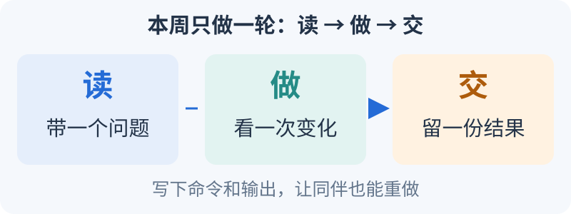

# 16 周任务单：每周读什么、做什么、交什么

<small>整理与维护：24cst朱鑫鹏</small>

第一次打开只看本周：**看一个现象，动手改一处，留下自己的结果。** 不用把 16 周内容一次读完。

1. **读**：点下表的本周入口，只读该周指定段落；第一次来从[第1周](#week-01)开始。
2. **做**：按本周“做”完成一次操作，记下预期和实际结果；遇到错误保留第一条报错。
3. **交**：对照“交与验”保存命令、版本和输出，让同伴照着重做一次。

**预期**：本周结束时，有一份能看出“做了什么、结果怎样”的记录。缺设备或数据时，按该周替代任务做，并标记待资源。

| 当前阶段 | 直接打开本周任务 |
|---|---|
| 起步与通信 | [第1周](#week-01) · [第2周](#week-02) · [第3周](#week-03) · [第4周](#week-04) |
| 坐标与定位 | [第5周](#week-05) · [第6周](#week-06) · [第7周](#week-07) · [第8周](#week-08) |
| 规划与控制 | [第9周](#week-09) · [第10周](#week-10) · [第11周](#week-11) · [第12周](#week-12) |
| 诊断与交接 | [第13周](#week-13) · [第14周](#week-14) · [第15周](#week-15) · [第16周](#week-16) |

<link rel="stylesheet" href="../../visuals/reader.css">

## 怎样使用这张进度表

本页是[培训路线](learning-route.md)的执行表，正式评分仍按 [T0–T10](../assignments/README.md)。每周安排约 6–8 小时，不要求看完所链接的整本教程。建议分为两次实践和一次 20–30 分钟复盘；周内先阅读指定段落，做出输出后再拓展。

没有数据、设备或接口时，标记“待资源”并做该周替代任务；替代任务不抵扣未完成的实测验收。不会编程的同学可将第 1–4 周延长到 6–8 周；有基础的同学凭同伴可复现的成果申请跳过。周次不会自动授予实车资格。

## 第 1 周：新终端里跑通最小通信（S0） 

**先想明白**：终端是发命令的窗口，进程是操作系统运行程序的对象，节点是在进程中创建的 ROS 通信对象；一个进程可以包含多个节点。source 为当前 shell 加入寻找 ROS 包的路径，一个终端成功不代表新终端已继承同样环境。看教学路径 `training/ros2_ws/src/nav_training/setup.py` 的 [console_scripts][week-entry]，把运行入口 `sequence_publisher` 对到 `nav_training.sequence:publisher_main`；再看路径 `training/ros2_ws/src/nav_training/nav_training/sequence.py` 的 [SequencePublisher 构造函数](https://github.com/Navigator-Vision-Algorithm-Team/knowledge-base/blob/main/training/ros2_ws/src/nav_training/nav_training/sequence.py#L10-L18)，实际节点名才是 `sequence_source`。沿 [spin_node][week-runtime]看节点创建与持续处理回调，就能把“包、可执行入口、节点、进程”分清。

**读**：[环境页第 1–2 节](environment.md)、[F1 终端和 F3 最小语法](../self-study/foundations.md)。先认识 shell、进程、包、可执行文件四个词。

**做**：完成 talker/listener；在新终端重做 source；保存系统/ROS 版本、启动命令和接收输出。自己写一个读取两个数的 C++ 程序，避免只会运行别人的节点。

**交与验**：`week01/README.md` 加文本日志，同伴按步骤能收到数据。回答“关掉一个终端，哪个进程结束”；遇安装错误保存第一条错误。**加餐**：F1 路径含空格与日志重定向实验。

## 第 2 周：构建、分支与包来源（S0 / T0） 

**先想明白**：源文件像配方，构建产物像做出的成品，install 目录是 ROS 运行时找成品的地方。你在 A 工作区改了配方，却 source B 工作区，当然可能继续跑旧程序。对照 [loam_interface 的共享库与可执行入口][week-cmake]：`SHARED` 生成可加载的库，组件注册又声明可执行入口。报错时区分“编译没产出”“没有安装”“运行时找错包”，下一步检查的位置也就不同。

**读**：[环境页第 3–5 节](environment.md)、[F2 Git、F4 CMake](../self-study/foundations.md)。本队源码从 `package.xml` 和 `loam_interface/CMakeLists.txt` 开始。

**做**：建立小 ament 包并编译；完成 F3 多文件路径长度程序；练一次冲突解决和 revert；用 `ros2 pkg prefix` 找到实际安装位置。列出完整比赛工程目前缺什么依赖，先不启动实车入口。

**交与验**：T0 仓库与构建记录，排除生成目录。导师故意让你在未 source 的新终端运行，你能说明并恢复。**加餐**：解释普通 executable 和可加载组件的构建差别。

## 第 3 周：写自己的 Topic 节点（S1） 

**先想明白**：发布频率 5 Hz 表示理想间隔约 `0.2 s`，60 秒约发 300 条；实际计数还受起止时刻影响。先读教学 [publish_next][week-sequence]中“发布当前序号，再加一”，再到本队 [构造函数的 pub/sub][week-loam]找订阅回调。看到 `state_estimation_topic` 时先问它是装 Topic 名的字符串，还是正在传输的消息；参数与消息分清后，接口表才不会把两者混写。

**读**：[ROS2 课程通信部分](../ros2-tf/README.md)、[ROS2 系统专题的通信单元](../self-study/ros2-systems.md)、[源码 R1](../assignments/reading-labs.md)。C++ 只补当前用到的类、智能指针和回调。

**做**：教学发布者定时发递增计数，订阅者累计收到数量；用参数决定频率或前缀，写 launch；在 `/training` 下运行，比较相对名与绝对名。只读 `LoamInterfaceNode` 的构造函数与两个回调，不读完整 LIO。

**交与验**：代码、CMake/install、launch、接口表和一次改参数结果；能指出参数由哪里读取。**加餐**：R1 的 TF 初始化先后问题，只写源码推断与隔离复现设计。

## 第 4 周：通信故障与 Action 取消（S1 / T1） 

**先想明白**：通信要同时满足“找到同一个名字、使用同一种类型、QoS 能兼容”。例如 `/training/sequence` 和 `/sequence` 相差一个 namespace，频率再高也收不到。用 [bad_topic.launch.py][week-bad-topic]定位教学错名；Action 则对照 [accept_cancel 与 execute][week-action]，前者允许取消，后者检查请求并设置最终状态。看到“cancel accepted”后还要等待结果，不能提前把任务写成 CANCELED。

**读**：[系统专题 QoS、Action](../self-study/ros2-systems.md)，回看 Topic/Service/Action 的区别。

**做**：修复教学节点的错 namespace 和不兼容 QoS；按 Humble Action 示例完成目标、反馈、结果、取消。把请求被接受和最终取消完成分别记录。

**交与验**：T1 证据包，两道故障都要有修复前后端点信息。口试“为什么 CLI 能看见 Topic，订阅回调却没有数据”。**加餐**：进度回调慢时，取消处理是否及时；在自己的节点测，不接底盘。

## 第 5 周：坐标、单位与 TF 发布权（S2） 

**先想明白**：同一个箭头在世界和车体坐标中可以有不同分量。车头朝世界 `+y` 时，世界 `+x` 的 `0.2 m/s` 在车体中是向右侧的 `vy=-0.2`，因此 [transformVelocity][week-fake-math]使用的是逆向旋转。手算时先写“输入在哪个 frame、输出在哪个 frame”，再选符号。TF 发布权表要写具体节点，因为两名发布者同时改同一条边会让定位结果失去唯一来源。

**读**：[ROS2/TF 课程](../ros2-tf/README.md)、[系统 TF 表](../system/README.md)、[定位专题的向量与刚体变换](../self-study/localization.md)。

**做**：手算并编码 0、±90° 的二维旋转；画出本队 map/odom/base_footprint/chassis/gimbal_yaw/front_mid360/fake frame；每条 TF 标发布者和静态/动态。完成 [R2 的坐标计算](../assignments/reading-labs.md)。

**交与验**：计算输入输出、TF 图、唯一发布权表；能区分 Topic namespace 与 frame 字符串。**加餐**：用逆变换验证往返一致性，报告数值误差。

## 第 6 周：时间、同步与运动（S2 / T2） 

**先想明白**：速度积分是把“每秒走多少”变成“这一段走多少”。`0.2 m/s × 0.1 s=0.02 m`；dt 重复或回跳后，这一步不能照常算。读教学 [TimedModel.step][week-time]：首帧只建立时间基准，回跳清旧命令，超时只积分到有效期末。再看本队 [publishOdometry 的 steady_clock 差分][week-scan]，解释消息时间与执行间隔为何是两个量；不用先学完时间同步理论才做这道题。

**读**：[ROS 时间与 TF 排障材料](../self-study/ros2-systems.md)、[F5 CSV 时间练习](../self-study/foundations.md)。

**做**：教学节点生成静止、前进、侧移、旋转、组合运动；记录 Pose/Twist/TF。分别构造缺边和错时故障；静态 TF 已缓存时不能仅停发布者冒充断链。完成 [R5 时间例题](../assignments/reading-labs.md)。

**交与验**：T2 五种运动证据、非正 dt 处理、断链与时间错误的排除依据。**加餐**：ROS time 暂停/回跳时应用计时与墙钟计时的区别。

**把单项练习串起来**：完成[轻量巡逻的离线基线](../training/patrol-workshop.md)，分别解释正常、等待障碍、取消、断流的状态与最后速度；ROS 环境具备时再接多节点接口。把它作为本周 Action/运动巩固的统一场景，五种运动、TF 和时间边界仍按 T2 验收；不把全部多节点开发挤进同一周。先看[外参偏转对照图](../training/controlled-experiments.md)，手算误差后再执行隔离实验。

## 第 7 周：从原始输入到里程计（S3 / T3） 

**先想明白**：频率均值正常仍可能有一段数据中断。十个间隔中九个是 0.01 s，一个是 0.2 s，平均值会掩盖那个影响估计的长空档，所以要保存间隔序列和异常时间段。到 [Livox 预处理][week-preprocess]找 `offset_time` 写入 `curvature` 的位置，再追 [loam_interface 输出][week-loam]：字段名字不能替代单位说明，CustomMsg 的逐点时间也不能靠 PointCloud2 的帧时间自动补出。

**读**：[传感器与定位页第 1–3 节](../sensor-lio/README.md)，定位专题中的点云与 IMU 基础。

**做**：用已登记 bag 列 Topic/类型/频率/QoS/stamp/frame；追踪 `livox/lidar → Point-LIO → aft_mapped_to_init/cloud_registered → loam_interface`。区分 CustomMsg 和可视化 PointCloud2。

**交与验**：T3 输入体检表，能定位三个不同层的问题。无 bag 时先读接口、制作合成时间样本并登记“动态体检待资源”。**加餐**：合成含噪静止数据，估计均值/方差，不能当成 MID-360 实测噪声。

## 第 8 周：地图包、初始化与重定位（S3 / T4） 

**先想明白**：二维图像告诉规划“哪里可走”，PCD 给配准提供三维几何，它们不是换一种后缀的同一份文件。看 [reality launch 的地图路径][week-map]确认加载入口；再读 [performRegistration][week-gicp]的 `converged` 分支。单位初值能发 TF，不代表点云对齐；初值对照要记录“估计变换如何变化、几何是否贴合”，不能只记节点有没有运行。

**读**：[传感器与定位页第 4–7 节](../sensor-lio/README.md)、[R3 地图路径题](../assignments/reading-labs.md)。

**做**：登记 YAML+PGM+PCD、外参、输入 bag 和校验值；在隔离条件下同参数重跑两次，再单独改变 initialpose。解释建图分支的静态 map→odom 与定位分支 small_gicp 的区别。

**交与验**：T4 地图清单、重复结果与失败初始化样本；有 TF 但未收敛不算成功。缺配套 bag 时可先完成路径题和[合成配准实验](../self-study/localization.md)。**加餐**：比较初值范围对 ICP/GICP 的影响，不急着换 LIO。

## 第 9 周：用小图学会搜索（S4 / T5） 

**先想明白**：A* 给格子打分 `f=g+h`，g 是已走代价，h 是到终点的下界估计。四邻接单位代价时 `(1,1)` 到 `(4,3)` 的曼哈顿 h 为 `3+2=5`；障碍可能让实际路更长，却不会让这个下界变大于真实最优代价。先手推一次队列，再对照本队 [GridBased 的插件和 DUBIN 参数][week-planner]：真实规划状态还含朝向，教学邻接表没有表达这些限制。

**读**：[环境表达与规划](../planning/README.md)、[规划控制专题搜索部分](../self-study/planning-control.md)。

**做**：按[A* 两步练习](../training/astar-workshop.md)先手算并补全启发式、搜索和回溯，再在个人文件中独立实现四邻接 A*。两步使用同一组固定输入，输出代价、扩展数、耗时和路径；用独立 BFS/Dijkstra 或 h=0 参照检查最优代价；完成 T5 的六类边界测试。完成填空只算第一阶段，不能代替独立实现。

**交与验**：代码、固定地图、全部自动检查结果，解释无解退出与合法索引；说明为何不等于本队 Smac Hybrid。**加餐**：带权地形与启发式权重对照，分别记录是否最优和是否可行。

## 第 10 周：从地形点到 Costmap 格子（S4 / T6） 

**先想明白**：若局部地面 z 为 0.02 m、点 z 为 0.17 m，离地高度是 0.15 m。读 [terrain_analysis 的 dis_z][week-terrain]与 [障碍层 intensity 过滤][week-layer]，把这一数值从点追到格子。低于标记阈值只说明这次不标记该点；旧障碍是否清掉，要另看 clearing 和射线。一次只改一个参数，是为了能把路径变化归因到具体环节。

**读**：[规划页地形/Costmap 部分](../planning/README.md)、[R4 参数加载题](../assignments/reading-labs.md)。

**做**：在同一场景分别改 footprint/半径、膨胀和地形阈值，保留基线与有效参数。找一个障碍，追踪其 `registered_scan → terrain_map → costmap` 表示；关注 intensity 的离地高度语义与输出 frame。

**交与验**：T6 四组对照，每组重复三次；能解释变化发生在哪层。无数据/仿真时先用小栅格演示膨胀，运行部分待资源。**加餐**：比较完整 footprint 和圆半径近似对窄通道的影响。

**读图练习**：先用[地图原点对照](../training/controlled-experiments.md)分清“坐标参照变了”和“障碍真的移动了”。把基线、唯一改动、预测、观测、恢复五项写成同一份记录；真实 Costmap 调参仍要自己的输入与有效参数，不能用本库合成图代交实测结果。

## 第 11 周：导航 Action、BT 与真实插件（S5） 

**先想明白**：BT 每次 tick 都在问“这一项成功了、失败了，还是仍在运行”。读 [本队单点树][week-tree]中的 `planner_id="GridBased"` 与 `controller_id="FollowPath"`，再去 YAML 找同名插件。树中 3 Hz 主要限制规划成功后的再次发起节奏；首次立即执行，子树 RUNNING 期间仍随父树继续 tick，不能当作所有分支 tick 或控制器输出速度的频率上限，细节见 [Nav2 的 BT 讲解](../nav2/README.md)。节点列表有 controller_server，却处在 inactive，是“对象存在但尚未提供相应行为”；查 [lifecycle_nodes][week-lifecycle]把管理者与被管理者连起来。

**读**：[Nav2 课程](../nav2/README.md)、本队 `navigate_to_pose_w_replanning_and_recovery.xml`、系统专题 BT 单元。

**做**：画 Goal→BT→GridBased→FollowPath 图，写出插件全名；记录 lifecycle、反馈、失败、取消。沿 `navigation_launch.py` 分别画组合与非组合启动分支。

**交与验**：实际节点/Action/Path 记录和 BT 状态说明，能区分“节点存在”和“服务器 active”。**加餐**：用假动作节点演示 RUNNING/FAILURE/retry/cancel，不接导航输出。

## 第 12 周：速度坐标、限幅与输出缓存（S5 / T7） 

**先想明白**：零消息是一条新输入，断流是没有新输入，取消是 Action 状态变化，三者必须分开观测。到 [cmdVelCallback 与 syncCallback][week-fake-state]逐行追 `latest_cmd_vel_`；手推“非零→零→再次同步”时，特别看零分支有没有改旧缓存。最后读 [速度 remap][week-navigation]，确认你监听的是哪一层输出；只看控制器端零值，不能解释后续变换是否又加了 spin。

**读**：[源码审查证据](../system/nav2-and-control-evidence.md)、[R2 完整题](../assignments/reading-labs.md)、[规划与控制专题](../self-study/planning-control.md)。

**做**：追踪 `cmd_vel_controller → cmd_vel_nav2_result → cmd_vel`；解释 velocity_smoother、fake 变换、自旋和外部串口。隔离观察零输入、取消与输入断流；完成一次可回退参数/launch 小改动。

**交与验**：T7 全链接口表、源码推断与实际观测分列、回退结果。停止路径未通过时如实记录，仍可完成诊断作业。**加餐**：离线全向 PID 实验；代码开发 T9 可在本关后选题。

## 第 13 周：盲测诊断与台架准备（S6） 

**先想明白**：有用的假设能被证据否定。怀疑错 Topic 时，若两端全名、类型、QoS 都匹配，就应转向下一层；若全名已经不同，就先验证这一处。先用教学 [resolve_topic 与 run_topic][week-case]练出“名称差异→接收为零→修名后恢复”的解释，再把相同方法用于真实端点。台架部分还要补串口和驱动证据，教学模型没有模拟它们。

**读**：[Debug 与实车流程](../debug-real/README.md)，整理自己的前 12 周故障记录。

**做**：完成三道跨层陌生软件故障；每题先写一个假设和两条检查，再允许修改。由负责人核验急停、驱动使能、最终停止路径、控制权、场地和冻结阈值。

**交与验**：T8 盲测记录及准入检查单；未确认外部串口/停车指标，运动部分保持待验收。**加餐**：将一道题整理为现象→根因→修复→回归的知识库条目。

## 第 14 周：受控实车回归（S6 / T8） 

**先想明白**：软件发布零速度、底盘接收零速度、机器人停止，是三个时间点。例如教学假设中分别发生在 t=1.00、1.03、1.18 s，通信延迟是 0.03 s，发布到物理停止是 0.18 s；这些是假设数字，用于定义记录口径。对照 [fake 节点的发布位置][week-fake-state]标记软件时间点，再由负责人确认底盘接收与物理观测方法。阈值和测法先冻结，结果才能相互比较。

**前置**：T0–T7 通过且第 13 周台架与负责人签字齐备。阅读当天有效参数、场地地图、回退版本和停止阈值。

**做**：按 T8 值守完成前进/横移/旋转/到达/取消/停止后重启，每类至少三次；任何停止检查失败就中止。记录最终 Topic、底盘接收、动作与时间线。

**交与验**：全量结果与维护者签字，才能取得对应实车资格。无车时重复离线诊断，不能以仿真替代实车认证。**加餐**：分析重复结果差异，不提高运动上限来追求“更快”。

## 第 15 周：一项真实代码改动（S7 / T9） 

**先想明白**：小修复也要说明“原来哪条输入会错，改后哪条正常输入仍正确”。可先读教学 [replay_motion.compare][week-replay]的严格递增时间检查，思考为何重复 stamp 应有明确结果。若选择本队 [publishOdometry][week-scan]的时间处理，还要考虑首帧和 Twist 的坐标语义；修一处 dt 不能自动证明整段接口正确。用真实故障输入与相邻正常输入组成回归范围，再决定最小改动。

**读**：按选题进入[定位](../self-study/localization.md)、[规划控制](../self-study/planning-control.md)或[系统](../self-study/ros2-systems.md)的一组指定材料。

**做**：与维护者确定一个可复现小问题；改前复现、最小修改、原故障回归、相邻正常输入、可审查 PR 和回退。日志补充、空输入、参数校验适合首题；超时/停车改动需共同定义接口责任。

**交与验**：T9 编译与实际回归证据，同伴复现。尚未上车的修改明确标注待实车。**加餐**：写一页算法适用性报告，给出保留现方案或更换的证据。

## 第 16 周：比赛演练与交接（S7 / T10） 

**先想明白**：交接让另一人知道“启动哪个入口、何时判断正常、失败时去哪查”。例如 [单点 BT][week-tree]中规划失败先清全局图再重试，控制失败有另一层局部恢复；记录只写“自动恢复”会丢失原因。把一次演练按 Goal UUID、结果状态、日志时间段串起来，附冻结的 [navigation_launch][week-navigation]路径和参数来源。十次任务保留全部记录，另一人才能判断失败是同一原因还是不同问题。

**前置**：已通过 S6，代码/地图/参数冻结，岗位和值守明确。阅读已有 Goal 协议与问题处理记录，不假定仓库有未实现的比赛决策功能。

**做**：从开机到任务、受控失败、恢复、归档走完整流程；按 T10 保留十次固定任务所有结果；另一名同学按说明接手复现。

**交与验**：交接清单、失败归因、回归记录与维护者确认。十次至少九次的教学门槛不代表比赛可靠性指标。**加餐**：选择下一阶段模块方向，给下一届留下一个合格作业和一个故障样例。

## 每周复盘只回答四件事

1. 我本周实际运行/阅读了哪份代码、哪个版本和输入？
2. 我预期什么、看到了什么，有哪条证据支持结论？
3. 我修复或排除了哪个原因，恢复基线了吗？
4. 下周需要补哪一个知识点或资源，由谁提供？

报告可用[统一模板](../maintenance/README.md)。导师关注独立判断与证据，不用看课时长、笔记页数或背公式数量作为合格依据。

[week-entry]: https://github.com/Navigator-Vision-Algorithm-Team/knowledge-base/blob/main/training/ros2_ws/src/nav_training/setup.py#L22-L27
[week-runtime]: https://github.com/Navigator-Vision-Algorithm-Team/knowledge-base/blob/main/training/ros2_ws/src/nav_training/nav_training/runtime.py#L14-L26
[week-sequence]: https://github.com/Navigator-Vision-Algorithm-Team/knowledge-base/blob/main/training/ros2_ws/src/nav_training/nav_training/sequence.py#L10-L39
[week-bad-topic]: https://github.com/Navigator-Vision-Algorithm-Team/knowledge-base/blob/main/training/ros2_ws/src/nav_training/launch/bad_topic.launch.py#L6-L7
[week-action]: https://github.com/Navigator-Vision-Algorithm-Team/knowledge-base/blob/main/training/ros2_ws/src/nav_training/nav_training/fibonacci_server.py#L29-L61
[week-time]: https://github.com/Navigator-Vision-Algorithm-Team/knowledge-base/blob/main/training/ros2_ws/src/nav_training/nav_training/core.py#L79-L109
[week-case]: https://github.com/Navigator-Vision-Algorithm-Team/knowledge-base/blob/main/training/cases/run_case.py#L42-L64
[week-replay]: https://github.com/Navigator-Vision-Algorithm-Team/knowledge-base/blob/main/training/tools/replay_motion.py#L14-L45
[week-cmake]: https://github.com/Navigator-Vision-Algorithm-Team/Navigation-2027/blob/183a4109b0de2030bb8970a54654937c8b039ba9/ros_ws/src/pb2025_sentry_nav/loam_interface/CMakeLists.txt#L26-L33
[week-loam]: https://github.com/Navigator-Vision-Algorithm-Team/Navigation-2027/blob/183a4109b0de2030bb8970a54654937c8b039ba9/ros_ws/src/pb2025_sentry_nav/loam_interface/src/loam_interface.cpp#L23-L98
[week-fake-math]: https://github.com/Navigator-Vision-Algorithm-Team/Navigation-2027/blob/183a4109b0de2030bb8970a54654937c8b039ba9/ros_ws/src/pb2025_sentry_nav/fake_vel_transform/src/fake_vel_transform.cpp#L147-L154
[week-fake-state]: https://github.com/Navigator-Vision-Algorithm-Team/Navigation-2027/blob/183a4109b0de2030bb8970a54654937c8b039ba9/ros_ws/src/pb2025_sentry_nav/fake_vel_transform/src/fake_vel_transform.cpp#L93-L133
[week-scan]: https://github.com/Navigator-Vision-Algorithm-Team/Navigation-2027/blob/183a4109b0de2030bb8970a54654937c8b039ba9/ros_ws/src/pb2025_sentry_nav/sensor_scan_generation/src/sensor_scan_generation.cpp#L115-L156
[week-preprocess]: https://github.com/Navigator-Vision-Algorithm-Team/Navigation-2027/blob/183a4109b0de2030bb8970a54654937c8b039ba9/ros_ws/src/pb2025_sentry_nav/point_lio/src/preprocess.cpp#L94-L122
[week-map]: https://github.com/Navigator-Vision-Algorithm-Team/Navigation-2027/blob/183a4109b0de2030bb8970a54654937c8b039ba9/ros_ws/src/pb2025_sentry_nav/pb2025_nav_bringup/launch/rm_navigation_reality_launch.py#L62-L85
[week-gicp]: https://github.com/Navigator-Vision-Algorithm-Team/Navigation-2027/blob/183a4109b0de2030bb8970a54654937c8b039ba9/ros_ws/src/pb2025_sentry_nav/small_gicp_relocalization/src/small_gicp_relocalization.cpp#L134-L192
[week-planner]: https://github.com/Navigator-Vision-Algorithm-Team/Navigation-2027/blob/183a4109b0de2030bb8970a54654937c8b039ba9/ros_ws/src/pb2025_sentry_nav/pb2025_nav_bringup/config/reality/nav2_params.yaml#L469-L504
[week-terrain]: https://github.com/Navigator-Vision-Algorithm-Team/Navigation-2027/blob/183a4109b0de2030bb8970a54654937c8b039ba9/ros_ws/src/pb2025_sentry_nav/terrain_analysis/src/terrain_analysis.cpp#L485-L515
[week-layer]: https://github.com/Navigator-Vision-Algorithm-Team/Navigation-2027/blob/183a4109b0de2030bb8970a54654937c8b039ba9/ros_ws/src/pb2025_sentry_nav/pb_nav2_plugins/src/layers/intensity_obstacle_layer.cpp#L403-L444
[week-tree]: https://github.com/Navigator-Vision-Algorithm-Team/Navigation-2027/blob/183a4109b0de2030bb8970a54654937c8b039ba9/ros_ws/src/pb2025_sentry_nav/pb2025_nav_bringup/behavior_trees/navigate_to_pose_w_replanning_and_recovery.xml#L5-L38
[week-navigation]: https://github.com/Navigator-Vision-Algorithm-Team/Navigation-2027/blob/183a4109b0de2030bb8970a54654937c8b039ba9/ros_ws/src/pb2025_sentry_nav/pb2025_nav_bringup/launch/navigation_launch.py#L253-L340
[week-lifecycle]: https://github.com/Navigator-Vision-Algorithm-Team/Navigation-2027/blob/183a4109b0de2030bb8970a54654937c8b039ba9/ros_ws/src/pb2025_sentry_nav/pb2025_nav_bringup/launch/navigation_launch.py#L42-L51
