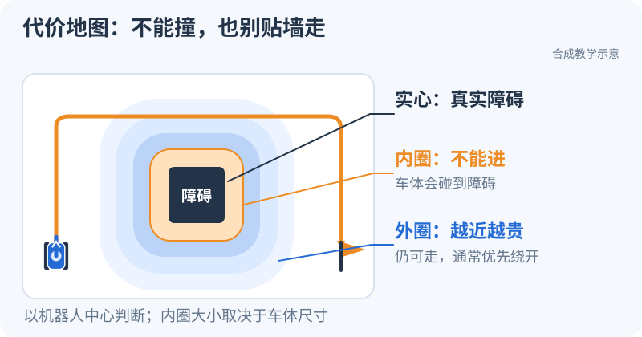

# S4：机器人怎样绕开一堵墙？

<small>整理与维护：24cst朱鑫鹏</small>

你在墙的这一侧，目标在另一侧。小车应该往哪走？先看动画，不急着读公式。

<div data-nav-visuals="查看A*搜索动图"></div>


## 先玩 5 分钟：给小车找条路

点「单步」，看搜索一格格向外展开；再点「开始」，看看最后留下的路线。颜色的含义直接写在图里，暂时记住：**最终路径要连得上，也不能穿墙。**

<iframe src="../visuals/playground.html?scene=astar" title="可以播放和单步观察的A星绕墙演示" width="100%" height="620" loading="lazy" style="border:0;border-radius:12px"></iframe>

[单独打开搜索演示](../visuals/playground.html?scene=astar)。这个演示可以暂停、重播和逐步看；需要快速回顾时，再展开上面的动图。

现在试三下：

1. 跑完「可绕障地图」，用手指数一数路径走了几步，和显示的代价比一比。
2. 切到「无路可走地图」。墙封住以后，程序该继续等，还是告诉你没有路？
3. 切回原图重播。用一句话说出“正在尝试的格子”和“最后要走的路径”有什么不同。

这一步看懂后，再做[A* 两步练习](../training/astar-workshop.md)。先把动画里的过程写成小程序，暂时不用接 ROS。

## 有路线了，为什么还要离墙远一点？

图里的线没有宽度，机器人有。把它想成一个圆：圆心不能贴着墙走，否则车身会碰上。

<div data-nav-visuals="查看障碍与代价圈示意图"></div>



<iframe src="../visuals/playground.html?scene=costmap" title="调节障碍代价圈的入门演示" width="100%" height="620" loading="lazy" style="border:0;border-radius:12px"></iframe>

[单独打开代价地图演示](../visuals/playground.html?scene=costmap)。拖动滑块，看障碍周围的影响范围怎样变化。**外围变浅的区域表示经过有代价，不是整圈都禁止通行。** 这些是教学数值，实际参数在下面的本队代码里查。

<link rel="stylesheet" href="../visuals/reader.css">
<script src="../visuals/reader.js" defer></script>
<div data-nav-fold></div>

## 接下来读什么

前置：TF、消息坐标、二维全向运动；真实地形实验还需 S3 数据包。目标是解释机器人为何可走/不可走、如何生成路径，以及规划模型和实际全向底盘的差异。必学一份 A* 和本队 Costmap 数据路径；无需把所有搜索算法各写一遍。

## 1. 三类地图与地形输入

机器人找路前，需要把“空间里有一张桌子”变成算法能查询的表达。PCD保存三维点，适合对齐几何；OccupancyGrid把地面划成格子，表达占据情况；Costmap在栅格上再叠加障碍和靠近障碍的代价，帮助规划/控制选择通路。可以把占据图看成“哪里有东西”，代价图看成“机器人从这里经过有多困难”。空闲、未知、障碍是不同状态；“没看到”并不推出“肯定没有”。

| 表达 | 数据和用途 | 常见误解 |
|---|---|---|
| PCD 点云地图 | small_gicp 对齐先验地图 | 以为 map_server 直接加载 PCD |
| YAML+图像/OccupancyGrid | map_server/SLAM 提供二维占据地图；resolution、origin、free/occupied/unknown | 同名文件必然坐标对齐 |
| global/local Costmap | 叠加静态图、实时障碍、足迹清除和膨胀后的规划/控制代价 | 把未知当自由，把可视化颜色当算法全部输入 |

本队路径是 `registered_scan + lidar_odometry → terrain_analysis → terrain_map → IntensityObstacleLayer`。地形节点把相对地面高度等结果写入 intensity，**不是直接用雷达反射强度当碰撞代价**。先核对点云 frame、字段、地面处理与阈值，再调 Costmap。[terrain_analysis 实现](https://github.com/Navigator-Vision-Algorithm-Team/Navigation-2027/blob/183a4109b0de2030bb8970a54654937c8b039ba9/ros_ws/src/pb2025_sentry_nav/terrain_analysis/src/terrain_analysis.cpp)，[IntensityObstacleLayer 实现](https://github.com/Navigator-Vision-Algorithm-Team/Navigation-2027/blob/183a4109b0de2030bb8970a54654937c8b039ba9/ros_ws/src/pb2025_sentry_nav/pb_nav2_plugins/src/layers/intensity_obstacle_layer.cpp)。

### 1.1 先把一格的位置算对

resolution 是每格对应多少米，origin 是栅格原点在参考系中的位姿，像素下标不是米。知识库路径 `training/datasets/synthetic-v1/map/teaching_map.yaml` 的[教学地图](https://github.com/Navigator-Vision-Algorithm-Team/knowledge-base/blob/main/training/datasets/synthetic-v1/map/teaching_map.yaml)给出 `resolution=0.25`、`origin=[-1,-1,0]`。用从0开始、从地图下方向上计数的网格 `(i,j)=(4,6)`，格心坐标为：

```text
x = -1 + (4 + 0.5) × 0.25 = 0.125 m
y = -1 + (6 + 0.5) × 0.25 = 0.625 m
```

加0.5是走到格子中心，而不是停在格边。PGM图像的第一行在上方，若直接用图像row作j，y会翻转；本教学图高度16，图像row=9对应 `j=16−1−9=6`。生成规则可在知识库路径 `training/tools/generate_data.py` 的[`write_map` L134–149](https://github.com/Navigator-Vision-Algorithm-Team/knowledge-base/blob/main/training/tools/generate_data.py#L134-L149)看到：第143行明确使用 `height−1−row`。如果origin带yaw，还要对局部格心进行旋转后再加平移。本例yaw=0，不代表所有地图都可省略旋转。

### 1.2 一个箱子怎样成为障碍格

假设箱子点的地面高度差为0.22 m，这个数被terrain节点写入intensity；Costmap看到它后还要检查强度范围、距离、坐标是否落在图内。主仓库路径 `ros_ws/src/pb2025_sentry_nav/terrain_analysis/src/terrain_analysis.cpp` 的[高度编码 L499–514](https://github.com/Navigator-Vision-Algorithm-Team/Navigation-2027/blob/183a4109b0de2030bb8970a54654937c8b039ba9/ros_ws/src/pb2025_sentry_nav/terrain_analysis/src/terrain_analysis.cpp#L499-L514)产生该字段；路径 `ros_ws/src/pb2025_sentry_nav/pb_nav2_plugins/src/layers/intensity_obstacle_layer.cpp` 的[`updateBounds` L400–435](https://github.com/Navigator-Vision-Algorithm-Team/Navigation-2027/blob/183a4109b0de2030bb8970a54654937c8b039ba9/ros_ws/src/pb2025_sentry_nav/pb_nav2_plugins/src/layers/intensity_obstacle_layer.cpp#L400-L435)消费它：

1. 第400–403行按x/y/z/intensity字段逐点读取。
2. 第406–407行跳过不在intensity范围内的点；这步不是直接设置“代价=0.22”。
3. 第411–423行按观测原点检查点的距离范围。
4. 第429行将世界坐标转为栅格索引；第435行把保留点对应格子标记为 `LETHAL_OBSTACLE`。

因此点云在RViz很亮不说明一定被标记，点云有数据也不说明TF、字段或范围正确。先拿一个已知高度箱子的点追完这四步，再进行阈值实验。

## 2. 当前 Costmap 应读什么

基线 [reality YAML](https://github.com/Navigator-Vision-Algorithm-Team/Navigation-2027/blob/183a4109b0de2030bb8970a54654937c8b039ba9/ros_ws/src/pb2025_sentry_nav/pb2025_nav_bringup/config/reality/nav2_params.yaml) 的 global/local 都使用 StaticLayer、IntensityObstacleLayer、InflationLayer；local 以 odom 为 global_frame，global 以 map 为 global_frame，robot_base_frame 为 gimbal_yaw_fake。这些是本课必读项。

VoxelLayer 与 IntensityVoxelLayer 先了解，不因代码存在就称其已加载。默认 `robot_radius=0.2`、`inflation_radius=0.7` 是仓库值，不能作为未知尺寸实车的安全参数。实车须记录测量外形、云台转动后包络与实际 footprint；用半径还是多边形由维护者确认。

### 2.1 三个图层分别解决什么

StaticLayer把先前保存的占据图带进来，比如固定墙；IntensityObstacleLayer把现在看到的箱子等实时观测带进来；InflationLayer给障碍周围加上代价，让路径不必紧贴边缘。局部图随着机器人移动而滚动，关注附近控制；全局图在map里覆盖去目标的路线。当前local为5×5 m、0.05 m/格，约100×100格；这个数是窗口格数，不是实时点云点数。

圆形半径0.2 m意味着直径0.4 m。宽0.5 m的理想通道中，若车位于正中，几何上每侧只有0.05 m余量，定位误差、外形测量和实际控制都可能消耗它。膨胀半径0.7 m相当于14个0.05 m格子的影响范围，但整个0.7 m圈并非都被当成不可通行；不同距离的代价不同，必须看代价值和算法碰撞条件。不能把“膨胀圈有颜色”直接读成“通道封死”。

真实配置路径是 `ros_ws/src/pb2025_sentry_nav/pb2025_nav_bringup/config/reality/nav2_params.yaml` 的[local/global图层 L368–451](https://github.com/Navigator-Vision-Algorithm-Team/Navigation-2027/blob/183a4109b0de2030bb8970a54654937c8b039ba9/ros_ws/src/pb2025_sentry_nav/pb2025_nav_bringup/config/reality/nav2_params.yaml#L368-L451)。第一遍只圈 `global_frame`、`robot_base_frame`、尺寸、resolution和plugins；第二遍再查每层数据源、marking/clearing和阈值。

### 2.2 marking 与 clearing 不是“有点”和“没点”的简单开关

marking用命中的观测标记障碍；clearing沿观测射线清理可确定的自由空间。箱子移走以后，若雷达看到后面的墙，射线扫过原来的箱子位置，才提供了更新自由空间的证据；若雷达断流，则只是什么也没收到，不能等同于障碍消失。手工清图能重置状态，但它不证明正常clearing链路已经修好。

主仓库路径 `ros_ws/src/pb2025_sentry_nav/pb_nav2_plugins/src/layers/intensity_obstacle_layer.cpp` 的[`updateBounds` L377–394](https://github.com/Navigator-Vision-Algorithm-Team/Navigation-2027/blob/183a4109b0de2030bb8970a54654937c8b039ba9/ros_ws/src/pb2025_sentry_nav/pb_nav2_plugins/src/layers/intensity_obstacle_layer.cpp#L377-L394)先分别收集marking与clearing观测，再对clearing观测调用 `raytraceFreespace`。实验要记录“箱子移走且后方有新观测”和“停止发布点云”两种条件，预期不能混写。

T6 每次只改变一个参数类别：

1. 足迹/半径：固定地图、起终点，比较窄通道能否通过及膨胀区域；不得通过缩小足迹“解决”碰撞。
2. inflation_radius/cost_scaling_factor：解释通道中心偏好与墙边代价变化，不能只写“更流畅”。
3. obstacle 的 marking/clearing、观测距离：添加/移除障碍，区分真实清除、数据断流和手工清图。
4. terrain intensity 阈值：对同一平地/坡面/低障碍数据，记录哪些点被保留、Costmap 如何变化。不能凭注释承诺“开启就能上坡”。

对照表至少包括：commit、地图校验值、输入 bag/场景、有效参数、唯一改动、Costmap 截图、路径长度、规划成功/失败、耗时与失败日志。每组重复三次；无闭环环境时只验输入与规划，不计算实车到达率。

一次参数实验可以这样写：同一地图、同一箱子、同一起终点，基线与对照只改inflation参数，比较路径距墙的距离和规划代价；机器人半径、地形阈值都保持记录值。若同时改四类参数，即使路径变好了，也无法知道哪一项起作用。参数先查运行值再填表，launch会重写YAML里的时间设置，详见[系统地图](../system/README.md)。

## 3. A* 必做，但不要求先完成算法大全

先了解 BFS 用于等权图、Dijkstra 用于非负权图，再实现 A*：`f(n)=g(n)+h(n)`。推荐先固定四邻接、每步代价 1、曼哈顿启发式；八邻接作为扩展时，明确对角代价和禁止穿角规则。加权地图必须保持启发式与代价单位一致。

### 3.1 在一张五格宽的小图上手算

以下是**手算示意图，不是现有教学PGM的内容**。x向右、y向上，`#`为障碍，`.`为空闲，四邻接每步代价1：

```text
y=2  . . . . .
y=1  S . # . G
y=0  . . . . .
     0 1 2 3 4   x
```

S在 `(0,1)`，G在 `(4,1)`。`g` 是从起点走过来的已知代价，`h=|x−4|+|y−1|` 是忽略障碍估计的剩余步数，`f=g+h` 用来挑下一格。起点g=0、h=4、f=4；往右到 `(1,1)` 得g=1、h=3、f=4，但下一步 `(2,1)` 被挡。改到 `(1,2)` 得g=2、h=4、f=6，再沿上方走到G一共6步；绕下方也有6步。h=4是下界，不是声称真实路径一定只有4步。

BFS像一圈一圈展开，当每步同价时能找最少步数；Dijkstra优先展开当前g最小的格，适合代价不同；A*再加一个不会过高估计的h，把搜索朝目标引导。这里的曼哈顿h适合四邻接单位代价；八邻接若允许1.414的对角步，不能继续原样用曼哈顿距离，因为它可能高估。

### 3.2 你要实现的搜索骨架

下面是**待作业实现的伪代码**，配套[A* 两步练习](../training/astar-workshop.md)提供待填写框架、固定输入和离线参考实现。这里的二维教学搜索由知识库独立编写，不是从本队 Planner 复制的函数：

```text
best_g[S] = 0；把 (h(S), S, 0) 放入优先队列
while 队列不空:
    取出 f 最小的一项 (f, n, 入队时的g)
    若入队时的g已不是best_g[n]：跳过旧条目
    若 n == G：沿 parent 反向追踪，翻转后返回路径
    for 每个合法、可通行的邻格 m:
        candidate = best_g[n] + step_cost(n,m)
        若 candidate < best_g[m]（未访问时为无穷大）:
            更新best_g[m]与parent[m]，把(candidate+h(m),m,candidate)入队
返回“无通路”
```

优先队列负责选最有希望的格；`best_g`保证新路线确实更便宜时才更新；parent记录“从哪一格来到这里”，用来恢复有序路径；跳过旧条目避免同一格改善后，旧的较贵记录又被当成当前结果使用。只维护visited却不允许更便宜路径改写，是带权搜索里很容易出现的错误。

实现要求：输入地图和起终点，输出有序网格路径、总代价、扩展节点数、运行耗时或清楚的失败原因。处理边界/障碍上的起终点、无解、起终点相同、窄通道、unknown 策略；没有路径时不能无限循环。路径每一段都必须可通行。用 Dijkstra（或 A* 的 h=0 模式）作为小图代价参照，不能只看动画。

先在框架中补全启发式、搜索和路径回溯，再在个人仓库独立实现同一接口。两阶段使用相同固定输入，由独立 BFS 检查单位代价图的最优代价；路径绕上侧还是下侧可以不同。参考代码供完成后对照，验收还会换地图，不能把参考实现输出当成自己的作业。

将网格路径转换为 `nav_msgs/msg/Path` 可作加分：格子中心要结合地图 resolution 与 origin 旋转转换到 map 坐标；不直接把像素坐标当米。T5 先用教学地图，不能把作业包替换上车 Planner。

从真实资源开始做：用知识库路径 `training/datasets/synthetic-v1/map/teaching_map.pgm` 的[20×16教学网格](https://github.com/Navigator-Vision-Algorithm-Team/knowledge-base/blob/main/training/datasets/synthetic-v1/map/teaching_map.pgm)与本页1.1的YAML读取占据状态。先在小示意图上验代价6、无解和起终点相同，再跑这张固定地图；Dijkstra参考结果与A*总代价应一致，扩展节点数可以不同。把搜索输入/输出保存到自己的作业目录，图像和生成器仍作为基准资源保留。

## 4. 再读本队 Planner

当前 `GridBased` 选择的是 **`nav2_smac_planner/SmacPlannerHybrid`**，`motion_model_for_search=DUBIN`、`angle_quantization_bins=64`、`minimum_turning_radius=0.05`；不是普通二维 A*。Hybrid-A* 在位置和朝向状态上考虑运动约束。DUBIN 不包含横向平移原语，因此全向控制器能侧移不代表 Planner 充分利用了全向能力。

### 4.1 为什么同一格还要记录朝向

教学A*把机器人缩成一个能向上下左右走的点；Hybrid搜索把“位置+朝向”一起作为状态。站在窄门前，同一个位置朝向门口或横着站，接下来可执行的转弯动作不同，所以不能合并成一个状态。64个角度桶相当于每桶 `360/64=5.625°`；若用20×20教学网格演示，位置状态400个，加朝向后可有25,600个离散状态。这个乘法帮助理解搜索规模，不是本队运行扩展节点数。

DUBIN模型用前进直线和左右弧线连接状态，最小转弯半径限制弧线弯曲程度；配置中的0.05 m是0.05 m/格时的一格长度尺度，不意味着真实车在任何速度下都能完成这样的转弯。全向底盘可以侧移，但Planner的运动原语未必包含“原姿态横向平移”这一步。要通过同场景路径和跟踪数据评估适配，不凭底盘名称决定换算法。

本仓库提供的是插件选择和配置，Smac算法实现属于Nav2依赖。先读主仓库路径 `ros_ws/src/pb2025_sentry_nav/pb2025_nav_bringup/config/reality/nav2_params.yaml` 的[`GridBased` L468–503](https://github.com/Navigator-Vision-Algorithm-Team/Navigation-2027/blob/183a4109b0de2030bb8970a54654937c8b039ba9/ros_ws/src/pb2025_sentry_nav/pb2025_nav_bringup/config/reality/nav2_params.yaml#L468-L503)，区分插件名、`allow_unknown`、搜索时间、角度桶与平滑选项；再读主仓库路径 `ros_ws/src/pb2025_sentry_nav/pb2025_nav_bringup/behavior_trees/navigate_to_pose_w_replanning_and_recovery.xml` 的[`ComputePathToPose` L8–16](https://github.com/Navigator-Vision-Algorithm-Team/Navigation-2027/blob/183a4109b0de2030bb8970a54654937c8b039ba9/ros_ws/src/pb2025_sentry_nav/pb2025_nav_bringup/behavior_trees/navigate_to_pose_w_replanning_and_recovery.xml#L8-L16)，确认BT请求的 `planner_id="GridBased"`确实对应这段配置。不能把依赖库实现写成主仓库自研A*。

学习结论：**读懂和调试现用 Planner 必学，从零实现 Hybrid-A* 进阶。** 不能仅凭“全向”就判定现配置错误，也不能说它已经最合适。后续专项可在同一 footprint、代价图和任务集下对照 Smac2D/Hybrid/Lattice，比较可达性、路径长度、计算时间、跟踪误差和碰撞余量，再决定是否换插件。

Humble 配置/API 交叉核对 [Nav2 Humble Smac 源码](https://github.com/ros-navigation/navigation2/tree/humble/nav2_smac_planner)。现行 [Nav2 Smac 文档](https://docs.nav2.org/rolling/configuration_and_development/configuration_guide/planners_plugins/smac/)用于概念阅读，Rolling/Jazzy 参数和插件分隔符不能直接照抄到 Humble。

## 验收与排错

完成 [T5–T6](../assignments/README.md)。能分别解释：地图无通路、unknown 策略、起点碰撞、TF 不可用、规划超时；知道清 Costmap 不能修复地图坐标错位。下一步沿[Nav2 与控制链](../nav2/README.md)检查路径如何变成最终速度。

用三个相似的“规划失败”练习拆根因：S被放进墙格，属于输入位置不可通行；墙中留有未知区域但策略禁止经过，属于unknown策略；S/G和地图正确却查不到map→机器人TF，属于无法得到起点位姿。前两项可用自己的A*小图复现，第三项必须看ROS运行证据。报告应先定位失败发生在哪一层，再引用配置/BT/图层函数；“规划算法差”不是可复核的根因。

自学指定章节与固定地图实验见[规划与控制专题](../self-study/planning-control.md)：先读 Red Blob A*，完成 T5 后再选带权搜索和 Smac 对照；不需要同时实现所有候选算法。
