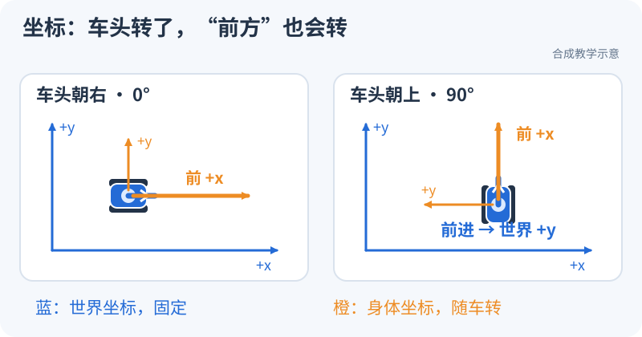
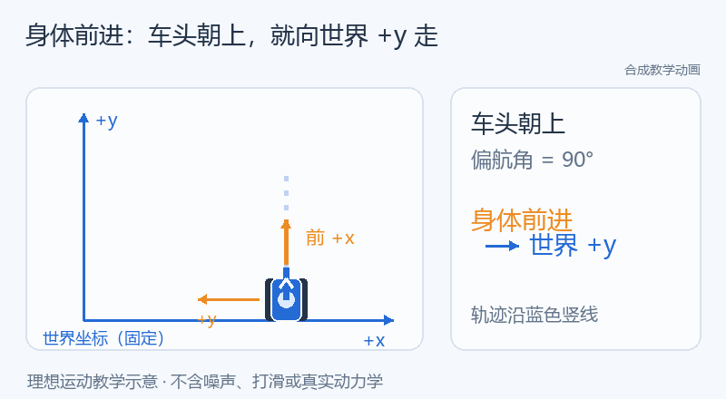

# 消息怎么传到节点，车头转了又往哪走？（S1–S2）

<small>整理与维护：24cst朱鑫鹏</small>

**先看消息怎么传**：两个节点先约好同一个 Topic 名，再看数字能不能从左边送到右边。

<div data-nav-visuals="查看消息传递示意图"></div>


<iframe src="../visuals/playground.html?scene=messages" loading="lazy" width="100%" height="620" style="border:0;border-radius:12px" title="消息传球：比较同名与不同名Topic"></iframe>

[单独打开演示](../visuals/playground.html?scene=messages)

## 现在试一下：接通，再接错（5分钟）

1. 保持“名字相同”，点“开始”。看发送数和接收数一起增长。
2. 改成“名字不同”。只观察两个计数：哪边还在加，哪边停在 0？
3. 改回“名字相同”。看接收是否恢复，用一句话写下刚才改了哪条通信地址。

**预期**：发送节点可以一直工作，接收节点却可能什么也收不到；先查两端是否接在同名 Topic，再查后面的类型和 QoS。

## 再看车头：转了90°，“向前”还是同一个方向吗？

**先看车体轴和世界轴**：蓝色世界轴固定在地上，橙色车体轴跟着车头转。

<div data-nav-visuals="查看坐标示意图与转向动图"></div>





<iframe src="../visuals/playground.html?scene=motion" loading="lazy" width="100%" height="620" style="border:0;border-radius:12px" title="车体与世界：车头转90度后的前进和侧移"></iframe>

[单独打开演示](../visuals/playground.html?scene=motion)

**现在试一下（3分钟）**：选“车头 0°”和“向前”，点“开始”；再选“车头 90°”和“向前”，重新开始；最后选“向左侧移”，比较轨迹。

**预期**：车头朝世界 +y 时，车体 +x 的“向前”会沿世界 +y 移动。`body` 指随车转的身体方向，`world` 指固定的世界方向；速度属于哪一套坐标，必须先说清。

**看懂了再往下读**：先展开第1节把演示接线换成自己的 ROS 节点；第2、3节再解释 TF 和速度公式，第4节处理时间与回放。页面演示只做教学，不连接真实底盘。

<link rel="stylesheet" href="../visuals/reader.css">
<script src="../visuals/reader.js" defer></script>

<div data-nav-fold></div>

## 真正运行ROS节点前，要准备什么？

原课程：**S1–S2：ROS2、TF、时间与全向运动**。

前置：[最小环境](../onboarding/environment.md)已通过。目标是写小节点、看懂通信关系，并用实验区分通信、坐标和时间问题。先在独立开发机完成；本页的教学 Topic 不接真实底盘。

## 1. 第一个自己的节点

### 1.1 把通信想成两个人按约定传数字

publisher（发布者）每0.1秒发送一个序号，subscriber（订阅者）收到后打印。这两个程序不必互相调用函数，但必须约定**通道名和数据格式**。package 是可构建/安装的代码单位，workspace 是组织这些包的工作目录，node 是运行中的通信参与者；一个进程也可以装多个节点，所以“开了几个进程”和“有几个节点”不能混为一谈。

例如 `rate_hz=10` 表示每秒10次，定时器间隔是 `1/10=0.1 s`。队列深度20表示最多保留一定数量的待处理数据，不能读成20 Hz。若实际接收日志是 `0,1,2,4`，它提示有一帧未被观察到，但可能来自发布、传输、处理或日志节流，先查端点和计数，不直接判驱动丢包。

知识库已经有可读的教学实现：路径 `training/ros2_ws/src/nav_training/nav_training/sequence.py` 的[`SequencePublisher` L10–25](https://github.com/Navigator-Vision-Algorithm-Team/knowledge-base/blob/main/training/ros2_ws/src/nav_training/nav_training/sequence.py#L10-L25)和[`SequenceSubscriber` L28–39](https://github.com/Navigator-Vision-Algorithm-Team/knowledge-base/blob/main/training/ros2_ws/src/nav_training/nav_training/sequence.py#L28-L39)。沿以下四步读，不必先理解所有 Python 语法：

1. 第12行给节点起名并放进 `/nav_training`；第13–15行读启动参数。
2. 第16行声明发送 `Int64`，第18行约定每隔 `1/rate` 调用 `publish_next`。
3. 第22–23行先发送当前序号，再加1；消息格式和频率在不同位置决定。
4. 第34行把订阅与 `receive` 回调连接；第38行转发收到的消息，第39行的日志有1秒节流，日志行数因此不等于接收消息数。

先运行并画出这套示例的接线，再按T1要求写自己的节点。现有示例的名字是 `sequence_source/sequence_sink`，下面自写C++练习用 `training_publisher/training_subscriber`，查询时应使用实际名字。

T1 在 `nav_training_ws` 添加 publisher/subscriber：发布带递增序号的数据，订阅端输出序号、接收时间和计数。再把发布频率设为参数，用 Python launch 同时启动节点、设置 namespace 和 remap。

从空包到可运行代码，按顺序做三个官方 Humble 章节：[C++ pub/sub](https://github.com/ros2/ros2_documentation/blob/humble/source/Tutorials/Beginner-Client-Libraries/Writing-A-Simple-Cpp-Publisher-And-Subscriber.rst) → [C++ 参数](https://github.com/ros2/ros2_documentation/blob/humble/source/Tutorials/Beginner-Client-Libraries/Using-Parameters-In-A-Class-CPP.rst) → [launch 入门](https://github.com/ros2/ros2_documentation/blob/humble/source/Tutorials/Intermediate/Launch/Creating-Launch-Files.rst)。章节中的包名可以保留在另一个练习包里；迁移到 `nav_training` 时要一致修改 CMake、依赖与运行名。

在 `src/training_publisher.cpp`、`src/training_subscriber.cpp` 完成自己的节点后，CMakeLists.txt 在 `ament_package()` 之前至少需要以下目标和安装规则；这段只负责构建和安装，不会自动生成节点源码：

```cmake
add_executable(training_publisher src/training_publisher.cpp)
ament_target_dependencies(training_publisher rclcpp std_msgs)
add_executable(training_subscriber src/training_subscriber.cpp)
ament_target_dependencies(training_subscriber rclcpp std_msgs)
install(TARGETS training_publisher training_subscriber
  DESTINATION lib/${PROJECT_NAME})
# 创建 launch 目录并保存 training.launch.py 后再加入这一行
install(DIRECTORY launch DESTINATION share/${PROJECT_NAME})
```

重新 `colcon build --symlink-install --packages-select nav_training`，source 后分别用 `ros2 run nav_training training_publisher`、`ros2 run nav_training training_subscriber` 验证，再用 `ros2 launch nav_training training.launch.py` 验证一起启动。节点名和 Topic 在源码/launch 中设为下例所用名称，或用查询结果替换。T1 先用启动参数设置频率，动态改频率是扩展项，不能以参数值改变就认为定时器周期自动改变。

必学：workspace/package/node、消息类型、Topic、参数、Service、Action、QoS、日志和 launch。Service 适合短请求，Action 适合有持续反馈、可取消的长任务；导航 Goal 的“已接受”不等于“已到达”。

具体地说，连续雷达数据用 Topic；一次查询地图用 Service；“去到2米外，再告诉我走了多远、是否完成、能否取消”用 Action。参数是节点的设置，如发布频率；launch 负责把设置与节点启动组织起来。QoS 是通信双方对可靠性、历史保存等行为的约定，不是给消息换一个名字。Best Effort 发布者不能满足 Reliable 订阅者要求，两个端点即使同名同类型也可能收不到数据。

```bash
# 在两个教学节点已运行的终端旁执行
ros2 node list
ros2 node info /training_publisher
ros2 topic list -t
ros2 topic info /training_data --verbose
ros2 topic echo /training_data --once
ros2 topic hz /training_data
ros2 param list /training_publisher
ros2 action list -t
```

名称由自己的代码决定，若不一致先用 list 查询，不照抄改生产配置。故障练习：将订阅 Topic 改错一次，再构造 Best Effort 发布/Reliable 订阅不兼容一次；先保留现象、端点与 QoS 证据再修。`hz` 是观察端收到的数据速率，受 QoS 和工具负载影响，不能直接当作驱动真实采样率。

真实代码从 [loam_interface](https://github.com/Navigator-Vision-Algorithm-Team/Navigation-2027/blob/183a4109b0de2030bb8970a54654937c8b039ba9/ros_ws/src/pb2025_sentry_nav/loam_interface/src/loam_interface.cpp) 开始读：找构造函数、declare/get_parameter、create_subscription、回调、create_publisher。先不推导滤波公式。

这条阅读路线的真实路径是 `ros_ws/src/pb2025_sentry_nav/loam_interface/src/loam_interface.cpp`：[`LoamInterfaceNode` L23–51](https://github.com/Navigator-Vision-Algorithm-Team/Navigation-2027/blob/183a4109b0de2030bb8970a54654937c8b039ba9/ros_ws/src/pb2025_sentry_nav/loam_interface/src/loam_interface.cpp#L23-L51)里，`declare_parameter` 给出接口/默认值，`get_parameter` 取当前值；第43–44行固定输出名，第46–51行从参数读取输入名并绑定回调。把它抄成“输入名从哪来→哪种消息→哪个回调→哪个输出”，就完成了第一遍源码阅读。

Action 练习先按[自定义 Action](https://github.com/ros2/ros2_documentation/blob/humble/source/Tutorials/Intermediate/Creating-an-Action.rst)建立 `action_tutorials_interfaces/Fibonacci.action`，再跟随 [Humble C++ Action 教程](https://github.com/ros2/ros2_documentation/blob/humble/source/Tutorials/Intermediate/Writing-an-Action-Server-Client/Cpp.rst)编译服务端/客户端。GitHub 原文的 `literalinclude` 指向源码，可直接查看 [client.cpp](https://github.com/ros2/ros2_documentation/blob/humble/source/Tutorials/Intermediate/Writing-an-Action-Server-Client/scripts/client.cpp) 和 [server.cpp](https://github.com/ros2/ros2_documentation/blob/humble/source/Tutorials/Intermediate/Writing-an-Action-Server-Client/scripts/server.cpp)。

官方客户端通常只发目标，T1 需要额外实现取消：在 goal_response 回调保存非空 goal_handle，在第一次或第二次 feedback 回调中用布尔标记保证只请求一次 `client_ptr_->async_cancel_goal(goal_handle)`；不要在回调里阻塞等待。记录取消响应，并在 result 回调检查 `rclcpp_action::ResultCode::CANCELED`。服务端需要接受取消，并在执行循环中检查 `is_canceling()` 后调用 `canceled(result)`。选择足够长的 Fibonacci 任务避免取消前已完成。提交自己的改动与实际状态，不能只关闭客户端充当取消。

Action 至少有三个时刻：服务端接受任务、过程中收到反馈、最后收到结果。取消响应说“服务端同意处理取消”，最终 `CANCELED` 才说明任务以取消结束。知识库路径 `training/ros2_ws/src/nav_training/nav_training/fibonacci_client.py` 的[`run` L38–65](https://github.com/Navigator-Vision-Algorithm-Team/knowledge-base/blob/main/training/ros2_ws/src/nav_training/nav_training/fibonacci_client.py#L38-L65)给了现成 Python 阅读对照：第42行发目标，第44行检查是否接受，第47行取得结果 future，第54–55行发取消并检查响应，第57–65行等待并检查最终状态。它计算数列而不控制机器人，适合先把任务契约学明白。

## 2. TF 与命名空间

坐标变换采用 `p_A = T_A_B · p_B`：T_A_B 把 B 中的坐标转换到 A。理解平移、旋转、齐次变换和四元数归一化；不需要先学李群推导。米、秒、弧度与右手系见 [REP-103](https://github.com/ros-infrastructure/rep/blob/master/rep-0103.rst)。

### 2.1 同一个点，为什么会有两组坐标

你站在教室门口，用教室方向描述桌子位置；机器人用自身前方描述同一张桌子。桌子没动，参考系换了，数字就会变。二维写法是 `p_A=R(yaw)·p_B+t`：先把方向旋转到A，再加B原点在A中的位置。右手约定中x向前、y向左、z向上，正yaw从上往下看是逆时针。

设雷达原点在底盘中为 `(0.2,0)`，雷达相对底盘转90°；雷达测到一个点 `(1,0)`。旋转后是 `(0,1)`，再加安装平移得到底盘坐标 `(0.2,1)`。下方静态TF练习设 yaw=0，同一个雷达点则变成 `(1.2,0)`，z还要加0.3。**给点换 `frame_id` 不会做这些运算**。本节0.2/0.3是教学假设，实车安装值要读模型。

四元数是表达三维旋转的一种格式，不是把roll/pitch/yaw直接填到x/y/z。仅绕z转90°时，`(x,y,z,w)=(0,0,sin(45°),cos(45°))≈(0,0,0.7071,0.7071)`；零旋转是 `(0,0,0,1)`，四个分量全零不合法。组合变换也有顺序：`T_odom_base=T_odom_lidar·T_lidar_base`，不能交换两项。

把“外参只差一点”变成可计算的问题：距离雷达 1 m 的点，若 yaw 多填 5°，方向误差约为 8.7 cm；同方向更远的点偏差更大。下面是固定合成输入的几何对照，先预测向哪侧偏，再按[对照实验](../training/controlled-experiments.md)复算和恢复。它不代表实车标定精度。


真实对应位置是主仓库路径 `ros_ws/src/pb2025_sentry_nav/sensor_scan_generation/src/sensor_scan_generation.cpp` 的[`laserCloudAndOdometryHandler` L62–85](https://github.com/Navigator-Vision-Algorithm-Team/Navigation-2027/blob/183a4109b0de2030bb8970a54654937c8b039ba9/ros_ws/src/pb2025_sentry_nav/sensor_scan_generation/src/sensor_scan_generation.cpp#L62-L85)：第71行读里程计位姿，第72–73行查安装关系，第75–76行按顺序相乘，第78–81行分别发布TF和Odometry，第84行用逆变换把点云转回雷达坐标。先在纸上标注每个矩阵的“源→目标”，再对照变量名，避免凭名字猜方向。

用教学帧 `training_base`、`training_lidar` 做静态实验，避免和实车帧重名：

```bash
ros2 run tf2_ros static_transform_publisher --x 0.2 --y 0.0 --z 0.3 \
  --roll 0 --pitch 0 --yaw 0 \
  --frame-id training_base --child-frame-id training_lidar
```

另一个终端运行 `ros2 run tf2_ros tf2_echo training_base training_lidar`，应看到设定平移和单位旋转。RViz Fixed Frame 设 `training_base`，添加 TF，解释为什么雷达原点在该位置。不要把所有传感器机械地串成一条链；本队树见[系统地图](../system/README.md)。

本队 bringup 将 TF topic 放入机器人 namespace，但 frame ID 保留 `map`/`odom` 等。只读检查示例（节点已启动且使用默认 namespace）：

```bash
export ROBOT_NS=/red_standard_robot1
ros2 run tf2_ros tf2_echo map base_footprint --ros-args \
  -r /tf:=$ROBOT_NS/tf -r /tf_static:=$ROBOT_NS/tf_static
ros2 run tf2_tools view_frames --ros-args \
  -r /tf:=$ROBOT_NS/tf -r /tf_static:=$ROBOT_NS/tf_static
ros2 topic info "$ROBOT_NS/tf" --verbose
ros2 topic info "$ROBOT_NS/tf_static" --verbose
```

工具参数以本机 `--help` 为准。若回放，工具也需要适配回放时间；不要同时混入另一台机器同名帧。报告每条边的发布者、静态/动态、时间源和所属模式；一个 child 在同一树里不能有两个父亲。

### 2.2 namespace 管通信名字，frame ID 管空间名字

相对 Topic `sequence` 在 `/nav_training` 下解析为 `/nav_training/sequence`；绝对 Topic `/sequence` 保持原名。可以把namespace理解为通信地址的文件夹，但TF消息里的 `training_base` 是消息内容，不会自动改成 `/nav_training/training_base`。

知识库路径 `training/ros2_ws/src/nav_training/launch/bad_topic.launch.py` 的[故障入口](https://github.com/Navigator-Vision-Algorithm-Team/knowledge-base/blob/main/training/ros2_ws/src/nav_training/launch/bad_topic.launch.py)把订阅名设为 `/sequence`；实际接线由路径 `training/ros2_ws/src/nav_training/nav_training/presets.py` 的[`description` L10–29](https://github.com/Navigator-Vision-Algorithm-Team/knowledge-base/blob/main/training/ros2_ws/src/nav_training/nav_training/presets.py#L10-L29)生成。发布者仍发相对 `sequence`，所以一端在 `/nav_training/sequence`，另一端在 `/sequence`。这两个地址都能出现在列表里，却没有同一条数据流。查 `topic info --verbose` 后再用 `sink_topic:=sequence` 复测，把“故障前、根因、修复后”各保存一次。

对应主系统要读路径 `ros_ws/src/pb2025_sentry_nav/pb2025_nav_bringup/launch/bringup_launch.py` 的[命名空间/TF remap L140–197](https://github.com/Navigator-Vision-Algorithm-Team/Navigation-2027/blob/183a4109b0de2030bb8970a54654937c8b039ba9/ros_ws/src/pb2025_sentry_nav/pb2025_nav_bringup/launch/bringup_launch.py#L140-L197)。查TF工具若仍订阅根 `/tf`，即使机器人TF在 `/red_standard_robot1/tf` 正常发布，工具也会像“什么都没发生”。

## 3. 理想全向运动模型

T2 自写教学节点：输入 `/training/cmd_vel`（Twist），输出 `/training/odom`（Odometry）和 `training_odom→training_base` TF；用实际 dt 积分。

创建独立运动包可用 `ros2 pkg create --build-type ament_cmake nav_training_motion --dependencies rclcpp geometry_msgs nav_msgs tf2 tf2_ros`。若沿用旧包，将这些依赖加入 package.xml、CMake 的 find_package 和 ament_target_dependencies；消息与 TF 发布方式参考[Humble C++ tf2 广播器](https://github.com/ros2/ros2_documentation/blob/humble/source/Tutorials/Intermediate/Tf2/Writing-A-Tf2-Broadcaster-Cpp.rst)。

```text
xdot = cos(yaw) * vx - sin(yaw) * vy
ydot = sin(yaw) * vx + cos(yaw) * vy
yawdot = wz
x += xdot * dt; y += ydot * dt; yaw += wz * dt
```

逐行理解：第一、二行将车体速度旋转到世界方向；第三行给角速度关系；最后一行才乘上秒数累积位置和角度。以下是只用于手算的理想例子，初始位置都为0，忽略加速过程：

| 初始yaw与输入 | 持续时间 | 预期变化 |
|---|---|---|
| yaw=0，vx=0.2、vy=0、wz=0 | 1 s | x增加0.2 m |
| yaw=0，vx=0、vy=0.2、wz=0 | 1 s | y增加0.2 m，车向左侧移 |
| yaw=π/2，vx=0.2、vy=0、wz=0 | 1 s | x约不变，y增加0.2 m，仍是沿车头前进 |
| vx=vy=0，wz=π/2 | 1 s | 只转90°，位置不变 |

组合运动时yaw不断变化，不能把第一帧的方向固定用整整1秒。知识库路径 `training/ros2_ws/src/nav_training/nav_training/core.py` 的[`integrate_body` L29–47](https://github.com/Navigator-Vision-Algorithm-Team/knowledge-base/blob/main/training/ros2_ws/src/nav_training/nav_training/core.py#L29-L47)采用恒定车体Twist的圆弧精确积分：第34行求本步转角，第38–42行处理半步方向和圆弧缩放，第43–45行更新位置和yaw。它与上面的Euler教学式目的相同，实现更适合组合运动；读代码时不要把两者说成逐行相同。

vx/vy 是机器人坐标系速度；Odometry 的 pose 对应 header.frame_id，twist 按 child_frame_id 语义填写。处理第一帧、dt≤0、时钟回跳、输入超时和角度归一化。至少做直行、侧移、纯旋转、yaw=90° 后前进、组合运动五例。

这只是运动积分和消息接口教学。没有轮速反馈、碰撞、打滑和传感器噪声，不能称为真实里程计，也不能用于给 Nav2 实车验收打分。

再读知识库路径 `training/ros2_ws/src/nav_training/nav_training/ideal_model.py` 的[`IdealModel` 源码](https://github.com/Navigator-Vision-Algorithm-Team/knowledge-base/blob/main/training/ros2_ws/src/nav_training/nav_training/ideal_model.py)：`receive_command` 读Twist并限制输入，`tick` 用节点时钟推进模型，再把同一个pose分别填进Odometry和TF。注意它的教学静态安装为x=0.2、z=0.1，与本页手工静态TF例子的z=0.3不同；做T2时选择一套清楚记录，不能同时发布两条同child的静态TF。

### 3.1 把运动节点接成一个巡逻任务

完成单项通信和运动后，做[轻量巡逻综合练习](../training/patrol-workshop.md)：目标点列表通过 Action 提交，位姿从 Odometry 进入控制节点，Twist 驱动教学模型，到点后通过 Service 写日志。任务层决定“去哪个点、等待还是结束”，控制层决定“这一刻发多少速度”，模型层负责“这段时间移动了多少”。把三个职责拆开，取消或断流时就能沿接口查到停止发生在哪一层。

先运行固定离线案例，解释正常、障碍等待、取消和超时的状态变化；再按页内接口在个人工作区实现 ROS 版。必须同时展示正常移动和停止后的零速度、反馈与终态，离线通过不能代替真实节点通信记录。

## 4. bag、时间与 QoS 一起学

先读 [ROS 时间设计](https://design.ros2.org/articles/clock_and_time.html)、[Humble QoS](https://github.com/ros2/ros2_documentation/blob/humble/source/Concepts/Intermediate/About-Quality-of-Service-Settings.rst)、[rosbag2 Humble](https://github.com/ros2/rosbag2/tree/humble)。

### 录制：先有清单，再收数据

bag 可以看作带时间顺序的“消息录像”：它保存发布过什么，不能根据你后来给的新速度改变机器人旧轨迹。传感器采样时刻、header.stamp、观察工具收到消息的时刻、程序墙钟是不同的量。10.00 s采到一帧、10.04 s才收到，数据仍属于10.00 s；用收到时刻查动态TF，可能把它放在机器人已经转过去的位置。

S1 先录自己的 `/training_data`：`ros2 bag record -o training_intro /training_data`，结束后 `ros2 bag info training_intro`，检查类型、时长、数量。后续由负责人采集本队原始 LiDAR/IMU、关节状态、TF、定位输出及必要导航诊断数据，按[数据清单](../maintenance/README.md)登记。

不要无条件给实车录制加 `--use-sim-time`；只有原系统依赖仿真时钟且 `/clock` 正常时才使用相应选项。录制完成当场检查关键 topic 和静态 TF 是否齐全。

先用知识库路径 `training/datasets/synthetic-v1/time_anomalies/timestamps.csv` 的[时间异常样本](https://github.com/Navigator-Vision-Algorithm-Team/knowledge-base/blob/main/training/datasets/synthetic-v1/time_anomalies/timestamps.csv)手算相邻差：100.0→100.1→100.1→100.05→100.45→100.55秒，依次出现重复、回跳、0.4秒间隔。不要先排序，排序会抹掉“到达顺序里发生了回跳”这个证据。样本生成位置是知识库路径 `training/tools/generate_data.py` 的[`write_time_anomalies` L152–163](https://github.com/Navigator-Vision-Algorithm-Team/knowledge-base/blob/main/training/tools/generate_data.py#L152-L163)，只用于时间练习，不是实车传感器记录。

### 回放分为两种，不能混在一起

| 模式 | 回放什么 | 同时不应启动什么 |
|---|---|---|
| 系统观察 | 已记录的输入、输出、完整 TF；输出接 RViz/观察工具 | 同名算法输出发布者与底盘执行端 |
| 重跑算法 | 原始 LiDAR/IMU 和必要关节/静态 TF；具体按本次算法输入白名单 | 旧 LIO、旧 map→odom、旧 odom→base TF 等与重算结果重复的发布者 |

在独立开发机/独立 ROS domain 中进行，不加载真实串口和驱动执行端。先执行 `ros2 bag info BAG_DIR`，这里 `BAG_DIR` 替换为已登记数据集路径。再根据清单准备节点的 `use_sim_time=true`，最后 `ros2 bag play BAG_DIR --clock --topics ...`（`...` 必须替换成数据集中确认过的白名单；完整语法查本机帮助）。同一回放环境只保留一个预期 `/clock` 源。

`--clock` 不会修好传感器原始错误时间戳。回放暂停/跳转/重播会考验节点状态，重新开始实验时必要地重启算法，记录预热区间。bag 不响应新 cmd_vel，不能证明闭环控制或避障成功。

两个关键推导：原记录相邻位移0.02 m、消息时间差0.1 s，对应0.2 m/s；若二倍速回放使回调墙钟间隔变成0.05 s，用墙钟差分就得到0.4 m/s，而消息本身仍描述0.2 m/s。主仓库路径 `ros_ws/src/pb2025_sentry_nav/sensor_scan_generation/src/sensor_scan_generation.cpp` 的[`publishOdometry` L130–154](https://github.com/Navigator-Vision-Algorithm-Team/Navigation-2027/blob/183a4109b0de2030bb8970a54654937c8b039ba9/ros_ws/src/pb2025_sentry_nav/sensor_scan_generation/src/sensor_scan_generation.cpp#L130-L154)正是用 `steady_clock` 算dt，适合练习辨别时间来源；上面的数值是解释机制的假设，不是已采集的该节点输出。

另一种边界是旧命令有效期。知识库路径 `training/ros2_ws/src/nav_training/nav_training/core.py` 的[`TimedModel.active_twist/step` L79–109](https://github.com/Navigator-Vision-Algorithm-Team/knowledge-base/blob/main/training/ros2_ws/src/nav_training/nav_training/core.py#L79-L109)会在命令有效期到头时截断运动，并在时钟回跳时清除缓存：0.2 m/s命令只有效0.5 s，之后没有新命令，累计应为0.1 m，而不是无限向前。这个超时规则属于教学模型，不能迁移成实车停车保证。

先用自己的教学数据走完整命令：停止原来的 publisher，在保存了 `training_intro` 的目录执行 `ros2 bag play training_intro --clock --topics /training_data`；另一终端执行 `ros2 topic echo /training_data`，应重新看到录制的序号。需要检查依赖 ROS 时间的订阅节点时，用 `ros2 run nav_training training_subscriber --ros-args -p use_sim_time:=true` 启动，并通过 `ros2 param get /training_subscriber use_sim_time` 验证。T2 的 TF bag 可用 `rviz2 --ros-args -p use_sim_time:=true` 观察，Fixed Frame 设 `training_odom`；`ros2 param get /rviz2 use_sim_time` 和 `ros2 topic echo /clock --once` 用于核对时间源。S1 的 std_msgs 序号 bag 不包含 TF，不能要求它在 RViz 显示机器人。

QoS 先通过端点证据定位。仅在确实不兼容时，按照[官方覆盖说明](https://github.com/ros2/ros2_documentation/blob/humble/source/How-To-Guides/Overriding-QoS-Policies-For-Recording-And-Playback.rst)创建覆盖 YAML；`/tf_static` 的 transient local 历史数据也要验证。

## 5. 常见错误与通过标准

| 现象 | 优先检查 | 不应直接做 |
|---|---|---|
| 能看到 Topic，但订阅没数据 | 完整名字、类型、端点 QoS、发布计数 | 先重装 ROS |
| TF 树有边但查某个时刻失败 | header.stamp、use_sim_time、/clock、缓存、数据是否停止 | 随便加大 tolerance |
| 单车正常，多机帧乱 | ROS domain、namespace、TF topic remap、frame ID、重复发布者 | 把所有 topic 改成全局名 |
| 侧移方向错 | vx/vy 定义、yaw 旋转、接口坐标约定 | 直接把某轴乘 -1 掩盖问题 |
| 倍速回放速度变了 | 时间差分使用消息 stamp 还是墙钟/steady_clock | 把回放结果当实车速度结论 |

按 [T1–T3](../assignments/README.md)提交代码、TF 图和至少两个不同根因的故障记录。完成后进入[传感器与定位](../sensor-lio/README.md)。

合格的故障记录要能被别人复核。比如“订阅不刷新”：先记节点列表有source和sink，再记source实际发布 `/nav_training/sequence`、sink实际订阅 `/sequence`，最后记修复参数后收到递增序号。若只有一张“修好了”的截图，别人无法区分你修了名字、QoS还是根本没启动节点。上述现成故障入口给的是已知根因；第二份记录应换成时间或QoS原因，练习不依赖答案倒推证据。

具体官方章节与进阶实验见[ROS2 系统自学](../self-study/ros2-systems.md)；二维变换和时间差分可先做[带解答源码练习](../assignments/reading-labs.md)。
