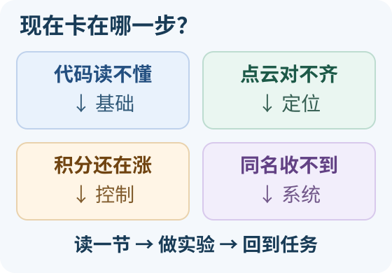

# 自学选路：只补现在卡住的一节

<small>整理与维护：24cst朱鑫鹏</small>

先把缺口写成一句具体的话，再选一节阅读和一个小实验。这里用来解决当期任务的卡点，或在必修交付后选一项拓展；**不用从头刷完所有资源**。



## 哪一句最像你现在的卡点？

| 当前缺口 | 本次只读这一节 | 回到任务前，能说明什么 |
|---|---|---|
| 构造函数看过了，不懂回调何时运行 | [基础 F3：最小语法与读代码顺序](foundations.md#f3c-812) | 谁建立订阅，哪条输入触发哪个回调 |
| `map→odom` 还在发，却不能确认点云对齐 | [定位第四段：small_gicp 与本队封装](localization.md#5-small_gicp-57) | 配准成功与持续发布 TF 为什么是两条证据 |
| 输出速度限幅了，积分状态为什么还在涨 | [控制 B：离散时间实验](planning-control.md#b) | 一步 PID 更新中，输出限幅与积分状态的关系 |
| 两端 Topic 同名，消息仍收不到 | [系统第 2 节：QoS 兼容性](ros2-systems.md#2-qos) | 发布端提供什么、订阅端要求什么，怎样做最小对照 |

**现在试一下（5 分钟）**：选最像自己的一行，先读该节的解释，写出“我还缺哪条证据”，再选它的小实验。能用原始输入和观察回答问题，就回到当前任务；结果不符时只补对应知识点。先修不足时按该节提示退回一小步。

<link rel="stylesheet" href="../visuals/reader.css">
<script src="../visuals/reader.js" defer></script>

<div data-nav-fold></div>

## 先选适合自己的入口

这里把“可以学什么”变成可执行的阅读与实验路线。先按[逐周任务单](../onboarding/weekly-plan.md)完成当期必修，再选一个方向深入。每个方向都给先修、指定章节、真实代码入口、小实验和验收；完成阅读不等于完成作业。

假设你在 RViz 里看到地图和机器人，发目标却没有路径。此时从“学习更强的 PID”开始，很难回答眼前的问题；先查 Goal 是否进入、Planner 是否 active、起终点是否合法，才能缩小范围。自学选题也一样：不是先认领“我要学 SLAM”这么大的名词，而是选一句可验证的问题。例如“初值 yaw 偏 60° 时 GICP 是否会收敛到错误位置”，就能接到 [performRegistration 的初值与收敛分支][study-gicp]和定位合成实验。

| 你现在遇到的问题 | 从哪里开始 | 本轮学习结束时应留下什么 |
|---|---|---|
| 从没写过程序，终端也不熟 | [基础补课：Linux、Git、C++、CMake、Python](foundations.md) | 一个能构建的小程序、一份别人能执行的 README |
| 看见节点代码，不知从哪一行读起 | [源码导读与带解答练习](../assignments/reading-labs.md) | 自己填的接口表、推导、诊断证据链 |
| 想知道每周具体学到哪里 | [16 周任务单](../onboarding/weekly-plan.md) | 每周一个小交付，阶段末按 T0–T10 验收 |
| 想研究点云、漂移、滤波、重定位 | [数学与定位专题](localization.md) | 合成数据实验→配准对照→本队定位诊断 |
| 想研究路径、PID、全向运动、Nav2 插件 | [规划与控制专题](planning-control.md) | 栅格搜索对照、全向控制实验、插件适用性报告 |
| 想解决“偶发卡住、收不到、很慢、无法停止” | [ROS2 与系统工程专题](ros2-systems.md) | 可复现故障、性能证据、修复与回归方案 |

## 两种节奏

阅读、实验、记录要围绕同一个问题。例如本周研究坐标旋转，先算 yaw=π/2 时 `(0.2,0)` 如何变为 `(0,-0.2)`，再看 [transformVelocity][study-fake]，最后写明输入/输出 frame 和符号约定。若数值、源码和解释已对上，本周可以结束；不需要为了“学够时间”再读一整本控制书。若结果不符，则记录差异并补相应知识点，而不是换一个更复杂的算法名。

**基础学习**：每周 6–8 小时中，约 2 小时阅读、3–4 小时实验、1 小时记录、半小时与同伴复盘。只读该周的指定小节，不把一整套课程作为入门门槛。英文慢的同学可用页面翻译，但保留参数名、单位、函数名和错误原文。

**有余力的学习**：当周必修已交付后，每周增加 2–3 小时，连续 4–6 周完成一个小项目。定位、规划、控制、系统可分别选题；规划与控制共用一册，因为路径约束和底盘运动必须一起判断。不要求所有人同时学完四个方向。

| 起点 | 推荐第一项拓展 | 暂缓的内容 |
|---|---|---|
| S0–S1 | 用 Git 做一次冲突恢复；给教学包补构建说明 | 大型 SLAM 工程、全套 C++ 模板元编程 |
| S2 | 二维坐标变换、时间戳检查、合成轨迹 | 直接推完整 ESKF/李群滤波 |
| S3 | 噪声统计、点云降采样、ICP 初值对照 | 用一条漂亮轨迹宣布定位算法胜出 |
| S4 | 搜索代价与启发式；路径可行性检查 | 把 JPS/D* Lite/MINCO 都变成必修实现 |
| S5 | 全向 PID、取消/超时、BT 状态、性能瓶颈 | 直接在比赛分支切换 Controller 或 Planner |
| S6 之后 | 经维护者选题的真实模块改动和回归 | 未验收就承担整机改版 |

## 怎样读一份外部资料

1. 先写一个问题，例如“为什么有 `map→odom` 仍不能判定重定位成功”。带着问题查对应章节。
2. 记下版本和适用假设：ROS 发行版、消息类型、坐标约定、差速或全向、数据时间单位。
3. 在本队固定版本源码里找对应输入、状态、输出、失败路径；教程例子与本队不同之处单独列出。
4. 做最小实验，保存原始输入和失败样本。读完论文仍不能说清怎么测，就先缩小问题。
5. 写 150–300 字结论：回答了什么、证据是什么、对本队有什么用、还有什么不能推断。

不需要通读全部论文。第一次先看问题定义、框图、输入输出、实验设置和局限；准备修改模块时再推公式、读实现。公开视频和作者开放版本优先；付费书是可选项，不是完成本路线的必要条件。

拿滤波资料练一次“迁移到源码”：教材的状态可能只有 `[位置,速度]` 两个量，本队 [common_lib.h][study-state]却有位置、姿态、速度、外参、偏置等状态。不要把教材变量名逐字贴过去；先列状态维度和单位，再到 `Estimator.cpp`找传播和观测函数。两者共有的是“预测→测量修正”的结构，具体维度、时间和旋转表示必须由本队实现回答。

## 拓展项目交付模板

```text
选题 / 先修任务 / 预计投入：
要回答的一个具体问题：
阅读材料 URL、章节、访问日期、版本：
本队对应 commit、文件、函数与接口：
固定输入、基线、唯一变化因素、重复次数：
指标及计算方法 / 原始数据和运行命令：
结果（包含失败） / 原因 / 局限：
是否建议改本队代码、适用场景、回退方式：
同伴复现记录 / 导师评语 / 未验证项：
```

拓展合格要求：同伴能复现；指标定义完整；至少解释一个失败例；能指出教程与本队的一处差异。提出“目前没有证据支持换算法”也可以是合格结论。完成拓展不能代替 [T8 实车准入](../assignments/README.md)。

**一个填写例子（教学设计，尚非运行结果）**：问题写“重复时间戳应怎样处理”，输入固定为 `0、1、1、0.5 s`；基线取 [TimedModel.step][study-time]的行为，观察首帧、重复时间、回跳后位姿与旧命令。指标写“是否继续积分、clock_resets、回跳后 active_twist”，而不是泛泛“程序稳定”。另一人拿同样输入重算后，你才能写实测结论；若只读过源码，就写源码预测。具体到这一步，项目才有可交付的边界。

## 版本与链接维护

本批资源核对日期为 **2026-09-14**。本队代码链接固定为 [Navigation-2027@183a410](https://github.com/Navigator-Vision-Algorithm-Team/Navigation-2027/tree/183a4109b0de2030bb8970a54654937c8b039ba9)。外部网站章节可能调整，按标题定位；学习报告记录自己读到的版本。

ROS2 优先 Humble 文档；官网访问受限时使用官方文档仓库 `humble` 分支。Nav2 和 BehaviorTree.CPP 也要按 Humble 依赖核对，不能把 Rolling/新版示例原样抄入本队。中文教程提供辅助解释，技术结论回到对应版本原文和源码确认。

维护者每学期检查失效链接、版本和作业成本。新增资源必须填“读哪部分、解决哪道题、何时停止”；不把没有任务对应的长书单堆进新人首页。

队内固定 SHA 链接用于回答“当时这份源码到底怎么写”，教学 `main` 链接用于找到当前配套材料。复现实验还需记录自己的知识库 commit；若 [training/core.py][study-time]后来改了规则，旧报告应保留旧版本与输入，不能只留下会变化的网页地址。链接可点击是入口，函数、版本和证据才使结论可追溯。

[study-gicp]: https://github.com/Navigator-Vision-Algorithm-Team/Navigation-2027/blob/183a4109b0de2030bb8970a54654937c8b039ba9/ros_ws/src/pb2025_sentry_nav/small_gicp_relocalization/src/small_gicp_relocalization.cpp#L134-L166
[study-fake]: https://github.com/Navigator-Vision-Algorithm-Team/Navigation-2027/blob/183a4109b0de2030bb8970a54654937c8b039ba9/ros_ws/src/pb2025_sentry_nav/fake_vel_transform/src/fake_vel_transform.cpp#L147-L154
[study-state]: https://github.com/Navigator-Vision-Algorithm-Team/Navigation-2027/blob/183a4109b0de2030bb8970a54654937c8b039ba9/ros_ws/src/pb2025_sentry_nav/point_lio/include/common_lib.h#L18-L41
[study-time]: https://github.com/Navigator-Vision-Algorithm-Team/knowledge-base/blob/main/training/ros2_ws/src/nav_training/nav_training/core.py#L79-L109
