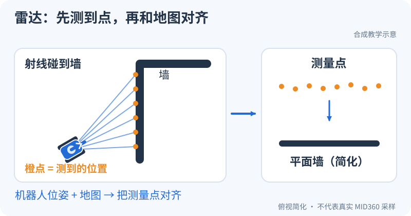

# 雷达打在墙上的点，怎么变成车的位置？

<small>整理与维护：24cst朱鑫鹏</small>

**先看一面墙**：雷达先得到一批测量点，定位程序再把这些点与地图放到一起比较。



## 现在试一下：只分清三个对象（5分钟）

1. 在图中找到雷达射线碰到墙的位置，把这些小点叫作“这次测量到的点”。
2. 找到固定墙面，把它当作已有的“地图”；再找到小车的位置与朝向，把它叫作“位姿”。
3. 用手指在图上比画小车向墙靠近一点，想一想：测得的距离会变，还是固定墙面会跟着车走？

**预期**：能说清“点是本次观测，地图是环境参照，位姿是车的位置和朝向”。第一遍先认这三样，不用背算法名或推导滤波公式。

**看懂了再往下读**：第1节再把这三个对象细分为雷达、LIO、地形、PCD 与栅格地图；第2节沿消息追输出，第6节才进入运行和保存。先看图，不需要先启动雷达或完整导航栈。

<link rel="stylesheet" href="../visuals/reader.css">
<script src="../visuals/reader.js" defer></script>

<div data-nav-fold></div>

## 这节课用哪套代码，要准备什么？

原课程：**传感器、Point-LIO、建图与重定位**。

本课对应主仓库 **Navigation-2027** 的提交 `183a4109b0de2030bb8970a54654937c8b039ba9`。目标是从消息和坐标系解释定位链路，并能用数据定位断点。本文已经核对该提交的源码、launch、参数及地图文件；**没有在 Ubuntu、Gazebo 或实车上编译、运行验收**。下列命令是待执行的训练步骤，不能据此认定系统已经可用。

前置是 S1–S2，先读 [系统链路](../system/README.md)。没有实车时优先用负责人提供的固定 bag 做输入体检和隔离重跑；没有 bag 也可先完成源码与地图清单练习。[仿真环境验收](../simulation/README.md)由维护者建设后提供，不作为新人入门前置。

## 1. 先把五个概念分清

| 对象 | 在本仓库中的用途 | 应观察的输出 |
|---|---|---|
| 原始雷达与 IMU | 给 Point-LIO 提供点、点时间、角速度和加速度 | `livox/lidar`、`livox/imu` |
| LIO 局部里程计 | 利用雷达与 IMU 估计连续运动并累计点云 | `aft_mapped_to_init`、`cloud_registered` |
| 地形处理 | 为局部避障、建栅格地图提供带离地高度的点云 | `terrain_map` |
| 先验 PCD 地图 | 给 small_gicp 做三维点云配准 | `map → odom` TF |
| 栅格地图 | 给地图服务器、全局规划使用；建图时由 SLAM 生成 | `map`，保存为 YAML + PGM |

PCD 与 YAML + PGM 不能相互替代。二者必须来自同一场地，并验证原点、朝向、比例及建图时的机器人外参是否一致。文件名相同并不能证明配准一致。

### 1.1 从“雷达看见墙”到“知道自己走了多少”

雷达测的是物体相对雷达的距离和方向。假设一面固定墙，上一时刻在雷达前方2.0 m，下一时刻在前方1.8 m；在方向没变、对应点正确的理想条件下，可以推断雷达向墙靠近约0.2 m。这就是利用环境估计运动的直觉。实际环境有许多点、遮挡和噪声，需要寻找对应关系并求解位置与姿态；雷达不会在原始消息里直接告诉你“车前进了0.2 m”。

IMU提供角速度和加速度，适合补充高频运动信息，但积分会累计偏差；雷达用墙、地面等几何约束来纠正估计。LIO 是 LiDAR–Inertial Odometry，意思是雷达与惯性信息结合的里程计。它首先关心本次运动的连续性；重定位再把这套局部坐标放回以前的地图。因此“有里程计”和“知道在场地哪里”是两层任务。

本队接收这些信息的真实入口是主仓库路径 `ros_ws/src/pb2025_sentry_nav/point_lio/src/laserMapping.cpp` 的[订阅创建 L368–390](https://github.com/Navigator-Vision-Algorithm-Team/Navigation-2027/blob/183a4109b0de2030bb8970a54654937c8b039ba9/ros_ws/src/pb2025_sentry_nav/point_lio/src/laserMapping.cpp#L368-L390)。读到 `create_subscription<...>` 时先写“需要哪种消息、从哪个参数指定的话题来”，读到 `create_publisher<...>` 再写“估计结果从哪里出来”。数学公式暂时放在第二遍。

## 2. 本仓库的实际消息链路

以下名称省略默认命名空间 `/red_standard_robot1`。这些节点间多数使用相对 topic 名，TF topic 在 bringup 中从 `/tf`、`/tf_static` 重映射到命名空间内；**frame 字符串仍是 `map`、`odom` 等，不会自动变成带前缀的名字**。[命名空间与 TF 重映射][bringup]

```text
实车 MID360
  ├─ livox/lidar  [livox_ros_driver2/msg/CustomMsg]
  ├─ livox/lidar/pointcloud [sensor_msgs/msg/PointCloud2，可视化旁路]
  └─ livox/imu    [sensor_msgs/msg/Imu]
          │
       Point-LIO
          ├─ aft_mapped_to_init [Odometry，camera_init / body]
          └─ cloud_registered [PointCloud2，camera_init]
                      │
                loam_interface
          ├─ lidar_odometry [Odometry，odom / front_mid360]
          └─ registered_scan [PointCloud2，odom]
              ├─ sensor_scan_generation
              │    ├─ sensor_scan [PointCloud2，front_mid360]
              │    ├─ odometry [Odometry，odom / gimbal_yaw]
              │    └─ TF：odom → base_footprint
              ├─ terrain_analysis
              │    └─ terrain_map [PointCloud2，front_mid360]
              │         └─ 建图时转为 obstacle_scan → slam_toolbox → map
              └─ 定位时 small_gicp + 先验 PCD → TF：map → odom
```

### 2.1 驱动输出不是只有一种点云

实车 YAML 设 `xfer_format: 4`、`multi_topic: 0`、`publish_freq: 20.0`、`frame_id: front_mid360`。本地驱动在这种模式下把 CustomMsg 发布到 `livox/lidar`，把 PointCloud2 发布到 `livox/lidar/pointcloud`。Point-LIO 的 `lidar_type: 1` 分支订阅 **CustomMsg**，不能把另一个类型的点云仅改名后当作兼容输入。[实车参数][reality-config]、[驱动发布器][driver-topic]、[LIO 订阅器][lio-pubsub]

网络 JSON 固定使用主机 `192.168.1.50`、雷达 `192.168.1.3`。换机器先核对网口地址、实际雷达 IP 和端口；这些是仓库配置值，不是每台设备的事实。[MID360 网络配置][mid360-network]

驱动 IMU 的 `header.frame_id` 写成 `livox_frame`，点云使用配置的 `front_mid360`；IMU 和点云时间来自设备数据。本地 Point-LIO 直接处理数值并用 `mapping.extrinsic_T/R` 表达雷达与 IMU 的关系，不能以 RViz 点云“方向看着对”代替单位和外参校验。[IMU 发布][driver-imu]、[IMU 时间修正][imu-time]

**一个扫描并不是同一瞬间拍下的照片。** 假设扫描跨度0.1 s，机器人匀速以0.2 rad/s转动，这期间转了0.02 rad≈1.15°。距离2 m的同一面墙，末尾点和开头点的横向差可以达到约 `2×sin(0.02)≈0.04 m`。若把所有点都套用一个姿态，墙可能被画厚或画弯。每点的时间信息使算法能够按测量时刻处理运动，这也是不能把缺字段的PointCloud2简单改名喂给CustomMsg接口的原因之一。

跟到主仓库路径 `ros_ws/src/pb2025_sentry_nav/point_lio/src/li_initialization.cpp` 的[`livox_pcl_cbk` L90–145](https://github.com/Navigator-Vision-Algorithm-Team/Navigation-2027/blob/183a4109b0de2030bb8970a54654937c8b039ba9/ros_ws/src/pb2025_sentry_nav/point_lio/src/li_initialization.cpp#L90-L145)：第95行检查时间是否回退，第110/120行进入预处理分支，第143–144行把点云与起始时间分别入队。后续代码会使用 `curvature` 字段保存点时间相关数值；这个字段在此上下文不是教材里的曲率。再读同文件[`sync_packages` L234–249](https://github.com/Navigator-Vision-Algorithm-Team/Navigation-2027/blob/183a4109b0de2030bb8970a54654937c8b039ba9/ros_ws/src/pb2025_sentry_nav/point_lio/src/li_initialization.cpp#L234-L249)：扫描末时间由起始时间加最大点时间算出，IMU尚未覆盖末时间就先返回false。

具体排错例子：扫描属于10.00～10.05 s，而最新IMU只有10.03 s，驱动Topic可以都有消息，LIO却还在等覆盖10.05 s的IMU。`topic hz` 检查的是数据流是否持续，`header.stamp` 对齐检查的是数据能否一起使用，两者都要做。不要把这种等待直接归为“算力不够”。

### 2.2 Point-LIO 输出坐标系不能直接当作 odom

先理解“预测—校正”：预测用已有状态与运动信息推算下一刻，校正用新观测发现偏差并修正。用一维教学例子，预测向前走了0.20 m，墙面几何给出的观测是0.18 m，若演示用权重0.6做修正，得到 `0.20+0.6×(0.18−0.20)=0.188 m`。真实Point-LIO不使用这个固定0.6，也不是简单平均，它有位置、旋转、速度等状态和协方差；此例只解释为什么两类信息要共同参与。

主仓库路径 `ros_ws/src/pb2025_sentry_nav/point_lio/src/laserMapping.cpp` 的[滤波器注册 L348–359](https://github.com/Navigator-Vision-Algorithm-Team/Navigation-2027/blob/183a4109b0de2030bb8970a54654937c8b039ba9/ros_ws/src/pb2025_sentry_nav/point_lio/src/laserMapping.cpp#L348-L359)区分 `kf_input` 和 `kf_output`；同文件[`use_imu_as_input=False`分支 L573–644](https://github.com/Navigator-Vision-Algorithm-Team/Navigation-2027/blob/183a4109b0de2030bb8970a54654937c8b039ba9/ros_ws/src/pb2025_sentry_nav/point_lio/src/laserMapping.cpp#L573-L644)仍读取IMU，并调用 `predict` 与 `update_iterated_dyn_share_IMU`。所以这个参数选择滤波组织方式，不能读成“关闭IMU”。是否启用IMU还要看 `mapping.imu_en`：真实路径 `ros_ws/src/pb2025_sentry_nav/point_lio/src/li_initialization.cpp` 的[`sync_packages` L182–222](https://github.com/Navigator-Vision-Algorithm-Team/Navigation-2027/blob/183a4109b0de2030bb8970a54654937c8b039ba9/ros_ws/src/pb2025_sentry_nav/point_lio/src/li_initialization.cpp#L182-L222)分别处理不用IMU和等待雷达/IMU齐全的条件。

源码实际输出 frame 名为 `camera_init` 和 `body`；项目说明中的 `lidar_odom` 是对其语义的描述。Point-LIO 点云时间戳取扫描结束时间；里程计在开启 `publish_odometry_without_downsample` 时可取内部当前点时间。配置关闭 `publish.tf_send_en`，因此不要把 Point-LIO 自带的 `camera_init → aft_mapped` TF 当作主导航树的一部分。[输出 frame 与时间][lio-output]、[实车发布配置][reality-config]

`loam_interface` 首次收到里程计时查找 `base_footprint ← front_mid360`，缓存为 LIO 原点到导航 odom 原点的变换。随后生成 `registered_scan` 和 `lidar_odometry`。这解释了为何模型外参以及启动瞬间的关节姿态都影响结果。[loam_interface][loam]

`sensor_scan_generation` 使用近似时间同步，将这两个输出配对；按点云时间查找雷达到底盘、云台的 TF，并发布 `odom → base_footprint`，以及 child frame 为 `gimbal_yaw` 的 `odometry`。`odometry` 不是轮编码器消息的别名。[同步与变换][sensor-scan]、[同步策略][sync-policy]

把适配层理解为翻译员更容易读：LIO输出以本次雷达/IMU初始状态为参考，导航要使用odom和机器人模型。主仓库路径 `ros_ws/src/pb2025_sentry_nav/loam_interface/src/loam_interface.cpp` 的[`odometryCallback` L63–97](https://github.com/Navigator-Vision-Algorithm-Team/Navigation-2027/blob/183a4109b0de2030bb8970a54654937c8b039ba9/ros_ws/src/pb2025_sentry_nav/loam_interface/src/loam_interface.cpp#L63-L97)按以下顺序工作：

1. 第67–74行只在首次初始化时取安装关系，作为局部原点之间的转换；失败则本次返回并等待重试。
2. 第83–84行把当前LIO位姿与该转换相乘，位置和旋转都真正改变。
3. 第87–95行保持测量时间，填写新的父子frame与变换后的pose，再发布。

然后读真实路径 `ros_ws/src/pb2025_sentry_nav/sensor_scan_generation/src/sensor_scan_generation.cpp` 的[`laserCloudAndOdometryHandler` L62–85](https://github.com/Navigator-Vision-Algorithm-Team/Navigation-2027/blob/183a4109b0de2030bb8970a54654937c8b039ba9/ros_ws/src/pb2025_sentry_nav/sensor_scan_generation/src/sensor_scan_generation.cpp#L62-L85)，沿“里程计pose→点云stamp对应TF→底盘/云台位姿→输出”走一遍。近似同步意味着根据消息时间选择相近的一对，不是保证两种传感器硬件在同一瞬间采样；只有频率相同也不能证明同步正确。

### 2.3 terrain_map 的 intensity 是离地高度

`terrain_analysis` 接收 `registered_scan` 和 `lidar_odometry`，以局部地面高度估计各点离地高度，写入 `intensity`，最后将点云转换至 `front_mid360` 后发布。不要把 `terrain_map` 当作原始雷达反射强度，也不要仅凭 topic 名推断它在 `map` frame。[订阅关系][terrain-input]、[高度编码][terrain-height]、[输出 frame][terrain-output]

建图分支把 `terrain_map` 重映射为转换器的 `cloud_in`，输出 `obstacle_scan`。配置额外按 `intensity` 的 0.1～2.0 范围筛选点，所以地形高度的单位和阈值会影响最终栅格地图。[建图转换器][slam-launch]、[实车转换参数][reality-config]

例如一个局部格子的地面估计为z=0.08 m，箱子点z=0.30 m，那么离地量 `dis_z=0.30−0.08=0.22 m`。另一点z=0.11 m，离地量0.03 m。这两个点原始反射亮度可能相同，但输出intensity分别成为0.22和0.03；后者不在Costmap的0.1～2.0筛选范围。这里还假定点通过了地形节点的范围、点数、车体高度等条件，不能只凭这个减法保证一定进入障碍图。

逐行证据在主仓库路径 `ros_ws/src/pb2025_sentry_nav/terrain_analysis/src/terrain_analysis.cpp` 的[`processLaserCloud` 高度编码 L499–514](https://github.com/Navigator-Vision-Algorithm-Team/Navigation-2027/blob/183a4109b0de2030bb8970a54654937c8b039ba9/ros_ws/src/pb2025_sentry_nav/terrain_analysis/src/terrain_analysis.cpp#L499-L514)：第503行减去局部地面估计，第504行在 `consider_drop_` 开启时取绝对值，第507–509行检查离地量和支撑点数，第511行才写intensity。坡面若地面估计正确，绝对z很高也未必是障碍；若外参或地面估计错了，阈值再好也无法解释真实地形。

## 3. TF 的来源与模型差异

| TF 或模型关系 | 提供者 | 必须核对什么 |
|---|---|---|
| `map → odom`，定位模式 | small_gicp_relocalization | 先验 PCD、配准收敛、初始位姿、时效 |
| `map → odom`，建图模式 | static_transform_publisher，单位变换 | 此时 small_gicp 未启动；SLAM 参数关闭 TF 发布 |
| `odom → base_footprint` | sensor_scan_generation | 同步点云与里程计、正确雷达外参 |
| `base_footprint`、底盘、云台、雷达之间 | robot_state_publisher + 机器人模型 + joint_states | 选对模型，并有真实关节状态 |

实车入口的 `use_robot_state_pub` 默认 **False**。开启时包含机器人描述启动文件，默认模型为 `uic2025_sentry_robot`，其雷达挂在 `gimbal_yaw`，安装 roll 为 `-π/6`。模型的 joint_state_publisher 配置接收 `serial/gimbal_joint_state`。因此“开启 use_robot_state_pub”不能证明串口动态角度已接通，也不能同时保留另一个重复发布相同 TF 的机器人启动模块。[实车启动条件][reality-launch]、[机器人描述入口][robot-launch]、[UIC 雷达安装][uic-model]、[关节状态来源][robot-params]

仿真 spawn 使用 `pb2025_sentry_robot`，雷达挂在 `chassis`，roll 为 `-π/12`。两个模型的挂载方式不同；实车与仿真参数不能整份互换。[仿真模型选择][spawn]、[PB 雷达安装][pb-model]

安装外参有两层，先画清再改参数：**雷达相对IMU**的关系供LIO融合数值；**雷达相对云台/底盘**的关系供机器人坐标转换。它们描述不同的一对物体。比如把雷达连同内置IMU整体向左挪5 cm，雷达—IMU关系可能不变，雷达—底盘平移却改变了；把旧模型保留，地图上的墙就会跟车的位置对应错。

主仓库路径 `ros_ws/src/pb2025_sentry_nav/point_lio/src/laserMapping.cpp` 的[`pointBodyLidarToIMU` L111–127](https://github.com/Navigator-Vision-Algorithm-Team/Navigation-2027/blob/183a4109b0de2030bb8970a54654937c8b039ba9/ros_ws/src/pb2025_sentry_nav/point_lio/src/laserMapping.cpp#L111-L127)实际使用 `Lidar_R_wrt_IMU/Lidar_T_wrt_IMU` 或估计外参；模型路径 `ros_ws/src/pb2025_robot_description/resource/xmacro/uic2025_sentry_robot.sdf.xmacro` 的[安装关系 L18–22](https://github.com/Navigator-Vision-Algorithm-Team/Navigation-2027/blob/183a4109b0de2030bb8970a54654937c8b039ba9/ros_ws/src/pb2025_robot_description/resource/xmacro/uic2025_sentry_robot.sdf.xmacro#L18-L22)写着 `parent="gimbal_yaw"` 和安装pose。对照这两处，说清“哪个变换在算法内部使用、哪个变换由TF模型提供”，才算懂外参。

## 4. 建图与重定位由 slam 分支切换

本仓库没有一个统领所有节点的 `reality` 布尔参数。实车和仿真各有入口与 YAML；二者进入公共 bringup，再由 `slam` 选择分支。[公共分支][bringup]

| 分支 | 被启动的定位/建图模块 | 需要的地图输入 |
|---|---|---|
| `slam:=True` | Point-LIO；terrain_map 转 LaserScan；slam_toolbox；map_saver；静态 `map → odom` | 不加载先验 PCD；Point-LIO 保存 PCD 被显式打开 |
| `slam:=False` | Point-LIO；small_gicp；map_server | 显式或由 world 拼出的先验 PCD、栅格 YAML |

`loam_interface`、`sensor_scan_generation`、`terrain_analysis` 位于 navigation_launch，两种分支都会包含 navigation_launch。即使是“建图入口”，也包含完整导航与手柄模块；实车采集前要先通过团队的底盘使能、急停和串口验收。[导航公共节点][nav-common]、[分支启动][bringup]

Point-LIO 的 `prior_pcd.enable` 在两份 YAML 都是 False。定位分支虽把路径传给 Point-LIO，但默认仍不启用 LIO 先验地图；**small_gicp 仍需要同一参数指定的 PCD**。不要把关闭 LIO 的 prior_pcd 理解成整个系统不需要 PCD。[定位启动][localization]、[实车参数][reality-config]

small_gicp 累计 `registered_scan`，每 500 ms 执行一次配准，以前次结果作为初值；它接收 `initialpose`。每 50 ms 发布 `map → odom`，stamp 为最近点云 stamp + 0.1 s。这不是“任意位置自动全局定位”的保证，初值和地图重叠仍需验证。[配准与初始位姿][gicp]

### 4.1 配准是在找一把把两批点对齐的“尺子”

二维教学例子：先验地图有三个点 `(0,0),(1,0),(0,1)`，本次odom点云对应为 `(0.3,0),(1.3,0),(0.3,1)`。若对应关系已知，无旋转，只要把本次点云x减0.3 m就能重合，得到 `T_map_odom` 平移 `(-0.3,0)`。真实GICP要在大量三维点中寻找匹配，利用局部几何和协方差迭代求变换，不是扫描文件名后给出固定偏移。

“初值”是开始搜索的姿态猜测。两个外观相似的走廊可能产生错误对应，因此收敛只说明算法满足内部终止条件，还需检查场景位置与重合质量。体素降采样把小空间格内的点压缩成代表点，用较少点完成计算；它改变计算量与细节保留，不能当作“过滤越大越稳定”。

真实函数路线在主仓库路径 `ros_ws/src/pb2025_sentry_nav/small_gicp_relocalization/src/small_gicp_relocalization.cpp`：

| 阅读顺序 | 看见的真实操作 | 用上面例子解释 |
|---|---|---|
| [`loadGlobalMap` L95–120](https://github.com/Navigator-Vision-Algorithm-Team/Navigation-2027/blob/183a4109b0de2030bb8970a54654937c8b039ba9/ros_ws/src/pb2025_sentry_nav/small_gicp_relocalization/src/small_gicp_relocalization.cpp#L95-L120) | 读PCD，等待模型TF，再转换先验点云 | 先确认拿到的是那三个地图点，且坐标约定一致 |
| [`registeredPcdCallback` L123–132](https://github.com/Navigator-Vision-Algorithm-Team/Navigation-2027/blob/183a4109b0de2030bb8970a54654937c8b039ba9/ros_ws/src/pb2025_sentry_nav/small_gicp_relocalization/src/small_gicp_relocalization.cpp#L123-L132) | 记最新stamp/frame，累计点云 | 新来的点属于当前局部观测 |
| [`performRegistration` L134–167](https://github.com/Navigator-Vision-Algorithm-Team/Navigation-2027/blob/183a4109b0de2030bb8970a54654937c8b039ba9/ros_ws/src/pb2025_sentry_nav/small_gicp_relocalization/src/small_gicp_relocalization.cpp#L134-L167) | 降采样、估协方差、用前次变换align，成功才更新结果和清累计点 | 估计出的“-0.3”需通过收敛条件 |
| [`initialPoseCallback` L195–221](https://github.com/Navigator-Vision-Algorithm-Team/Navigation-2027/blob/183a4109b0de2030bb8970a54654937c8b039ba9/ros_ws/src/pb2025_sentry_nav/small_gicp_relocalization/src/small_gicp_relocalization.cpp#L195-L221) | 将地图中的机器人猜测位姿与TF组合，写成配准初值 | RViz初始位姿是帮助搜索的起点，不是配准验收结果 |

失败时源码保留此前结果，所以TF可能继续以20 Hz发送，而配准只计划每2 Hz执行一次。汇报时同时记“最近成功更新”和“TF发送”，不要把发送频率当作定位更新质量。

## 5. 现有地图能支持什么

| 路径（相对主仓库） | 本次文件检查 | 启动影响 |
|---|---|---|
| `ros_ws/src/pb2025_sentry_nav/pb2025_nav_bringup/pcd/reality/dona.pcd` | 存在，104,315,037 字节；PCD 头声明 3,259,837 点，binary | 可作为待验收先验地图；存在不代表匹配当前场地 |
| `ros_ws/dona.yaml`、`ros_ws/dona.pgm` | 存在；YAML 使用相对 `image: dona.pgm`，分辨率 0.05 m，origin `[-11.7,-3.45,0]` | 必须显式指定这个 YAML，或整理至发布地图目录 |
| `pb2025_nav_bringup/map/reality/` | 只有占位文件，没有 dona/final2/rmul_2024 YAML | 单独 `world:=dona` 仍拼出不存在的默认 YAML |
| `pb2025_nav_bringup/map/simulation/` | 4 套 rmul/rmuc、2024/2025 YAML + PGM | 仅代表二维地图资源存在 |
| `pb2025_nav_bringup/pcd/simulation/` | 只有说明，没有 PCD | 默认仿真定位分支缺少输入 |

[根目录说明明确提到 PCD 未完整提交][root-readme]；[dona YAML][dona-map]、[地图目录][map-tree]、[PCD 目录][pcd-tree]。实车入口默认 `world:=rmul_2024`，而根 README 导航示例使用 `final2`；二者都没有对应的完整实车地图对。培训应教会核对路径，而非照抄名字。[默认路径拼接][reality-launch]

理解缺口可做一次字符串拼接：`world:=dona` 让默认map路径成为包share目录下的 `map/reality/dona.yaml`，默认PCD成为 `pcd/reality/dona.pcd`。现有YAML却在源码工作区的 `ros_ws/dona.yaml`，它不会因为名字相同自动搬进share目录。真实拼接代码在主仓库路径 `ros_ws/src/pb2025_sentry_nav/pb2025_nav_bringup/launch/rm_navigation_reality_launch.py` 的[map/prior_pcd_file L68–85](https://github.com/Navigator-Vision-Algorithm-Team/Navigation-2027/blob/183a4109b0de2030bb8970a54654937c8b039ba9/ros_ws/src/pb2025_sentry_nav/pb2025_nav_bringup/launch/rm_navigation_reality_launch.py#L68-L85)。先检查解析后的完整路径，才能判断是“地图加载失败”还是“配准不收敛”。

没有场地资源时，可以读知识库路径 `training/datasets/synthetic-v1/map/teaching_map.yaml` 的[教学栅格](https://github.com/Navigator-Vision-Algorithm-Team/knowledge-base/blob/main/training/datasets/synthetic-v1/map/teaching_map.yaml)及同目录[教学PCD](https://github.com/Navigator-Vision-Algorithm-Team/knowledge-base/blob/main/training/datasets/synthetic-v1/map/teaching_map.pcd)。生成规则在 `training/tools/generate_data.py` 的[`write_map` L134–149](https://github.com/Navigator-Vision-Algorithm-Team/knowledge-base/blob/main/training/tools/generate_data.py#L134-L149)：PCD只包含人工障碍格中心，z=0，注明frame为training_odom。这适合核对两种文件的坐标转换，不能充当实车三维先验、MID360输入或Point-LIO精度基准。

## 6. 动手步骤：先观测，再保存，再重定位

### 6.1 运行前置

下面均为 **Ubuntu 22.04 / ROS 2 Humble 的 Bash** 步骤。训练机已经完成依赖安装、源码编译；每个终端都需加载同一工作区。将示例目录改成训练机真实路径。实车还需雷达网口、供电、时间同步、模型和串口状态已验收；本课不自动启动底盘控制。

```bash
cd /path/to/Navigation-2027/ros_ws
source /opt/ros/humble/setup.bash
source install/setup.bash
ros2 pkg prefix point_lio
ros2 pkg prefix livox_ros_driver2
ros2 pkg prefix small_gicp_relocalization
```

若任意 `pkg prefix` 失败，先修复环境或构建，不继续追算法参数。仓库自带的 Livox SDK 是 amd64/arm64 Linux `.so`，Point-LIO 又有 Eigen、PCL、glog、Python 开发库等构建要求；根目录 small_gicp 不在 `ros_ws/src` 内，不能假定普通工作区构建自动安装它。见 [仿真依赖检查](../simulation/README.md)。[驱动构建条件][driver-cmake]、[Point-LIO 依赖][lio-cmake]

这里 `source` 是给当前终端设置包查找环境，`pkg prefix` 回答“现在会找到哪份安装”，不是检查源码文件夹是否存在。比如电脑里有源码但尚未编译，`pkg prefix point_lio`仍可能失败；同时加载两套overlay则可能找到旧版本。把返回目录写进实验记录，才能让别人知道你真正运行了哪份代码。

### 6.2 采集一组链路证据

前置：对应的实车建图系统或已验收仿真系统正在运行。以下只读取状态，不发布控制目标。频率命令观察 10～20 秒后 Ctrl+C。

```bash
ros2 topic list -t
ros2 topic info /red_standard_robot1/livox/lidar --verbose
ros2 topic hz /red_standard_robot1/livox/imu
ros2 topic hz /red_standard_robot1/cloud_registered
ros2 topic hz /red_standard_robot1/registered_scan
ros2 topic hz /red_standard_robot1/terrain_map
ros2 topic echo /red_standard_robot1/lidar_odometry --once
ros2 topic echo /red_standard_robot1/odometry --once
ros2 param get /red_standard_robot1/point_lio use_sim_time
```

前置：默认命名空间未改变，TF 已在命名空间内发布。分别观察下面两条变换；Ctrl+C 后切换命令。

```bash
ros2 run tf2_ros tf2_echo odom base_footprint --ros-args \
  -r /tf:=/red_standard_robot1/tf -r /tf_static:=/red_standard_robot1/tf_static
ros2 run tf2_ros tf2_echo base_footprint front_mid360 --ros-args \
  -r /tf:=/red_standard_robot1/tf -r /tf_static:=/red_standard_robot1/tf_static
```

记录 topic 类型、发布/订阅者、QoS、频率、frame_id、stamp 的来源。应能回答：驱动 20 Hz 不等于每个节点 20 Hz；近似时间同步可能使消息频率下降；没有 TF 或 TF 过期不是点云算法参数调大就能解决的。

建议先取“静止10秒”这一小片段，不急着整场地绕圈。按原始输入→LIO输出→适配输出→地形输出逐段填表：原始点云有而cloud_registered没有，检查类型和IMU覆盖；cloud_registered有而lidar_odometry没有，检查loam初始化TF；最后点云有但地面倾斜，检查模型与外参。静止场景减少运动因素，能先确认接线；它不能代替动态漂移测试。上面每个断点都能回到本页2.1/2.2的真实回调。

### 6.3 建图与保存

前置：已完成实车安全接入与 TF 验收；当前没有另一套重复导航/驱动；机器人模型确实应由本入口发布。若团队已有独立模型发布者，改用 `use_robot_state_pub:=False`。正式动前先静止检查地面方向和里程计漂移。

```bash
ros2 launch pb2025_nav_bringup rm_navigation_reality_launch.py \
  slam:=True use_robot_state_pub:=True
```

前置：RViz 已出现正常更新的 `/red_standard_robot1/map`；在另外一个加载环境的终端保存到新目录，防止覆盖既有地图。

```bash
mkdir -p training-output/session-01
ros2 run nav2_map_server map_saver_cli \
  -f "$PWD/training-output/session-01/map" --ros-args \
  -r __ns:=/red_standard_robot1
```

Point-LIO 默认 `pcd_save.interval: -1`，会在内存中累计，正常退出时写 **编译时源码路径** `point_lio/PCD/scans.pcd`；它不会自动生成 `map/reality/<world>.yaml`，也不会自动把 PCD 移到地图发布目录。结束时使用正常 Ctrl+C 并检查保存日志与文件；异常崩溃后的保存不能保证。保存过程本身可能影响内存和实时性。[PCD 累积][pcd-accumulate]、[退出保存][pcd-save]、[ROOT_DIR 定义][lio-cmake]

交付地图时同时附上 PCD、YAML、图像、采集日期、场地、源码提交、模型、雷达外参、初始姿态和保存日志。检查 YAML 的 image 能相对 YAML 所在目录解析，再在相同场地验证重定位。PCD 与二维地图对齐尚未通过时，标记为“采集完成，配准待验收”。

保存出两类地图，是因为未来两类使用者不同。map_saver保存栅格给规划看；Point-LIO保存空间点给配准看。若YAML写 `image: map.pgm`，把YAML单独移动到另一个目录而不带图像，map_server仍会读失败。先以新目录保存和核对文件，再回到实车/数据验证坐标重合，不能把“文件都存在”写成建图质量合格。

### 6.4 使用现有 dona 文件进行定位验收

前置：真实场地确为该 dona 地图所描述场地；有负责人确认 PCD 与栅格坐标对应关系；先完成上面环境、TF 和底盘使能验收。此命令仅解决源码中的默认路径缺口，不代表地图已经标定通过。

```bash
ros2 launch pb2025_nav_bringup rm_navigation_reality_launch.py \
  slam:=False use_robot_state_pub:=True \
  map:="$PWD/dona.yaml" \
  prior_pcd_file:="$PWD/src/pb2025_sentry_nav/pb2025_nav_bringup/pcd/reality/dona.pcd"
```

静止观察配准日志和 `map → odom`，检查地图与障碍物是否重合。需要时在 RViz 设置接近实际位置、朝向的初始位姿，并确认发到 `/red_standard_robot1/initialpose`。以至少三个位置、不同朝向的重复启动结果验收；不能用“RViz 出现一棵 TF 树”替代收敛验证。

一个便于复核的场景是有直角墙和独立立柱的位置：只看一面无限长墙，沿墙方向错1 m仍可能“看起来重合”；同时看墙角和立柱，平移/转角错误更容易暴露。记录初始化猜测、配准日志、TF数值及两个固定地标的重合截图。真实initialpose如何成为配准初值见本页4.1，不要把RViz点击位置当作算法自动定位结果。

## 7. 已发现的行为与待验证风险

| 源码已证实 | 为什么要在训练中观察 | 验证方法 |
|---|---|---|
| loam 点云回调未检查初次外参初始化是否完成；里程计失败时会重试 | 启动阶段点云可能早于正确外参 | 对齐启动日志和第一批 registered_scan，不以最初一帧验收 |
| sensor_scan_generation 查 TF 失败返回单位变换，仍继续输出 | “有消息”不能证明外参正确 | 出现 `Returning identity` 时本轮判为 TF 未通过 |
| odometry 的速度用 `steady_clock` 回调间隔计算 | bag 倍速、CPU 卡顿可能影响速度；与消息 stamp 的差分不同 | 同一段数据正常速率与变速重放比较；记录速率，不直接混用结果 |
| terrain_analysis 的两个订阅未进行同步配对，使用最近里程计 | 快速转动时可能出现姿态/点云时间错位 | 静止、低速旋转分别检查地面与障碍物一致性 |
| small_gicp 初始 result 为单位阵；发布检查是“是否全零” | 看到 map→odom 并不等价于已完成成功配准 | 同时检查 convergence 日志、场景重合与重复启动结果 |
| small_gicp 读图失败只记录错误；读取成功后等外参的循环没有上限 | 缺文件、缺 TF 可以卡在初始化或留下空地图 | 启动前验证文件；记录 Loaded global map 与 TF 初始化日志 |

以上是源码行为，不是本次复现的实车事故。[loam 回调][loam]、[TF 回退及速度计算][sensor-scan]、[地形回调][terrain-input]、[GICP 初始化及发布][gicp]

用“消息看起来正常”的反例检验理解：如果真实雷达相对底盘前移0.2 m，却因查TF失败回退成单位变换，节点仍然可以发里程计；缺失的0.2 m不会变成一个ROS通信错误，而会成为几何错误。证据应同时包含第98行 `Returning identity` 日志与当时TF查询结果，不能只贴输出Topic截图。另一例是配准失败后继续发布旧变换：应记录失败日志和结果是否更新，不能仅凭TF频率宣布通过。

## 8. 本课练习与提交物

1. **链路追踪**：提交一张自己的消息链路图，标注每条边的消息类型和 frame；指出 terrain_map 分支并不经过 sensor_scan 输出。
2. **参数解释**：解释 `use_imu_as_input: False` 与 `mapping.imu_en: True` 为什么不能读成“没用 IMU”；查源码给出两个参数各自控制的行为。解释雷达—IMU 外参与机器人模型安装外参的区别。
3. **时间审查**：列出雷达点时间、消息 header 时间、TF 时间、速度差分时间四类时间；解释为什么 bag 需要统一 use_sim_time，并引用本仓库的计算位置。
4. **缺口排查**：只给 `world:=dona` 会缺哪个文件？提交拼接后的绝对路径和文件存在检查；再写出显式 map/prior_pcd_file 参数。
5. **数据验收**：优先使用已登记的静止、直线、转弯 bag 完成输入体检与隔离重跑，提交日志、topic/QoS 表、TF 记录、地图文件清单和未验证项。资源就绪后再扩展到仿真或值守实车采集，实车先通过[停止链路前置检查](../debug-real/README.md)。不要求每个新人先搭仿真器才能完成本课。

通过标准：能从“缺输入、类型不符、时间不符、TF 不符、地图不符”五类原因定位至少三个故障；任何 `Returning identity`、持续 TF 查找失败、地图加载失败都不能写成算法验收通过。运行指标需由训练负责人结合机器、场景设定并实测；本文没有提供虚构的漂移或成功率。

提交时挑一帧真实消息做完整说明，例如“时间t的registered_scan在odom中；sensor_scan_generation用t的安装TF把它转到front_mid360；terrain_analysis走的是registered_scan另一支”。接着附真实路径和函数，再写你在数据里验证了哪一步。若只完成纸面阅读，可以交数值推演与路径清单，并把频率、漂移、实车重定位明确留作未测项。

需要补矩阵、滤波或配准基础时进入[定位自学专题](../self-study/localization.md)，其中给出指定章节、三个合成数据实验和 Point-LIO 逐函数阅读顺序。S2 可先做坐标变换；无 bag 时可做合成实验，动态定位验收仍保留待资源状态。

[bringup]: https://github.com/Navigator-Vision-Algorithm-Team/Navigation-2027/blob/183a4109b0de2030bb8970a54654937c8b039ba9/ros_ws/src/pb2025_sentry_nav/pb2025_nav_bringup/launch/bringup_launch.py#L139-L197
[reality-config]: https://github.com/Navigator-Vision-Algorithm-Team/Navigation-2027/blob/183a4109b0de2030bb8970a54654937c8b039ba9/ros_ws/src/pb2025_sentry_nav/pb2025_nav_bringup/config/reality/nav2_params.yaml#L1-L214
[driver-topic]: https://github.com/Navigator-Vision-Algorithm-Team/Navigation-2027/blob/183a4109b0de2030bb8970a54654937c8b039ba9/ros_ws/src/pb2025_sentry_nav/livox_ros_driver2/src/lddc.cpp#L450-L538
[lio-pubsub]: https://github.com/Navigator-Vision-Algorithm-Team/Navigation-2027/blob/183a4109b0de2030bb8970a54654937c8b039ba9/ros_ws/src/pb2025_sentry_nav/point_lio/src/laserMapping.cpp#L367-L391
[mid360-network]: https://github.com/Navigator-Vision-Algorithm-Team/Navigation-2027/blob/183a4109b0de2030bb8970a54654937c8b039ba9/ros_ws/src/pb2025_sentry_nav/pb2025_nav_bringup/config/reality/mid360_user_config.json#L13-L38
[driver-imu]: https://github.com/Navigator-Vision-Algorithm-Team/Navigation-2027/blob/183a4109b0de2030bb8970a54654937c8b039ba9/ros_ws/src/pb2025_sentry_nav/livox_ros_driver2/src/lddc.cpp#L396-L427
[imu-time]: https://github.com/Navigator-Vision-Algorithm-Team/Navigation-2027/blob/183a4109b0de2030bb8970a54654937c8b039ba9/ros_ws/src/pb2025_sentry_nav/point_lio/src/li_initialization.cpp#L151-L171
[lio-output]: https://github.com/Navigator-Vision-Algorithm-Team/Navigation-2027/blob/183a4109b0de2030bb8970a54654937c8b039ba9/ros_ws/src/pb2025_sentry_nav/point_lio/src/laserMapping.cpp#L182-L293
[loam]: https://github.com/Navigator-Vision-Algorithm-Team/Navigation-2027/blob/183a4109b0de2030bb8970a54654937c8b039ba9/ros_ws/src/pb2025_sentry_nav/loam_interface/src/loam_interface.cpp#L43-L98
[sensor-scan]: https://github.com/Navigator-Vision-Algorithm-Team/Navigation-2027/blob/183a4109b0de2030bb8970a54654937c8b039ba9/ros_ws/src/pb2025_sentry_nav/sensor_scan_generation/src/sensor_scan_generation.cpp#L38-L157
[sync-policy]: https://github.com/Navigator-Vision-Algorithm-Team/Navigation-2027/blob/183a4109b0de2030bb8970a54654937c8b039ba9/ros_ws/src/pb2025_sentry_nav/sensor_scan_generation/include/sensor_scan_generation/sensor_scan_generation.hpp#L69-L71
[terrain-input]: https://github.com/Navigator-Vision-Algorithm-Team/Navigation-2027/blob/183a4109b0de2030bb8970a54654937c8b039ba9/ros_ws/src/pb2025_sentry_nav/terrain_analysis/src/terrain_analysis.cpp#L95-L155
[terrain-height]: https://github.com/Navigator-Vision-Algorithm-Team/Navigation-2027/blob/183a4109b0de2030bb8970a54654937c8b039ba9/ros_ws/src/pb2025_sentry_nav/terrain_analysis/src/terrain_analysis.cpp#L499-L514
[terrain-output]: https://github.com/Navigator-Vision-Algorithm-Team/Navigation-2027/blob/183a4109b0de2030bb8970a54654937c8b039ba9/ros_ws/src/pb2025_sentry_nav/terrain_analysis/src/terrain_analysis.cpp#L584-L598
[slam-launch]: https://github.com/Navigator-Vision-Algorithm-Team/Navigation-2027/blob/183a4109b0de2030bb8970a54654937c8b039ba9/ros_ws/src/pb2025_sentry_nav/pb2025_nav_bringup/launch/slam_launch.py#L111-L199
[reality-launch]: https://github.com/Navigator-Vision-Algorithm-Team/Navigation-2027/blob/183a4109b0de2030bb8970a54654937c8b039ba9/ros_ws/src/pb2025_sentry_nav/pb2025_nav_bringup/launch/rm_navigation_reality_launch.py#L49-L165
[robot-launch]: https://github.com/Navigator-Vision-Algorithm-Team/Navigation-2027/blob/183a4109b0de2030bb8970a54654937c8b039ba9/ros_ws/src/pb2025_sentry_nav/pb2025_nav_bringup/launch/robot_state_publisher_launch.py#L53-L77
[uic-model]: https://github.com/Navigator-Vision-Algorithm-Team/Navigation-2027/blob/183a4109b0de2030bb8970a54654937c8b039ba9/ros_ws/src/pb2025_robot_description/resource/xmacro/uic2025_sentry_robot.sdf.xmacro#L15-L22
[robot-params]: https://github.com/Navigator-Vision-Algorithm-Team/Navigation-2027/blob/183a4109b0de2030bb8970a54654937c8b039ba9/ros_ws/src/pb2025_robot_description/params/robot_description.yaml#L1-L11
[spawn]: https://github.com/Navigator-Vision-Algorithm-Team/Navigation-2027/blob/183a4109b0de2030bb8970a54654937c8b039ba9/ros_ws/src/rmu_gazebo_simulator/launch/spawn_robots.launch.py#L28-L104
[pb-model]: https://github.com/Navigator-Vision-Algorithm-Team/Navigation-2027/blob/183a4109b0de2030bb8970a54654937c8b039ba9/ros_ws/src/pb2025_robot_description/resource/xmacro/pb2025_sentry_robot.sdf.xmacro#L14-L27
[nav-common]: https://github.com/Navigator-Vision-Algorithm-Team/Navigation-2027/blob/183a4109b0de2030bb8970a54654937c8b039ba9/ros_ws/src/pb2025_sentry_nav/pb2025_nav_bringup/launch/navigation_launch.py#L118-L150
[localization]: https://github.com/Navigator-Vision-Algorithm-Team/Navigation-2027/blob/183a4109b0de2030bb8970a54654937c8b039ba9/ros_ws/src/pb2025_sentry_nav/pb2025_nav_bringup/launch/localization_launch.py#L119-L185
[gicp]: https://github.com/Navigator-Vision-Algorithm-Team/Navigation-2027/blob/183a4109b0de2030bb8970a54654937c8b039ba9/ros_ws/src/pb2025_sentry_nav/small_gicp_relocalization/src/small_gicp_relocalization.cpp#L26-L221
[root-readme]: https://github.com/Navigator-Vision-Algorithm-Team/Navigation-2027/blob/183a4109b0de2030bb8970a54654937c8b039ba9/README.md#L59-L82
[dona-map]: https://github.com/Navigator-Vision-Algorithm-Team/Navigation-2027/blob/183a4109b0de2030bb8970a54654937c8b039ba9/ros_ws/dona.yaml#L1-L7
[map-tree]: https://github.com/Navigator-Vision-Algorithm-Team/Navigation-2027/tree/183a4109b0de2030bb8970a54654937c8b039ba9/ros_ws/src/pb2025_sentry_nav/pb2025_nav_bringup/map
[pcd-tree]: https://github.com/Navigator-Vision-Algorithm-Team/Navigation-2027/tree/183a4109b0de2030bb8970a54654937c8b039ba9/ros_ws/src/pb2025_sentry_nav/pb2025_nav_bringup/pcd
[driver-cmake]: https://github.com/Navigator-Vision-Algorithm-Team/Navigation-2027/blob/183a4109b0de2030bb8970a54654937c8b039ba9/ros_ws/src/pb2025_sentry_nav/livox_ros_driver2/CMakeLists.txt#L94-L120
[lio-cmake]: https://github.com/Navigator-Vision-Algorithm-Team/Navigation-2027/blob/183a4109b0de2030bb8970a54654937c8b039ba9/ros_ws/src/pb2025_sentry_nav/point_lio/CMakeLists.txt#L12-L58
[pcd-accumulate]: https://github.com/Navigator-Vision-Algorithm-Team/Navigation-2027/blob/183a4109b0de2030bb8970a54654937c8b039ba9/ros_ws/src/pb2025_sentry_nav/point_lio/src/laserMapping.cpp#L193-L211
[pcd-save]: https://github.com/Navigator-Vision-Algorithm-Team/Navigation-2027/blob/183a4109b0de2030bb8970a54654937c8b039ba9/ros_ws/src/pb2025_sentry_nav/point_lio/src/laserMapping.cpp#L1030-L1038
