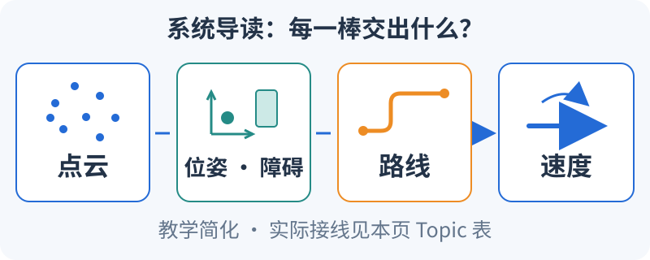

# 从雷达到车轮，中间是谁在做什么？

<small>整理与维护：24cst朱鑫鹏</small>

先追一份数据的接力：**雷达给出点，定位与环境处理生成位姿和障碍表示，规划给出路线，控制给出速度。**



图中合并了多个节点，省略了地图、TF、Action 与反馈回路；这是教学简化，实际接线以本页接口表和运行采集为据。

## 现在试一下：把箭头换成真实名字（5分钟）

1. 看图说出四类数据：点、位姿与障碍、路线、速度；先区分“经过哪里”和“这一刻怎么动”。
2. [展开真实接口表](#topic-flow)，找到 `/N/terrain_map` 的接收者，再用手指追 `cmd_vel_controller → cmd_vel_nav2_result → cmd_vel`，读出每段交给谁。
3. 写下这三段速度的发布模块；把最后一段的外部串口/底盘接收者标成“实机待确认”。

**预期**：能画出三段速度接线并标出待确认端点，知道 Path 表示路线、Twist 表示速度；有速度消息以后，还要确认执行端收到了。

**接着读**：第1节找启动文件，第3节核对 Topic 的名称和类型，第4节查坐标关系。`/N` 的含义见下方运行约定。

<link rel="stylesheet" href="../visuals/reader.css">
<script src="../visuals/reader.js" defer></script>

<div data-nav-fold></div>

## 这张图对应哪套代码和运行约定？

原课程：**本队系统地图：从启动入口追到机器人**。

本页依据 [Navigation-2027@183a410](https://github.com/Navigator-Vision-Algorithm-Team/Navigation-2027/tree/183a4109b0de2030bb8970a54654937c8b039ba9) 的源码静态整理。**主仓库已确认，实际运行图、有效参数和硬件接线仍须实机采集。** 下文以 reality 默认 `namespace=red_standard_robot1`、`use_composition=True` 为例，记 `/N/topic` 为 `/red_standard_robot1/topic`；TF 的 frame ID 不自动带 namespace。

## 1. 先读五个文件

| 顺序 | 文件（固定版本链接） | 要回答的问题 |
|---|---|---|
| 1 | [根 README](https://github.com/Navigator-Vision-Algorithm-Team/Navigation-2027/blob/183a4109b0de2030bb8970a54654937c8b039ba9/README.md) | 为什么依赖自瞄端串口？工作区和辅助脚本在哪？ |
| 2 | [rm_navigation_reality_launch.py](https://github.com/Navigator-Vision-Algorithm-Team/Navigation-2027/blob/183a4109b0de2030bb8970a54654937c8b039ba9/ros_ws/src/pb2025_sentry_nav/pb2025_nav_bringup/launch/rm_navigation_reality_launch.py) | namespace、world、slam、use_robot_state_pub、composition 默认是什么？ |
| 3 | [bringup_launch.py](https://github.com/Navigator-Vision-Algorithm-Team/Navigation-2027/blob/183a4109b0de2030bb8970a54654937c8b039ba9/ros_ws/src/pb2025_sentry_nav/pb2025_nav_bringup/launch/bringup_launch.py) | slam 如何选择分支？TF remap、参数替换在哪里？ |
| 4 | [navigation_launch.py](https://github.com/Navigator-Vision-Algorithm-Team/Navigation-2027/blob/183a4109b0de2030bb8970a54654937c8b039ba9/ros_ws/src/pb2025_sentry_nav/pb2025_nav_bringup/launch/navigation_launch.py) | 哪些节点是组件？cmd_vel 如何改名？lifecycle 管理谁？ |
| 5 | [config/reality/nav2_params.yaml](https://github.com/Navigator-Vision-Algorithm-Team/Navigation-2027/blob/183a4109b0de2030bb8970a54654937c8b039ba9/ros_ws/src/pb2025_sentry_nav/pb2025_nav_bringup/config/reality/nav2_params.yaml) | 实际插件、frame、数据源、速度和地图设置是什么？ |

最先画“谁启动谁”，再画通信图。仓库中有文件不等于 launch 启用了它，有参数段也不等于运行节点读取了它。

### 1.1 先用“去场地另一边”理解系统分工

假设机器人在场地左侧，要去右侧补给点。它必须连续回答四个问题：**我在哪里**（定位）、**哪里不能走**（环境表达）、**沿哪条路走**（规划）、**这一刻怎样运动**（控制）。雷达看到的是一批空间点，不会自己输出“到补给点”；Planner 输出的是路径，也不会直接驱动电机。ROS 节点是承担一项工作的程序，Topic 是传递某类数据的通道，launch 是安排程序启动、参数和接线的入口。

例如，地图上一条直线路径从 `(0,0)` 到 `(2,0)`，不代表机器人马上以 `2 m/s` 行驶：2 是目标距离，Path 是位置序列，Twist 才包含 `m/s` 和 `rad/s` 的运动指令。机器人途中看到一个箱子，变化先进入点云和 Costmap，再影响下一次规划/控制。调试时沿这条因果链找断点，比从“车没动”直接猜 PID 更有用。

第一遍读 launch 只圈三个东西：`DeclareLaunchArgument` 声明外部选项，`IncludeLaunchDescription` 继续包含别的入口，`Node`/`ComposableNode` 创建节点。第二遍才追参数和 remap。主仓库路径 `ros_ws/src/pb2025_sentry_nav/pb2025_nav_bringup/launch/rm_navigation_reality_launch.py` 的[参数声明 L50–134](https://github.com/Navigator-Vision-Algorithm-Team/Navigation-2027/blob/183a4109b0de2030bb8970a54654937c8b039ba9/ros_ws/src/pb2025_sentry_nav/pb2025_nav_bringup/launch/rm_navigation_reality_launch.py#L50-L134)与[节点/include L146–199](https://github.com/Navigator-Vision-Algorithm-Team/Navigation-2027/blob/183a4109b0de2030bb8970a54654937c8b039ba9/ros_ws/src/pb2025_sentry_nav/pb2025_nav_bringup/launch/rm_navigation_reality_launch.py#L146-L199)正好适合这样读。

## 2. 两个模式共用哪些模块

```text
reality 入口
 ├─ 可选机器人描述发布（use_robot_state_pub）
 ├─ Livox 驱动、手柄节点、可选 RViz
 └─ bringup（namespace、TF remap、参数替换、组件容器）
     ├─ slam=True：Point-LIO + 点云转scan + slam_toolbox + map_saver
     │            静态 map→odom；禁用 small_gicp
     ├─ slam=False：Point-LIO + small_gicp + map_server
     └─ navigation：loam_interface、sensor_scan_generation、terrain_analysis、
                    fake_vel_transform、Nav2 servers 与 lifecycle manager
```

`slam=True` 仍包含 navigation 分支，不能解释成“绝不会产生运动输出的录图模式”。建图、回放和源码实验都要隔离底盘执行端。建图分支在 [slam_launch.py](https://github.com/Navigator-Vision-Algorithm-Team/Navigation-2027/blob/183a4109b0de2030bb8970a54654937c8b039ba9/ros_ws/src/pb2025_sentry_nav/pb2025_nav_bringup/launch/slam_launch.py)，定位分支在 [localization_launch.py](https://github.com/Navigator-Vision-Algorithm-Team/Navigation-2027/blob/183a4109b0de2030bb8970a54654937c8b039ba9/ros_ws/src/pb2025_sentry_nav/pb2025_nav_bringup/launch/localization_launch.py)。

可以把建图理解为第一次来教室时画一张平面图，把重定位理解为第二次拿着图认出自己站在哪。两次都需要连续估计机器人运动，所以都保留 Point-LIO；第二次还要把局部点云与以前的 PCD 对齐，所以增加 small_gicp。二维地图供“找路”，三维 PCD 供“认位置”，即使都叫 dona，也不是同一种文件。

做一次纸面推演：把 `slam` 从 False 改成 True，划掉 small_gicp/map_server，写上 slam_toolbox/map_saver 和静态 map→odom；再检查 navigation 那一行是否仍然存在。主仓库路径 `ros_ws/src/pb2025_sentry_nav/pb2025_nav_bringup/launch/bringup_launch.py` 的[分支条件 L140–197](https://github.com/Navigator-Vision-Algorithm-Team/Navigation-2027/blob/183a4109b0de2030bb8970a54654937c8b039ba9/ros_ws/src/pb2025_sentry_nav/pb2025_nav_bringup/launch/bringup_launch.py#L140-L197)是判断依据，不能凭 launch 文件名猜行为。

## 3. 实际 Topic 数据流 <span id="topic-flow"></span>

以下名称为该基线的发布/订阅及 launch 配置预期；上车后用 `ros2 node info`、`ros2 topic info --verbose` 复核完整名称、类型和端点。

| 发布模块 | Topic / 类型 | 接收模块与作用 |
|---|---|---|
| livox_ros_driver2 | `/N/livox/lidar`，`livox_ros_driver2/msg/CustomMsg`；`/N/livox/imu`，`sensor_msgs/msg/Imu` | Point-LIO；reality lidar_type=1 分支读取 CustomMsg，不能拿任意 PointCloud2 替换 |
| point_lio | `/N/aft_mapped_to_init`，`nav_msgs/msg/Odometry`；`/N/cloud_registered`，`sensor_msgs/msg/PointCloud2` | loam_interface；原始 frame 语义是 camera_init/body，与 Nav2 odom 不同 |
| loam_interface | `/N/lidar_odometry`，Odometry；`/N/registered_scan`，PointCloud2 | sensor_scan_generation、terrain_analysis；registered_scan 另供 small_gicp |
| sensor_scan_generation | `/N/odometry`，Odometry；`/N/sensor_scan`，PointCloud2 | odometry 供 Nav2/速度转换；sensor_scan 是雷达坐标点云，**当前地形节点订阅 registered_scan** |
| terrain_analysis | `/N/terrain_map`，PointCloud2（最终发布为 front_mid360 frame，intensity 为地形量） | global/local Costmap 的 IntensityObstacleLayer；建图时另供点云转 scan；内部先在 odom 处理再变换 |
| pointcloud_to_laserscan（建图） | `/N/obstacle_scan`，`sensor_msgs/msg/LaserScan` | slam_toolbox→`/N/map`（OccupancyGrid）→map_saver |
| map_server（定位） | `/N/map`，`nav_msgs/msg/OccupancyGrid` | StaticLayer；数据来自 YAML 指向的图像，不是直接加载 PCD |
| RViz/导航客户端 | `/N/initialpose`，`geometry_msgs/msg/PoseWithCovarianceStamped` | small_gicp 的初始位姿输入；不是 AMCL 专属 Topic |
| RViz/任务客户端 | `/N/navigate_to_pose`，`nav2_msgs/action/NavigateToPose` | bt_navigator，反馈/结果/取消必须检查 |
| planner_server | `/N/plan`，`nav_msgs/msg/Path`（Nav2 通常接口，运行时确认） | BT 的规划结果交给 FollowPath；不是靠订阅 plan Topic 才能跟踪 |
| controller_server | `/N/cmd_vel_controller`，`geometry_msgs/msg/Twist` | velocity_smoother |
| velocity_smoother | `/N/cmd_vel_nav2_result`，Twist | fake_vel_transform；组合分支 behavior_server 也输出到此处 |
| fake_vel_transform | `/N/cmd_vel`，Twist；输入还包括 `/N/cmd_spin` | 外部串口/底盘接收者必须实测；不要推断存在完整仲裁与超时停车 |

主要实现证据：[Point-LIO 发布订阅](https://github.com/Navigator-Vision-Algorithm-Team/Navigation-2027/blob/183a4109b0de2030bb8970a54654937c8b039ba9/ros_ws/src/pb2025_sentry_nav/point_lio/src/laserMapping.cpp#L368)、[loam_interface](https://github.com/Navigator-Vision-Algorithm-Team/Navigation-2027/blob/183a4109b0de2030bb8970a54654937c8b039ba9/ros_ws/src/pb2025_sentry_nav/loam_interface/src/loam_interface.cpp#L46)、[sensor_scan_generation](https://github.com/Navigator-Vision-Algorithm-Team/Navigation-2027/blob/183a4109b0de2030bb8970a54654937c8b039ba9/ros_ws/src/pb2025_sentry_nav/sensor_scan_generation/src/sensor_scan_generation.cpp#L44)、[terrain_analysis](https://github.com/Navigator-Vision-Algorithm-Team/Navigation-2027/blob/183a4109b0de2030bb8970a54654937c8b039ba9/ros_ws/src/pb2025_sentry_nav/terrain_analysis/src/terrain_analysis.cpp#L95)。速度链的分支差异与辅助脚本问题见[证据页](nav2-and-control-evidence.md)。

### 3.1 读接口表时，要问数据“说的是什么”

PointCloud2 说“一批点分别在哪里”；Odometry 说“某个物体相对于某个参考系的位姿和速度”；OccupancyGrid 说“每个格子占据情况”；Path 说“依次经过哪些位姿”；Twist 说“当前要求怎样移动”。Action 则把一个持续任务的目标、反馈、结果和取消组织起来。收到 NavigateToPose 目标，只证明任务进入了交互流程，不能替代最终成功结果。

以 `cloud_registered → registered_scan` 为例，名字像是只改了前缀，代码却真的进行了坐标转换。主仓库路径 `ros_ws/src/pb2025_sentry_nav/loam_interface/src/loam_interface.cpp`：先读[构造函数 L26–51](https://github.com/Navigator-Vision-Algorithm-Team/Navigation-2027/blob/183a4109b0de2030bb8970a54654937c8b039ba9/ros_ws/src/pb2025_sentry_nav/loam_interface/src/loam_interface.cpp#L26-L51)找输入参数和输出名，再读[`pointCloudCallback` L54–60](https://github.com/Navigator-Vision-Algorithm-Team/Navigation-2027/blob/183a4109b0de2030bb8970a54654937c8b039ba9/ros_ws/src/pb2025_sentry_nav/loam_interface/src/loam_interface.cpp#L54-L60)。第59行把整批点转到 odom，第60行才发布。只改消息的 `frame_id` 相当于把厘米尺上的数字贴成米，数字没变，含义已经错了。

另一个接线练习：若最终 `/N/cmd_vel` 有20 Hz消息，但没有订阅者，导航到电机之间仍然没有连通。先查表中最后一行的接收者，再找部署机串口包；不要用“话题在刷新”替代“执行端收到了”。默认组件的三段速度接线可直接在主仓库路径 `ros_ws/src/pb2025_sentry_nav/pb2025_nav_bringup/launch/navigation_launch.py` 的[remap L281–328](https://github.com/Navigator-Vision-Algorithm-Team/Navigation-2027/blob/183a4109b0de2030bb8970a54654937c8b039ba9/ros_ws/src/pb2025_sentry_nav/pb2025_nav_bringup/launch/navigation_launch.py#L281-L328)逐段圈出。

## 4. TF 按发布者学习

| TF 关系 | 该基线的发布者/条件 | 要验收的事情 |
|---|---|---|
| map→odom | 定位：small_gicp_relocalization；建图：静态发布器 | 同一运行模式只能有一个权威来源；slam_toolbox 的 transform_publish_period=0，不能另开一个重复源 |
| odom→base_footprint | sensor_scan_generation | 来自 LIO 与雷达/底盘变换，不能再无条件加轮速 odom 发布同一边 |
| base_footprint 到 chassis、gimbal_yaw 等模型链 | robot_state_publisher 根据转换后的机器人模型与关节状态发布 | 固定关节与可动关节区别；完整生成树应以实际模型为准 |
| gimbal_yaw→front_mid360 | 默认 uic2025 模型的雷达固定安装关系 | 雷达相对云台固定，不表示相对底盘也固定；外参与模型要成套 |
| gimbal_yaw→gimbal_yaw_fake | fake_vel_transform 的导航虚拟帧，零平移、相对 yaw 为负里程计 yaw | 动态抵消云台在 odom 中的 yaw；不是 odom 直接发布的分支，也不能用静态 TF 替代 |

模型入口：[uic2025_sentry_robot.sdf.xmacro](https://github.com/Navigator-Vision-Algorithm-Team/Navigation-2027/blob/183a4109b0de2030bb8970a54654937c8b039ba9/ros_ws/src/pb2025_robot_description/resource/xmacro/uic2025_sentry_robot.sdf.xmacro#L20)。关节状态配置：[robot_description.yaml](https://github.com/Navigator-Vision-Algorithm-Team/Navigation-2027/blob/183a4109b0de2030bb8970a54654937c8b039ba9/ros_ws/src/pb2025_robot_description/params/robot_description.yaml) 读取 `serial/gimbal_joint_state`。实际串口必须提供匹配名称、单位和时间戳的数据。

```text
map
└─ odom
   └─ base_footprint → [实际机器人模型链] → gimbal_yaw
                                               ├─ front_mid360
                                               └─ gimbal_yaw_fake （动态虚拟导航帧）
```

此图省略模型中间关节，不是完整 URDF。Point-LIO 的 `publish.tf_send_en=False`，不要为了“补齐 TF”擅自启用原始 `camera_init→aft_mapped`。`Odometry` 消息存在与 TF 边存在是两回事。[REP-105](https://github.com/ros-infrastructure/rep/blob/master/rep-0105.rst) 的 map/odom 语义可以迁移，帧名和发布节点必须依据本队实现。

### 4.1 map 与 odom 为什么要同时存在

odom 像“从本次出发点开始累计的步数”，要求短时间连续；map 像“场地里固定的标尺”，希望长期位置正确。假设里程计认为机器人走到 odom 的 `x=2.0 m`，地图配准发现实际应在 map 的 `x=2.3 m`，并且两帧方向相同，那么 map→odom 平移设为 `+0.3 m`，机器人在 map 中就是 `0.3+2.0=2.3 m`。它修正全局位置，而不必把局部里程计瞬间改成2.3。这里只取一维、无旋转的教学例子；真实源码用三维变换组合。

主仓库路径 `ros_ws/src/pb2025_sentry_nav/small_gicp_relocalization/src/small_gicp_relocalization.cpp` 的[`performRegistration` L134–167](https://github.com/Navigator-Vision-Algorithm-Team/Navigation-2027/blob/183a4109b0de2030bb8970a54654937c8b039ba9/ros_ws/src/pb2025_sentry_nav/small_gicp_relocalization/src/small_gicp_relocalization.cpp#L134-L167)生成配准变换，接着[`publishTransform` L169–192](https://github.com/Navigator-Vision-Algorithm-Team/Navigation-2027/blob/183a4109b0de2030bb8970a54654937c8b039ba9/ros_ws/src/pb2025_sentry_nav/small_gicp_relocalization/src/small_gicp_relocalization.cpp#L169-L192)发布 map→odom。读第159行的 `converged` 检查与第171行的 `isZero` 检查，解释为什么“有TF”不足以证明本轮成功配准。

雷达安装外参回答“雷达相对机器人装在哪里”，LIO 位姿回答“机器人这一刻走到了哪里”。雷达装在云台上时，云台转30°会改变雷达到底盘的关系；这需要带时间的关节状态，而不是多补一条零旋转静态TF。上表里的发布权应与实际模型、关节状态相互对上。

## 5. 源码暴露的教学重点

1. **运行参数与文件默认值不同。** reality YAML 中 costmap 的 `use_sim_time: true` 经过 launch 重写；必须查运行值，不能仅据 YAML 判断实车在用仿真时钟。
2. **普通节点与组件分支需要分别核对。** composition=False 的 remap 与默认组合分支不完全相同；不能把它当作必然等价的 Debug 开关。
3. **有 TF 不代表定位正确。** small_gicp 可能继续发布旧估计；观察 stamp、配准结果、点云重合、实际位置，不只看 Topic 频率。
4. **里程计速度值得专项审查。** sensor_scan_generation 用 steady_clock 回调间隔差分位置；回放倍速可影响速度数值，且 twist 的参考系与消息约定需要核实。这是代码阅读/回归课题，不是本次已经修复的结论。
5. **外部依赖必须具名。** rm_robot_ws 是另一条 CAN/ros2_control 工程，不能替代本导航 README 所需的串口包；本次不把它列为所有导航新人的必修实现。

实践：完成节点图、Topic 表、TF 发布权表各一份，标出“源码已确认 / 运行已确认 / 待确认”。三张图必须能相互解释，见 [T3、T7](../assignments/README.md)。

可以用“有路径、车没动”写第一份三层证据：源码中 controller→smoother remap 存在，是设计接线；部署机看到 controller_server 为 active、接口有正确端点，是运行接线；记录最终速度和底盘回传/运动，才覆盖执行。每一层只回答它能回答的问题，缺少下一层就写待确认。教学用的错话题例子在知识库路径 `training/ros2_ws/src/nav_training/launch/bad_topic.launch.py` 的[现成入口](https://github.com/Navigator-Vision-Algorithm-Team/knowledge-base/blob/main/training/ros2_ws/src/nav_training/launch/bad_topic.launch.py)；它只在 `/nav_training` 演示接线故障，不是实车导航案例。
