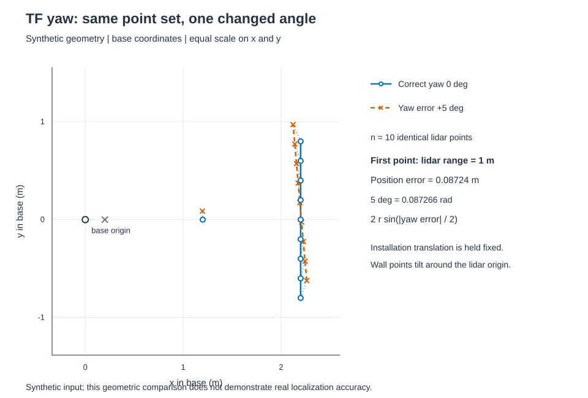
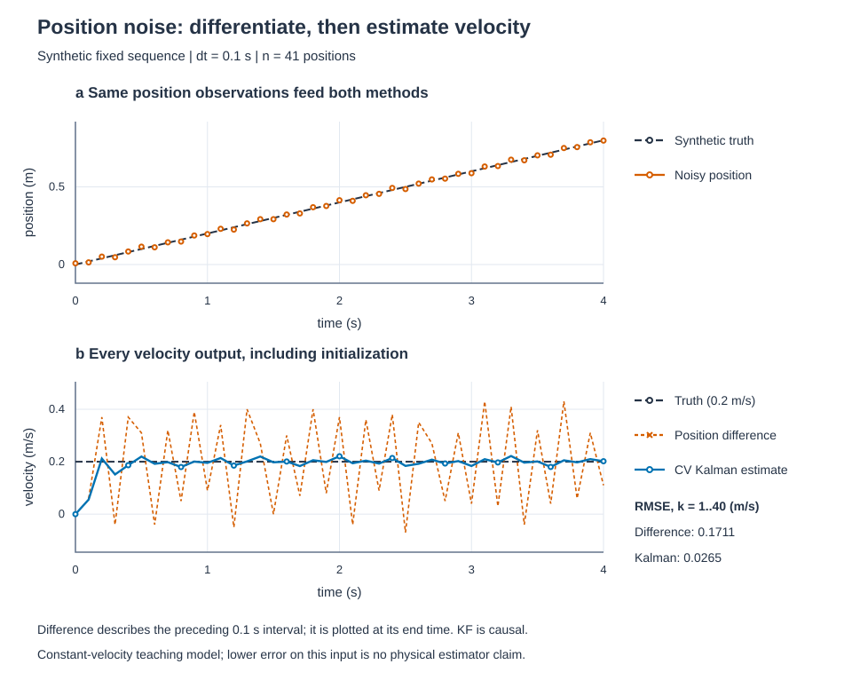

# 固定对照实验：让 TF、地图与滤波的差异看得见

<small>整理与维护：24cst朱鑫鹏</small>

“地图歪了”“定位有点抖”还不是可以复查的结论。这一页把它们变成三个小问题：**同一个点，只错 5° 会偏多少？同一张图，只改 origin 会发生什么？同一串位置，为什么差分速度比位置看起来更吵？** 每次只改一个量，先算一个答案，再用固定输入重现。

本页接在 [ROS2/TF](../ros2-tf/README.md)、[地图数据](datasets.md)和[定位自学第二段](../self-study/localization.md)之后，作为 T2/T6 的配套练习。三项全部使用合成数据；普通 **Python 3.10+ 标准库**即可运行，无须 ROS、NumPy、绘图库或网络。它们验证几何与计算规则，不能作为 ROS 通信、真实重定位或实车表现的测试结果。

## 1. 先把输入、程序和答案分开

下面的命令都从知识库仓库根目录执行。新文件集中在 `docs/navigation/training/assets/`，点击即可打开或下载：

| 文件 | 用来做什么 |
|---|---|
| [comparison_inputs.json](assets/comparison_inputs.json) | 固定的点、栅格和位置噪声；也是每次实验的输入清单 |
| [make_comparison_figures.py](assets/make_comparison_figures.py) | 坐标变换、差分、Kalman 计算及 SVG 绘图源码 |
| [comparison_report.json](assets/figures/comparison_report.json) | 本页图形对应的完整数值、输入副本和输入 SHA-256 |
| [test_comparison_figures.py](assets/test_comparison_figures.py) | 独立手算、指标口径、确定性和覆盖保护检查 |

先认识数据规模：TF 有 10 个相同雷达点；地图为 20×16 格、75 个占据格；速度实验有 41 个位置样本，时间为 0～4 s、间隔 0.1 s，没有缺失值。位置噪声是 JSON 中写死的序列，范围为 −0.015～0.015 m；它没有被声明为真实传感器噪声或某个随机分布。

第一次先不改输入，生成自己的基线：

```text
python docs/navigation/training/assets/make_comparison_figures.py --output-dir training/output/comparison-baseline
```

`--output-dir` 必须显式填写，而且目录必须尚不存在，包括空目录。程序拒绝覆盖已有目录；再次运行请换一个新名字。输出是三张 SVG 和一份 JSON，在浏览器打开 SVG，在编辑器打开报告即可。保持仓库中的 `assets/figures/` 和 `training/datasets/synthetic-v1/` 原样，后续只编辑输入的个人副本。

预期命令输出包含：

```text
1 m point / yaw error: 0.08723877 m
Map marked-cell displacement: 0.500 m
Velocity RMSE (same k=1..40): difference=0.171129, Kalman=0.026505 m/s
```

## 2. TF：安装方向错一点，远处为什么错得更多

### 先讲原理，再算一个点

雷达给的是“相对雷达”的坐标，底盘需要“相对底盘”的坐标。二维情况下，先旋转方向，再加安装平移：

```text
p_base = R(yaw) p_lidar + t
R(yaw) = [[cos(yaw), -sin(yaw)],
          [sin(yaw),  cos(yaw)]]
```

本实验固定安装平移 `t=(0.2,0) m`，正确 yaw 为 0°，只给旋转加上 +5°。取雷达前方 1 m 的点 `p_lidar=(1,0)`：正确坐标是 `(1.2,0)`；错误坐标是 `(0.2+cos 5°, sin 5°)≈(1.196195,0.087156)`。两点的欧氏距离约为 **0.087239 m，即 8.72 cm**。

注意 8.72 cm 指两种变换后位置的距离，横向 y 偏移约为 8.716 cm，两者略有不同。若点距雷达为 r，两种旋转结果的距离为 `2r sin(|Δyaw|/2)`；平移相同会在做差时抵消。于是方向误差相同，远点偏移更大。这里的 r 从雷达原点量起，不能拿到底盘原点的 1.2 m 代入。

### 运行、观察，再恢复

在第 1 节的输出中打开 `tf-yaw-comparison.svg`。蓝色圆点为正确变换，橙色叉号为错误变换；直墙由竖直变成倾斜，而安装平移保持不变。图中 x/y 使用相同的米制比例，便于判断角度。



将输入文件另存为 `training/output/comparison-tf-zero.json`，只把 `tf.yaw_error_deg` 改为 `0.0`。先预测两组点应重合，再运行：

```text
python docs/navigation/training/assets/make_comparison_figures.py --input training/output/comparison-tf-zero.json --output-dir training/output/comparison-tf-zero
```

检查报告中的 `tf.one_metre_point_error_m` 应为 0。随后重新选用原始输入、另建输出目录作为恢复；不改本队机器人模型的安装参数。若偏移没有归零，先查实际 `--input` 路径和报告内输入副本，不要先改绘图坐标。

### 回到本队代码

先看本页源码的 `transform_point`：边界输入是度，内部 `math.radians` 转为弧度。再读主仓库路径 `ros_ws/src/pb2025_robot_description/resource/xmacro/uic2025_sentry_robot.sdf.xmacro` 的[雷达安装位置][team-model]，辨认安装关系；接着到 `ros_ws/src/pb2025_sentry_nav/sensor_scan_generation/src/sensor_scan_generation.cpp` 的[变换查询与复合][team-scan]，给 `target_frame`、`source_frame` 及乘号两侧标注 frame。函数名中的 “to” 不应替代对矩阵输入输出坐标的核对。

本页的 `(0.2,0)` 是二维教学设置，不是该机器人模型完整安装参数。若要在 ROS 中做对应实验，应在个人仿真配置中改变唯一的静态边，再采集 TF/点云证据；这一步尚不能由上面的 Python 图代替。

## 3. 地图：像素没变，为什么与点云错开了

### origin 给每一格分配地图坐标

PGM 描述哪里占据，YAML 决定每格多大、放在哪儿。这里复用[教学地图](datasets.md)的几何：20×16 格，分辨率 0.25 m/cell，正确 origin 为 `[-1,-1,0]`，最后一项是 yaw，单位 rad。JSON 中 `1` 表示占据；原 PGM 使用灰度 `0` 表示占据，两种编码不同，几何一致。

图像首行在北侧，行号向下增加；地图 y 向北增加，因此要先翻转行。对于从零计数的图像 `(col,row)`，yaw=0 时格中心是：

```text
x = origin.x + (col + 0.5) * resolution
y = origin.y + (height - 1 - row + 0.5) * resolution
```

选内部障碍 `(col=14,row=8)`，手算得到 `(2.625,0.875) m`。现在只把 origin.x 从 −1 改为 −0.5 m，像素、分辨率、origin.y 和 yaw 都不变，中心就成为 `(3.125,0.875) m`，正好沿 +x 移动 0.5 m，即两格。`+0.5` 选格中心，漏掉它会另外引入半格误差。

### 用固定参照看错位

打开 `map-origin-comparison.svg`。两幅图使用相同坐标范围和米制比例；蓝色圆圈始终标在基线中心，橙色叉号标在改 origin 后的中心。图中的灰格是同一组占据格，并不代表物理障碍被移动。


检查报告的 `map.marked_center_correct_m`、`map.marked_center_perturbed_m` 和 `map.marked_displacement_m`，应分别对应上面的手算。把原始输入另存为 `training/output/comparison-map-zero.json`，只将 `map.origin_shift_m` 改成 `[0.0,0.0]`，再输出到新目录：

```text
python docs/navigation/training/assets/make_comparison_figures.py --input training/output/comparison-map-zero.json --output-dir training/output/comparison-map-zero
```

预期中心重合、位移为 0。最后切回原始输入重新生成，确认恢复为 0.5 m。这个流程不写 PGM、YAML 或 PCD；如果在后续 ROS 个人实验中复制 YAML 修改 origin，应保持基线 PCD 不动，记录 map_server 实际加载的 YAML 路径，再恢复所复制文件的 origin。

### 回到加载地图的入口

知识库路径 `training/tools/generate_data.py` 的[write_map][teaching-map]生成同一教学几何，可核对行翻转和格中心。主仓库路径 `ros_ws/src/pb2025_sentry_nav/pb2025_nav_bringup/launch/localization_launch.py` 的[地图参数替换][team-map-launch]展示 `map_yaml_file` 如何进入 `yaml_filename`，同文件的[节点加载与 PCD 入口][team-map-nodes]展示 PCD 如何进入另一条加载路径。应查清两份地图在同一坐标中是否一致，不能因为路径都能打开就认定对齐。

## 4. 速度：厘米级位置噪声怎样变成明显抖动

### 先差分两帧，看到噪声被放大

本实验的合成真值为匀速直行：`x_true(t)=0.2t`，单位 m；观测为 `z_k=x_true(t_k)+noise_k`。前两个位置观测是 `z0=0.008 m`、`z1=0.014 m`，间隔 0.1 s，直接差分速度为 `(0.014−0.008)/0.1=0.06 m/s`，而真值是 0.2 m/s。第三个观测为 0.051 m，下一段差分又跳到 0.37 m/s。

一般地，位置误差会以 `(noise_k−noise_(k−1))/dt` 进入速度。厘米级误差除以 0.1 s 就能变成十分之几 m/s，所以“位置图看起来还行”与“差分速度抖动明显”可以同时成立。只提高采样频率而不处理噪声，也不能自动解决这个问题。

### Kalman 在做什么

这里使用真正的一维常速度 Kalman 滤波，状态是 `[位置,速度]`，每次观测只有位置。它先按上一时刻的速度预测下一位置，再用新位置与预测的差修正两个状态。位置与速度的协方差使“位置观测”也能更新速度；它不是直接把真值速度 0.2 填进输出，也不是移动平均。

```text
F = [[1, dt], [0, 1]]       H = [1, 0]
x_pred = F x_prev          P_pred = F P_prev F^T + Q
innovation = z - H x_pred
K = P_pred H^T / (H P_pred H^T + R)
x = x_pred + K * innovation
Q = acceleration_variance * [[dt^4/4, dt^3/2],
                             [dt^3/2, dt^2]]
```

源码 `kalman_velocity` 用 Joseph 形式更新 P，以保持数值对称性和稳定性。参数与初值全部公开在 JSON：

| 量 | 固定值与含义 |
|---|---|
| dt | 0.1 s |
| 初始状态 | `[z0,0]=[0.008 m,0 m/s]`，第一帧仅初始化 |
| 初始协方差 P0 | 对角线 `[0.0001 m²,0.25 m²/s²]`，交叉项为 0 |
| 位置测量方差 R | 0.0001 m²，教学模型的假设值 |
| 每步加速度方差 | 0.04 m²/s⁴，按上式形成 Q |

这里 R 和加速度方差是教学设计参数；固定噪声序列不等于“方差恰好为 R”的随机采样。取第一步手算：`P_pred[0,0]=0.0001+0.1²×0.25+0.000001=0.002601`，位置—速度交叉项为 `0.02502`，创新为 `0.014−0.008=0.006 m`，因此速度更新为 `0+0.02502/(0.002601+0.0001)×0.006≈0.055579 m/s`。第一步仍未接近真值，后续观测才逐步积累信息。

### 同样的输入、同样的评分窗口

打开 `velocity-noise-comparison.svg`：上图是同一串位置观测，下图比较差分速度和 Kalman 速度，虚线为合成真值。图中保留 Kalman 的初始速度 0，避免只展示收敛之后的一段。



差分没有 k=0 输出，因此两种方法都在 **k=1～40 的同 40 个时刻**评分，Kalman 的初始化点也不计入。差分表示前一个 0.1 s 区间的平均速度，绘在该区间终点；本实验真值恒速，所以可以用同一真值逐点比较。RMSE 为 `sqrt(mean((估计速度−0.2)²))`，不是曲线视觉平滑程度。

| 相同输入、相同窗口 | 速度 RMSE | 速度 MAE |
|---|---:|---:|
| 位置相邻差分 | 0.171129 m/s | 0.163000 m/s |
| 一维常速度 Kalman | 0.026505 m/s | 0.013418 m/s |

这是本固定序列的结果。匀速模型有利于描述这段真值，不能据此声称滤波对急转、加速、时间异常或实车总能更好。滤波器只接收观测、dt 和模型参数；真值只用于造教学数据和评分。

作为选做，把输入另存一份，**只把 R 从 0.0001 改成 0.01**。先预测观测权重会怎样变化，再比较起步响应和 RMSE；不要只挑更平滑的曲线宣布获胜。恢复时切回原始 JSON、使用新的输出目录，重新检查报告内的 R 和同一评分窗口。

### 回到本队估计器，分清简化与实际

主仓库路径 `ros_ws/src/pb2025_sentry_nav/sensor_scan_generation/src/sensor_scan_generation.cpp` 的[publishOdometry][team-difference]由相邻变换和 `steady_clock` 间隔算速度，可用来练习辨认差分及时间来源；本实验则固定使用 0.1 s，不是在运行该 ROS 节点。

再看 `ros_ws/src/pb2025_sentry_nav/point_lio/src/Estimator.cpp` 的[状态传播与过程噪声][team-estimator]，找状态导数和 Q 的位置。Point-LIO 包含姿态、偏置等更高维状态，本页二维状态只是帮助读懂“预测—观测修正”的入口，不能把本页参数直接迁移到本队配置。

## 5. 留下别人能复查的实验记录

每项交一张对照图和一段短说明，按“改了什么—先预测多少—报告是多少—怎样恢复”写。例如：

> 保持地图 20×16、0.25 m/cell 和像素不变，只将 origin.x 增加 0.5 m。预测内部格中心从 (2.625,0.875) 变到 (3.125,0.875)，报告位移为 0.5 m。将个人输入的 shift 恢复为 [0,0] 后，两中心重合。

附上原始输入或个人输入副本、完整命令、报告内 `input_sha256`、手算过程，以及三项恢复结果。导师应能只凭这些材料在新目录重算；截图中的颜色或程序打印“成功”不能替代数值检查。

可运行标准库测试：

```text
python -m unittest discover -s docs/navigation/training/assets -p test_comparison_figures.py -v
```

本页配套 15 项测试覆盖 5° 几何手算、地图行方向、Kalman 单步手算、观测与真值分离、同窗口评分、输入合法性、输出确定性和拒绝覆盖。测试及图形生成的状态记在[验证记录](validation.md)；ROS TF 发布、map_server 加载、DDS 与实车仍需在各自环境另行验收。

## 6. 教学方法的来源

[SAS 导航新人培训手册][sas]通过系统链路、TF 外参和地图 origin 等问题引导新人预测故障；本页借鉴“只改一个量，再找数据证据”的练法。[上海交大交龙滤波培训][sjtu]先展示含噪位置差分，再解释滤波的必要性；本页采用相同问题顺序，但输入、实现、图形和验收数字均独立编写。外队的定位方案、总线或参数不作为本队配置。

[team-model]: https://github.com/Navigator-Vision-Algorithm-Team/Navigation-2027/blob/183a4109b0de2030bb8970a54654937c8b039ba9/ros_ws/src/pb2025_robot_description/resource/xmacro/uic2025_sentry_robot.sdf.xmacro#L15-L22
[team-scan]: https://github.com/Navigator-Vision-Algorithm-Team/Navigation-2027/blob/183a4109b0de2030bb8970a54654937c8b039ba9/ros_ws/src/pb2025_sentry_nav/sensor_scan_generation/src/sensor_scan_generation.cpp#L61-L104
[teaching-map]: https://github.com/Navigator-Vision-Algorithm-Team/knowledge-base/blob/main/training/tools/generate_data.py#L134-L149
[team-map-launch]: https://github.com/Navigator-Vision-Algorithm-Team/Navigation-2027/blob/183a4109b0de2030bb8970a54654937c8b039ba9/ros_ws/src/pb2025_sentry_nav/pb2025_nav_bringup/launch/localization_launch.py#L36-L51
[team-map-nodes]: https://github.com/Navigator-Vision-Algorithm-Team/Navigation-2027/blob/183a4109b0de2030bb8970a54654937c8b039ba9/ros_ws/src/pb2025_sentry_nav/pb2025_nav_bringup/launch/localization_launch.py#L119-L158
[team-difference]: https://github.com/Navigator-Vision-Algorithm-Team/Navigation-2027/blob/183a4109b0de2030bb8970a54654937c8b039ba9/ros_ws/src/pb2025_sentry_nav/sensor_scan_generation/src/sensor_scan_generation.cpp#L130-L154
[team-estimator]: https://github.com/Navigator-Vision-Algorithm-Team/Navigation-2027/blob/183a4109b0de2030bb8970a54654937c8b039ba9/ros_ws/src/pb2025_sentry_nav/point_lio/src/Estimator.cpp#L26-L110
[sas]: https://gitee.com/ucas-sas-robot-team/Algorithm-Group-Training/blob/master/%E5%AF%BC%E8%88%AA%E6%96%B0%E4%BA%BA%E5%9F%B9%E8%AE%AD.md
[sjtu]: https://sjtu-robomaster-team.github.io/vision-learning-6/
