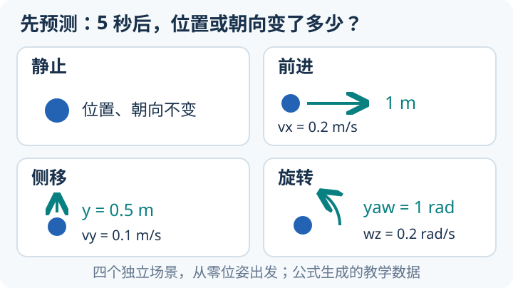
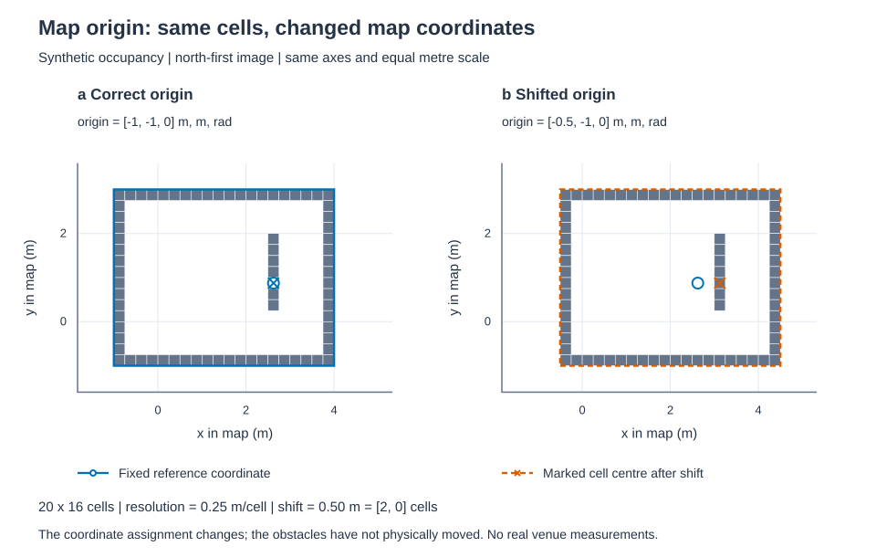

# 标准教学数据：从命令到轨迹、TF 与地图

<small>整理与维护：24cst朱鑫鹏</small>

先做一道能心算的题：**小车每秒前进 0.2 米，走 5 秒，应停在哪里？** 写下“前进 1 米”，再让程序根据速度重新算一次，看看答案是否一致。这一页使用公式生成的数据，普通 Python 就能开始。



## 今天先核对一次前进结果（5分钟）

在已经克隆的知识库根目录打开终端，运行下面一条。Ubuntu 上若命令叫 `python3`，将开头的 `python` 换成它；无需先安装 ROS 或重新生成数据。

```text
python training/tools/replay_motion.py training/datasets/synthetic-v1/forward/ground_truth.csv
```

先找三个字段：`samples` 应为 **51**，`duration_s` 为 **5.0**，`predicted_final.x` 约为 **1.0**；`passed: true` 表示本次重算符合这份合成真值。`0.9999999999999999` 和 1 米的微小差别来自浮点舍入。

再把路径中的 `forward` 改成 `lateral`，**运行前先预测**：每秒向车体左侧移 0.1 米，5 秒后应为 `y=0.5 m`。记下自己的输出，不必今天把 bag、TF 和地图全部学完。

看懂这一步后，展开第 1–2 节追输入和计算规则；准备好 Ubuntu/ROS 后再做第 3–4 节回放。它们是不同实验，离线重算通过不代表 ROS 或实车已验证。

<link rel="stylesheet" href="../../visuals/reader.css">
<script src="../../visuals/reader.js" defer></script>
<div data-nav-fold="先重算一组，再按需要展开数据约定、ROS 回放和地图练习。"></div>

## 这套数据包含什么，能验证到哪一步

本页配套[可下载的数据目录][data]包含四组实际 rosbag2 SQLite3/CDR 文件、解析真值 CSV、对齐的 YAML/PGM/PCD 地图和时间异常练习。整套 18 个文件共 385,599 bytes，可直接随知识库克隆；`manifest.json` 记录另外 17 个资产的 SHA-256、大小、单位、Topic、frame 和生成来源。

**全部数据由公式构造。** 这里没有 Livox 原始包、IMU、Point-LIO 输出、真实比赛场地或传感器噪声。它能训练读包、命令积分、时间戳、TF 和地图坐标；真实 LIO 重定位、传感器同步与 Nav2 实地闭环仍需要另行提供的真实数据。小地图的 PCD 只是占据格中心点，不能作为雷达原始输入。

先完成[教学工作区](workspace.md)的获取与首次运行。下面所有相对路径均以克隆后的知识库根目录为起点。

## 1. 四组数据的共同约定

约定相当于实验的尺子：先统一单位、起始位置、采样周期和 frame，才能判断差异来自算法还是输入解释。看到 `0.2` 时先读列名，它可以是 m/s，也可以是 rad/s；把角速度直接当角度，运动时长一变就会暴露错误。下表可先逐行心算终点，再看 CSV 和程序输出。

每组为 5 秒、10 Hz，含起点和终点共 51 个样本。时间从 `100000000000 ns` 到 `105000000000 ns`，是任意仿真时钟起点，不是 UTC 采集时间。前 50 个采样点给定恒定命令，第 51 点在第 5 秒写入零命令；位姿已经完成前 5 秒的运动。

| 目录 | 0 ≤ t < 5 s 的 `(vx,vy,wz)` | 5 秒终点 `(x,y,yaw)` |
|---|---|---|
| `stationary` | `(0,0,0)` | `(0,0,0)` |
| `forward` | `(0.2,0,0)` | `(1,0,0)` |
| `lateral` | `(0,0.1,0)` | `(0,0.5,0)` |
| `rotation` | `(0,0,0.2)` | `(0,0,1)` |

位置单位 m，线速度 m/s，角度 rad，角速度 rad/s。右手系：机体 +x 向前、+y 向左、+z 向上，正 yaw 从上方看逆时针。四组分别做平移或旋转，不包含边走边转。真值直接用 `x=vx*t, y=vy*t, yaw=wz*t` 计算，与教学模型的积分实现独立。

每组的 `ground_truth.csv` 包含 `stamp_ns, elapsed_s, x_m, y_m, yaw_rad, vx_m_s, vy_m_s, wz_rad_s`。`bag/` 里有 `metadata.yaml` 和 `bag.db3`；每个 bag 正好 154 条消息：

| Topic | 标准 ROS2 类型 | 条数 | 语义 |
|---|---|---:|---|
| `/nav_training/cmd_vel` | `geometry_msgs/msg/Twist` | 51 | 机体坐标下速度；Twist 本身无 header，时间来自 bag 记录 |
| `/nav_training/odom` | `nav_msgs/msg/Odometry` | 51 | 解析真值，header 为 `training_odom`，child 为 `training_base` |
| `/nav_training/tf` | `tf2_msgs/msg/TFMessage` | 51 | 动态边 `training_odom → training_base`，与 odom 同时同位姿 |
| `/nav_training/tf_static` | `tf2_msgs/msg/TFMessage` | 1 | 静态边 `training_base → training_lidar`，平移 `(0.2,0,0.1)`，无旋转 |

所有连接为 reliable；前三种为 volatile，静态 TF 为 transient_local、depth 1。带 header 的消息，其 stamp 等于 bag 记录时间。Odometry 的 covariance 是全零的合成占位值，不能据此估计真实传感器精度或调融合参数。

## 2. 先做不依赖 ROS 的精确重算

### 2.1 先分清“输入”“预测”和“真值”

CSV 同时存速度和解析位置，但两者的用途不同。速度是交给学生模型的输入，预测位置要由模型自己计算，真值是检查答案的尺子。若直接读取每行 `x_m,y_m` 作为预测，即使程序打印零误差，也没有检验积分是否正确。

路径 `training/tools/generate_data.py` 的 [samples](https://github.com/Navigator-Vision-Algorithm-Team/knowledge-base/blob/main/training/tools/generate_data.py#L50-L62)用独立闭式公式生成直行、侧移和旋转的真值；路径 `training/tools/replay_motion.py` 的 [compare](https://github.com/Navigator-Vision-Algorithm-Team/knowledge-base/blob/main/training/tools/replay_motion.py#L14-L45)用速度驱动 `TimedModel`，只在首行用真值设初始位姿。两条计算路线最后相遇，才是有意义的对照。

拿前进第 3 个样本练一次：零起点索引为 2，`elapsed_s=0.2`，预期 `x=0.2 m/s×0.2 s=0.04 m`。先写这个答案再运行。检查 `max_position_error_m` 还要知道它是**全程每点误差的最大值**；只看终点可能遗漏中途走偏、后来又回到终点的问题。

此命令使用已提交 CSV 和教学核心，无须安装下面的制包依赖：

```text
python training/tools/replay_motion.py training/datasets/synthetic-v1/forward/ground_truth.csv
```

它按时间顺序将速度交给模型，逐点比较模型位置与解析真值，默认误差门槛为 `1e-8`；退出码 0 表示比较通过。2026-09-14 在 Windows/Python 3.12.10 实际运行的前进结果节选：

```json
{
  "samples": 51,
  "duration_s": 5.0,
  "predicted_final": {"x": 0.9999999999999999, "y": 0.0, "yaw": 0.0},
  "max_position_error_m": 2.220446049250313e-16,
  "max_yaw_error_rad": 0.0,
  "passed": true
}
```

同次运行中，静止误差为 0，侧移最大位置误差 `1.11e-16 m`，旋转最大角误差 `2.22e-16 rad`，四组均通过。末尾浮点小数差异属于计算舍入；重新生成或修改公式后，应重新运行比较，而不是手动改真值迎合输出。

## 3. 直接回放 bag 内真值

bag 可以理解为带时间的消息档案，包含“在哪个 Topic、记录时间是多少、消息字节是什么”，回放时重新发布这些消息。它本身不负责从速度推导位置。本节把已存 Odometry/TF 当输入，目的是看消息和坐标；因此要用白名单排除速度，避免同时驱动另一份模型。

数据制作路径 `training/tools/generate_data.py` 的 [write_scenario](https://github.com/Navigator-Vision-Algorithm-Team/knowledge-base/blob/main/training/tools/generate_data.py#L76-L131)先建立四个连接，再将消息序列化为 CDR 后写入。CDR 是消息的二进制表示，`metadata.yaml` 是数据索引和说明，两者都不能靠改扩展名互相替代。154 条消息来自 `51×3+1`，最后的 1 是静态 TF，不是额外的运动采样点。

本节需要 Ubuntu 22.04/ROS2 Humble 和 `ros-humble-rosbag2`，环境与构建见[工作区页](workspace.md)。最新真实 ROS 验证结果统一记录在[验证状态](validation.md)；本页的 Python 读包结果本身不证明 DDS 或 RViz 已运行。

在所有相关终端统一 source Humble，并设置相同空闲 domain。以下 87 是示例；练习仅在当前机器通信。

```bash
source /opt/ros/humble/setup.bash
export ROS_DOMAIN_ID=87
export ROS_LOCALHOST_ONLY=1
ros2 bag info training/datasets/synthetic-v1/forward/bag
```

用上面的表核对四种 Topic、154 条消息和 5 秒 duration。先启动观察终端，再启动回放，防止错过开头。观察终端可以运行：

```bash
ros2 topic echo /nav_training/odom
```

另一个观察终端检查完整 TF 链；两个 TF Topic 需要显式 remap：

```bash
ros2 run tf2_ros tf2_echo training_odom training_lidar --ros-args \
  -p use_sim_time:=true \
  -r /tf:=/nav_training/tf -r /tf_static:=/nav_training/tf_static
```

回放终端执行下面的 Topic 白名单，只发布 bag 中的 odom/TF 真值和 `/clock`。本次观察时应结束此前的 `healthy.launch.py` 或 `ideal_model` 进程，使动态边只有 bag 一个发布来源：

```bash
ros2 bag play training/datasets/synthetic-v1/forward/bag \
  --clock 100 --delay 2 \
  --topics /nav_training/odom /nav_training/tf /nav_training/tf_static
```

预期前进末点 `training_base` 的 x 为 1 m，`training_lidar` 的 x 为 1.2 m、z 为 0.1 m。不要把雷达原点当成底盘原点。静态 TF 只写一次，late-join 依赖 transient_local 和仍存活的发布者；bag 播放进程结束后，新启动的观察器可能收不到静态边，应先启动观察器再重新播放。

如用 RViz，同样给 `/tf`、`/tf_static` 做上述 remap，启用 `use_sim_time`，Fixed Frame 设为 `training_odom`。本 bag 没有地图 Topic 或雷达点云 Topic。

## 4. 只回放命令，让模型重新生成 odom/TF

这次把袋子里原来的“答案”排除，只给模型速度和时钟，让它自己产生位姿。和上一节的差异可用一句话判断：**本次 Odometry 的发布者应该是模型节点，上一节应该是 bag 播放器**。检查发布者数量的目的，是确认你看到的答案来自哪条计算链。

比如 bag 里的真值是 x=1 m，而模型由于调度时序算到 x=0.998 m，同时回放两者可能让屏幕交替显示两个位置。此时改积分公式无法解决两个发布来源的问题。模型取回调时间的代码在路径 `training/ros2_ws/src/nav_training/nav_training/ideal_model.py` 的 [receive_command](https://github.com/Navigator-Vision-Algorithm-Team/knowledge-base/blob/main/training/ros2_ws/src/nav_training/nav_training/ideal_model.py#L45-L55)；和 CSV 重算的固定时间输入对比，就能解释为何两种实验的误差门槛不能混用。

重新打开两个终端，source 已构建的教学工作区，使用与上一节相同的 domain。模型终端从一个新模型进程开始：

```bash
source /opt/ros/humble/setup.bash
source training/ros2_ws/install/setup.bash
export ROS_DOMAIN_ID=87
export ROS_LOCALHOST_ONLY=1
ros2 run nav_training ideal_model --ros-args -p use_sim_time:=true
```

播放终端也 source Humble 并设置相同 domain，然后执行：

```bash
ros2 bag play training/datasets/synthetic-v1/forward/bag \
  --clock 100 --delay 2 --topics /nav_training/cmd_vel
```

本次 `/nav_training/odom` 和两类 TF 由教学模型发布；bag 只提供速度和 `/clock`。用 `ros2 topic info /nav_training/odom --verbose` 和 TF Topic 的同类命令确认发布者数量。每次换场景重启模型，保证从零位姿开始。

这里的 Twist 没有时间头，模型使用回调时刻的 ROS 时间；DDS 发现、消息调度和 `/clock` 频率会影响重算结果。观察“前进约 1 m、末速度归零”后，记录实际误差。严格逐样本终点比较使用第 2 节的 CSV 重算，不将现场回调时序误差解释为解析公式错误。也不要把包含旧真值 odom/TF 的整包同时送进已运行模型，否则会混入两个发布来源。

## 5. 地图三件套如何对齐

先认清三种文件各回答一个问题：PGM 描述每格黑白，YAML 解释这些像素的尺度和位置，PCD 描述三维点。没有 YAML 的 20 格可能是 20 cm，也可能是 20 m；因此看图像“长得一样”并不能说明地图坐标一致。本教学 PCD 是从占据格中心构造的几何示例，没有雷达扫描时序和 IMU。

`map/teaching_map.yaml` 指向同目录的 `teaching_map.pgm`，分辨率 0.25 m/cell，20×16 格，原点 `[-1,-1,0]`；几何范围为 x ∈ [-1,4]、y ∈ [-1,3]。图像 P2 ASCII PGM 的第一行在北侧，0 为占据，254 为空闲。地图有边界墙和一段内部障碍，共 75 个占据格。

`teaching_map.pcd` 为 ASCII PCD，每个占据格恰好一个 z=0 的中心点，同样在 `training_odom` 坐标系。YAML 本身不携带 ROS frame；若自行加载 map_server，应显式设置 `frame_id=training_odom`。

对图像从零计数的 `(row,col)`，点云坐标是：

```text
x = -1 + (col + 0.5) * 0.25
y = -1 + (15 - row + 0.5) * 0.25
z = 0
```

例如西南角占据格中心为 `(-0.875,-0.875,0)`，东北角中心为 `(3.875,2.875,0)`。练习时先手算这两个点，再检查像素行方向；漏掉 y 翻转或半格偏移，会让图像和点云错位。本地图可用于坐标读取练习，未经过 Nav2 地图质量或真实场地验收。

再算一个内部障碍：图像 `(row=10,col=14)` 的中心是 `x=-1+14.5×0.25=2.625 m`，`y=-1+5.5×0.25=0.375 m`。注意 `15-row` 把从上往下的图像行数换成从南往北的地图方向，`+0.5` 选的是格中心。路径 `training/tools/generate_data.py` 的 [write_map](https://github.com/Navigator-Vision-Algorithm-Team/knowledge-base/blob/main/training/tools/generate_data.py#L134-L149)正是按这个规则生成 PCD；路径 `training/tests/test_datasets.py` 的[几何对齐检查](https://github.com/Navigator-Vision-Algorithm-Team/knowledge-base/blob/main/training/tests/test_datasets.py#L85-L108)展示如何从文件读回，而不只相信生成器。

只改 YAML 的 origin，PGM 黑白像素可以完全不变，但每格的世界坐标都会平移。下图复用这张 20×16 教学图，对照 `origin.x=-1` 与 `-0.5 m`；PCD 保持基线，所以错位正好为 0.5 m。先用一个占据格手算，再读[固定地图实验](controlled-experiments.md)重现“图像看着一样，坐标却对不上”的原因。



## 6. 时间异常练习

差分回答的是“这次到达的数据，比上次在时间上前进了多少”。重复时间可能导致除零，负差分可能让积分倒退，大间隔意味着不能无条件按正常采样假设处理。它们都不是“把时间排序一下”就能解释清楚：排序会隐藏真实到达顺序里的回跳。

`time_anomalies/timestamps.csv` 按到达顺序存放 6 个纳秒时间戳，`expected.json` 给出零起点行号和判定规则。相邻差分应为：

```text
100000000, 0, -50000000, 400000000, 100000000
```

索引 2 为重复、3 为回跳、4 为大间隔；此练习把超过 200 ms 定义为 gap。先计算差分并标记异常，再讨论排序会丢失什么证据。该文件不是运动真值 CSV，也不另造乱序 bag：bag 的存储时间排序会混淆“消息到达顺序”这个练习目标。

路径 `training/tools/generate_data.py` 的 [write_time_anomalies](https://github.com/Navigator-Vision-Algorithm-Team/knowledge-base/blob/main/training/tools/generate_data.py#L152-L163)列出固定事件；再对照 `training/tools/replay_motion.py` 的[严格递增检查](https://github.com/Navigator-Vision-Algorithm-Team/knowledge-base/blob/main/training/tools/replay_motion.py#L22-L29)。后者拒绝异常运动 CSV，是离线对照工具的契约；在线模型遇到时钟回跳则清空命令。两者对异常采用不同策略，因为目的不同，不能把其中一项直接推广成所有节点的规则。

## 7. 重新制包与校验

SHA-256 可以当作文件内容的指纹：同一个文件传输或检出后，重新计算并与 manifest 比较，能发现字节是否变化。它不能判断这些字节中的算法答案对不对，所以还要做消息解码和数值检查。路径 `training/tools/generate_data.py` 的 [generate](https://github.com/Navigator-Vision-Algorithm-Team/knowledge-base/blob/main/training/tools/generate_data.py#L166-L214)在生成后记录每个资产的大小和摘要；manifest 自己不列在自己的摘要表里，否则会形成自引用。

使用 Python 3.10+，把制包依赖装进独立虚拟环境。Linux/macOS 示例：

```bash
python3 -m venv .venv-data
source .venv-data/bin/activate
python -m pip install -r training/requirements-data.txt
python -m pip check
python training/tools/generate_data.py --output training/output/synthetic-v1-new
python -m unittest discover -s training/tests -p test_datasets.py -v
```

Windows 可用 `py -3 -m venv .venv-data`，随后用 `.venv-data\Scripts\python.exe` 代替 `python` 执行相同命令。`training/output/synthetic-v1-new` 必须尚不存在；生成器拒绝覆盖已有目录，包括空目录。中断时保留部分结果以便检查，下次请选新的输出路径。测试在临时目录制包，不改提交的基线。

本次实际环境为 Python 3.12.10、pip 25.0.1、SQLite 3.49.1、rosbags 0.10.11；其余依赖在 `requirements-data.txt` 固定。生成器输出：

```json
{"asset_bytes": 379468, "bag_messages": 616, "dataset_id": "synthetic-v1", "hashed_assets": 17, "scenarios": 4}
```

实际测试结果：`Ran 10 tests ... OK`，`pip check` 返回 `No broken requirements found.`。测试通过 AnyReader 独立打开新生成的 bag，反序列化 CDR，核对消息类型/数量、时间、速度、终点、四元数和静态 QoS；另做 SQLite integrity check、PGM/PCD 格中心比对、manifest 校验、覆盖保护与连续两次生成的字节一致性。

所有文本资产明确保存 LF，仓库的 `.gitattributes` 保留数据原始字节以防换行转换破坏 SHA-256。字节一致性是在相同依赖环境的两次生成中验证；跨 SQLite/依赖版本重新制包时，应优先核对消息语义，并对新产物重新计算 manifest，不能假定所有数据库文件字节都相同。

制包显式选择 rosbag2 metadata v8。上游 [Humble metadata 解码器][metadata] 把 `offered_qos_profiles` 读成字符串；[rosbags 的制包 API][rosbags]在 v8 使用这种表示，不能直接换成 v9 的序列表示。Humble 的 [SQLite 读取实现][sqlite]按已知列取消息，制包文件的额外类型哈希列不会改变该查询。实际 Humble 的 `ros2 bag info/play` 是否通过，仍以[运行验证记录](validation.md)为准。

## 8. 学生与导师验收

一份易复核的记录可以写成：“forward，第 2 个零起点采样索引，期望 0.04 m，模型输出 0.04 m；来源 CSV 的 SHA 对上；最大误差以全部 51 点计算。”这里每个数字都有输入和规则可追溯。若改掉了速度，却仍引用原来那张真值表，首先要重新说明实验定义，再谈是否通过。

学生提交四组终点计算、一次 CSV 重算日志、Topic/frame 表、一张地图格到点云坐标的手算说明，以及时间异常的差分表。ROS 条件具备时，再提交一次只回放真值和一次模型重算的节点/发布者证据，并解释为何两次命令的白名单不同。

导师先用 manifest 检查数据是否被改动，再抽查旋转最后一个四元数 `z=sin(0.5), w=cos(0.5)`、侧移终点 0.5 m、最后零命令，以及 `training_base→training_lidar` 外参。把 `ground_truth.csv` 当实测里程计、把 PCD 当 Livox 原始扫描，或仅因 bag 能打开就宣称 Point-LIO 可跑，均不算通过此项理解检查。

[data]: https://github.com/Navigator-Vision-Algorithm-Team/knowledge-base/tree/main/training/datasets/synthetic-v1
[rosbags]: https://ternaris.gitlab.io/rosbags/topics/rosbag2.html
[metadata]: https://github.com/ros2/rosbag2/blob/humble/rosbag2_storage/src/rosbag2_storage/metadata_io.cpp
[sqlite]: https://github.com/ros2/rosbag2/blob/humble/rosbag2_storage_default_plugins/src/rosbag2_storage_default_plugins/sqlite/sqlite_storage.cpp
