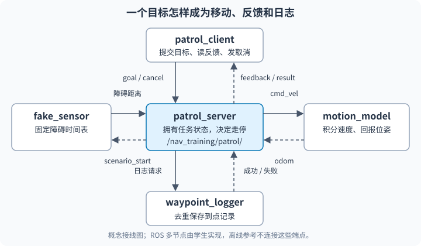

# 小车走完两个点，遇到障碍和取消会怎样？

<small>整理与维护：24cst朱鑫鹏</small>

**先看一趟巡逻**：不用先装 ROS，先在浏览器让小车走过两个点，再让它停下来。

<div data-nav-visuals="补充：查看定位、规划与控制的分工"></div>


<iframe src="../../visuals/playground.html?scene=patrol" loading="lazy" width="100%" height="620" style="border:0;border-radius:12px" title="巡逻试玩：两点、障碍等待、取消和断流"></iframe>

[单独打开演示](../visuals/playground.html?scene=patrol)

演示先走 A→B→A，看清一趟任务怎样结束；下面的 Python 练习换成两段直角路线，继续检查同样的走停和取消规则。

## 现在试一下：先玩2分钟，再跑一次Python（5–10分钟）

1. 点“开始巡逻”，趁小车还在走点“放入障碍”，看它等待；点“清除障碍”，看它继续走。
2. 点“重播新任务”并开始，途中点“取消任务”。确认它停住，观察最终状态；想再走，要重新开始一个新任务。
3. 试玩后，在知识库根目录运行下面这一条，比较文字报告与刚才的取消现象。

```text
python -B -X utf8 docs/navigation/training/assets/patrol_reference.py --scenario cancel
```

下载版需要把[参考脚本](assets/patrol_reference.py)和[固定输入](assets/patrol_cases.json)放在同一目录，再运行 `python -B -X utf8 patrol_reference.py --scenario cancel`。普通 Python 3.10+ 即可，Ubuntu 中可用 `python3`。

**预期**：浏览器取消后显示 `CANCELED`、零速度、位姿不再推进；Python 固定案例在 0.5 s 取消，停在 `(0.1,0)`，没有到点日志。网页帮助观察状态，精确时间以固定 Python 案例为准。

**看懂了再往下读**：第1节先预测时间线，第2节核对四种离线案例；第4节起再自己实现 ROS 节点。浏览器和普通 Python 通过，都不能代替 ROS 通信验收或 T8 实车资格。

<link rel="stylesheet" href="../../visuals/reader.css">
<script src="../../visuals/reader.js" defer></script>

<div data-nav-fold></div>

## 这项练习借鉴什么，实际要交什么？

原课程：**轻量巡逻：把 Topic、Service、Action 串成一个任务**。

你已经分别写过发布订阅、服务和 Action，现在让它们合作：客户端交两处巡逻点，巡逻节点决定走停，运动模型回报位姿，虚拟传感器制造障碍，日志服务记下到点证据。每一条消息都有后续用途，通信错误也会表现成可以定位的任务错误。

本练习借鉴 [UNNC AIM 的多节点巡逻作业](https://github.com/unnc-aim/aim-2526-ros2-coursework)：吸收任务分工、障碍滞回、到点日志和反馈流程。本队改用标准 `Odometry` / `Twist`、固定故障输入，取消、零速度和断流终止都作为必达项；原作业把取消列为可选加分。这里的参考代码由本队独立设计。

**先读清边界**：第一部分是普通 Python 的确定性协议模型；第二部分是你必须自己完成的 ROS2 Humble 多节点系统。参考模型没有 DDS、ROS 节点、硬件接口，也没有碰撞、惯性或定位噪声；它的通过记录不能代替 ROS 验收，更不能代替 [T8 实车资格](../assignments/README.md)。本页不增加全队实车规则。

## 1. 先预测一条时间线

从原点 `(0,0)` 出发，依次到 `(0.2,0)`、`(0.2,0.2)`，单位为米。教学平移速度上限为 **0.2 m/s 的模长**，固定周期 `dt=0.1 s`；第一段每步走 `0.2×0.1=0.02 m`，10 步到达，第二段再走 10 步。正常到点时间是 1.0 和 2.0 秒。

模型保持 `yaw=0`，所以世界系与身体系的 x/y 方向重合，第二段产生 `vy=0.2`。这个简化适合本队全向移动的入门演示；标准 Twist 的线速度仍属于身体坐标系，ROS 作业不能把有旋转的世界误差直接当身体速度。

每个事件先把**上一条速度**积分到当前时刻，再读取当前观测并决定**下一段速度**。因此 `t=0.5` 收到障碍时，位姿已经是 `(0.1,0)`，随后输出零速度；停止不抹掉此前合法发生的运动。

| 场景 | 固定输入 | 手算结论 |
| --- | --- | --- |
| `normal` | 两类输入每 0.1 s 更新；障碍距离 2 m | 1.0 / 2.0 s 依次到点，`SUCCEEDED` |
| `obstacle` | 0.5 s 距离 0.4 m；0.7 s 为 0.6；0.9 s 为 0.8；1.2 s 为 0.9 | 0.5–1.2 s 等待，延后 0.7 s，到点 1.7 / 2.7 s |
| `cancel` | 0.5 s 请求取消；之后仍有新输入 | `CANCELED`，停在 `(0.1,0)`，没有到点日志 |
| `timeout` | 两类输入最后一次更新在 0.4 s | 0.9 s `ABORTED`，停在 `(0.18,0)` |

先在纸上回答：为什么 0.6 m 和 0.8 m 都不恢复？为什么断流不是 0.4 s 立刻结束？取消后传感器恢复，能否继续同一个任务？这些问题决定你该写什么状态转换。

## 2. 跑离线基线，逐行核对

下载并把三个文件放在同一目录：[参考脚本](assets/patrol_reference.py)、[固定输入及预期](assets/patrol_cases.json)、[行为测试](assets/test_patrol_workshop.py)。也可在知识库根目录直接运行：

```text
python -B -X utf8 -m unittest discover -s docs/navigation/training/assets -p test_patrol_workshop.py -v
python -B -X utf8 docs/navigation/training/assets/patrol_reference.py --scenario normal
python -B -X utf8 docs/navigation/training/assets/patrol_reference.py --scenario obstacle
python -B -X utf8 docs/navigation/training/assets/patrol_reference.py --scenario cancel
python -B -X utf8 docs/navigation/training/assets/patrol_reference.py --scenario timeout
```

普通 Python 3.10+ 即可，无第三方依赖。在 Ubuntu 可以把 `python` 换成 `python3`。脚本按模型时间快速计算，不需要真的等待 2.7 秒。每行包含 `time/event/state/velocity/pose/feedback`，最后分别给 `waypoint_log`、`result`、`contract`。

需要保存完整机器可读证据时，运行以下命令；目录不存在时先自己建立报告目录，或直接输出到当前目录：

```text
python -B -X utf8 docs/navigation/training/assets/patrol_reference.py --scenario obstacle --json > patrol-obstacle.json
```

打开报告查四个位置：`events[5]` 的 0.5 s 等待与零速度、1.2 s 的恢复、两条 `waypoint_logs`、最后的 `result`。普通输出浮点数可能出现 `0.10000000000000002`，与 0.1 的差是表示误差；本例位置比较用 `1e-8 m`，不能把它移植成实测定位精度。

`feedback.current_index` 是当前目标的零起点索引；正常完成后等于点数 2，表示已经没有下一个目标。`distance_to_goal` 是平面欧氏距离；`result.reached_points` 是已到点并记录的数量，`total_time` 是接受到终止的模型时间，`interrupted` 在取消或中止时为 true。

`contract.passed=true` 表示固定输入的最终状态、到点数、结束时间、终点与日志时间符合文件里的独立预期，并检查速度模长、有限数值、停止状态速度与终态位姿。退出码 `0` 表示协议契约符合，`1` 表示不符合，`2` 表示输入／CLI 无效；**取消和断流是预期故障场景，正确结束时仍退出 0**。

参考在终态后再观察 0.5 s，用来暴露“收到新消息又开始动”的错误。先解释自己的结果，再读 [Patrol.tick](assets/patrol_reference.py) 的处理顺序；它不是待直接复制的 ROS Action Server。

## 3. 停止、恢复和坏输入的约定

状态从 `MOVING` 开始。距离 **小于 0.5 m** 时进入 `WAITING` 并输出零速度；只有 **大于 0.8 m** 才恢复 `MOVING`，中间区间保持此前状态。这叫滞回，避免数值在一个阈值附近波动时反复走停。等待时仍处理输入、取消和超时。

`SUCCEEDED`、`CANCELED`、`ABORTED` 都是终态：速度为 `(0,0,0)`，以后事件只能观察原位姿，不能恢复原任务。需要重新巡逻时，客户端发一个新 goal；离线则创建一个新 `Patrol` 实例。

里程计和障碍输入各维护一个接收时间。任意一类年龄 **达到 0.5 s** 即过期，输出零速度并以 `input_timeout` 中止。这个 0.5 s 是教学断流规则，不能解释成车辆停车保证。ROS 中接收年龄使用同一单调时钟；不要用墙钟年龄减去仿真的 ROS header 时间。

如果计时器很晚才执行，例如 0.0 s 收到 0.2 m/s，下一次在 0.8 s 才观察，旧速度只积分到 0.5 s，位移为 0.1 m，结果结束时间为 0.5 s、观测时间为 0.8 s。迟来的新包也不能复活已经错过超时边界的任务。

离线事件时间必须非负、有限且严格递增；重复或回退时间直接报 `ValueError`，不改动原状态和位姿。接收时间可重复，但不能回退、超前于当前事件或含 NaN/Inf。障碍接收时间与距离必须作为同一个观测成对提供。参数要求 `dt/速度/超时 > 0`、`0 ≤ 停止阈值 < 恢复阈值`；拒绝空目标、非二维目标、负障碍距离、非有限坐标，以及因极大数值导致段长无法用有限浮点数表示的目标。

`tick` 的 `obstacle_stamp` 与 `obstacle_distance` 必须成对提交，或者同时省略表示这一事件没有新障碍样本；不能单独刷新时间，把旧距离伪装成新消息。离线的 `odom_stamp` 只模拟里程计接收新鲜度，位姿仍由理想模型积分；ROS 实现必须读取真正收到的 Odometry 字段。

同一时刻事件的优先级也要讲清：已终止先保持；旧输入已经过期则中止；否则取消优先于障碍与到点日志。合法参数和事件才能进入积分。比较既有 [TimedModel.step](https://github.com/Navigator-Vision-Algorithm-Team/knowledge-base/blob/main/training/ros2_ws/src/nav_training/nav_training/core.py#L79-L109)：它同样截断过期运动，但对时钟回跳采取清缓存策略；本练习选择拒绝，二者不应混写成一个接口。

## 4. 学生 ROS2 系统：谁负责哪件事

在自己的练习工作区建立 `nav_patrol_interfaces`（ament_cmake 接口包）和 `nav_patrol`（Python 或 C++ 节点包）。所有节点及 Topic、Service、Action 都放在 **`/nav_training/patrol/`**；保持隔离命名，不重映射到实车速度 Topic。



`patrol_server` 独占任务状态与速度发布：验证 goal，读里程计与障碍，计算朝下一个点的速度，定时反馈，接受取消，调用日志服务，设置最终结果。一次只允许一个活动 goal；忙时明确拒绝新 goal，禁止两个执行回调同时抢速度。

`motion_model` 只接收 Twist 并积分，持续发布标准 Odometry；使用既有 [integrate_body](https://github.com/Navigator-Vision-Algorithm-Team/knowledge-base/blob/main/training/ros2_ws/src/nav_training/nav_training/core.py#L29-L47) 学习身体速度转世界位姿。自己加有限值检查、速度模长限制和 0.5 s 命令看门狗：服务器退出或停止发命令时模型也应停止。没有电机驱动。

`fake_sensor` 按 `scenario` 参数发布固定的距离序列；不要用未固定种子的随机障碍做必达验收。服务器在接受 goal 后发送 `scenario_start`，传感器以此重置场景相对时间；启动到首个 goal 之前持续发布安全距离，避免节点启动顺序改变故障时刻。

`waypoint_logger` 提供到点服务，把巡逻 ID、索引、坐标、ROS 到点时间写入学生自己的日志文件。按 `(patrol_id,index)` 去重，使重试不产生重复行。`patrol_client` 等服务器就绪后发送 goal，逐条打印反馈、取消响应与最终结果；不能仅凭 `cancel accepted` 宣称已经取消。

## 5. 固定接口，不用 Point 冒充 Odometry

| 完整端点 | 类型 | 发送者 → 接收者 |
| --- | --- | --- |
| `/nav_training/patrol/cmd_vel` | `geometry_msgs/msg/Twist` | server → motion_model |
| `/nav_training/patrol/odom` | `nav_msgs/msg/Odometry` | motion_model → server |
| `/nav_training/patrol/obstacle_distance` | `std_msgs/msg/Float32` | fake_sensor → server |
| `/nav_training/patrol/scenario_start` | `std_msgs/msg/Empty` | server → fake_sensor |
| `/nav_training/patrol/start_patrol` | `nav_patrol_interfaces/action/StartPatrol` | client ↔ server |
| `/nav_training/patrol/log_waypoint` | `nav_patrol_interfaces/srv/LogWaypoint` | server ↔ logger |

Odometry 的 `header.frame_id=patrol_odom`、`child_frame_id=patrol_base`，位置和四元数放进标准字段；时间戳为 ROS 时间。Twist 使用 `linear.x/y`、`angular.z`，其余分量为 0。Float32 没有 header，要在回调收到消息时记录单调接收时间；Odometry 同样记录接收年龄，并另外检查 header 时序与 frame。

下载 [StartPatrol 模板](assets/patrol_StartPatrol.action)，在接口包中重命名为 `action/StartPatrol.action`。三段依次是 Goal、Result、Feedback，用 `---` 分隔：

```text
geometry_msgs/Point[] waypoints
---
float64 total_time
uint32 reached_points
bool interrupted
string reason
---
uint32 current_index
geometry_msgs/Point current_pose
float64 distance_to_goal
string state
```

Goal 的所有点必须有限且 `z=0`，默认使用 `patrol_odom` 坐标；拒绝空列表。下载 [LogWaypoint 模板](assets/patrol_LogWaypoint.srv)，重命名为 `srv/LogWaypoint.srv`：request 含 `patrol_id/index/waypoint/timestamp`，response 含 `success/message`。巡逻 ID 使用 goal UUID，timestamp 使用到点 ROS 时间。

**模板尚未编译，也没有 ROS 适配实现。** 按 [ROS2 官方接口生成说明](https://github.com/ros2/ros2_documentation/blob/humble/source/Tutorials/Intermediate/Creating-an-Action.rst) 配置 `rosidl_generate_interfaces`，列入两个文件和 `DEPENDENCIES geometry_msgs builtin_interfaces`，补包依赖、`action_msgs`、`rosidl_default_runtime` 与接口包 group。编译后必须实际运行 `ros2 interface show`。

服务器到点后先发零 Twist，异步调用日志服务；服务成功后才增加已记录点数并发往下一点。等待日志时也保留取消、反馈和输入超时处理，可标记 `WAITING` 并在节点日志写明 `wait_reason=log`，与 `wait_reason=obstacle` 分清。日志失败或等待超过声明的 1 s 教学期限，零速度并 `ABORTED`，reason 写出原因。

取消回调接受请求，执行路径还必须检查 `is_cancel_requested`、清除旧速度、发零 Twist、调用 `goal_handle.canceled()` 并返回 result。正常结束用 `succeed()`，输入／日志故障用 `abort()`。对照 [本队教学 accept_cancel/execute](https://github.com/Navigator-Vision-Algorithm-Team/knowledge-base/blob/main/training/ros2_ws/src/nav_training/nav_training/fibonacci_server.py#L29-L61) 与 [ROS2 官方 Action Server 代码](https://github.com/ros2/examples/blob/humble/rclpy/actions/minimal_action_server/examples_rclpy_minimal_action_server/server.py)：接受取消与返回终态是两步。

ROS 定时器、订阅、Action 执行、日志 future 要能同时推进。可用短周期状态推进与异步 service，或多线程 executor 配合回调组和状态锁；不要在占用唯一回调线程的循环里等 service，造成取消与里程计永远处理不到。实现方式可以不同，验收观察必须相同。

## 6. 参数、launch 和启动顺序

学生提供 `patrol.launch.py` 和参数 YAML，至少声明并检查 `dt=0.1`、`max_speed=0.2`、`input_timeout=0.5`、`command_timeout=0.5`、`stop_distance=0.5`、`clear_distance=0.8`、`scenario`、日志路径。ROS 到点容差由你声明，例如 `0.005 m`；解释它与离线精确到点的差别。

运动模型／传感器／server 的周期都设为 0.1 s；双方 Topic 使用兼容 QoS，例如 reliable、volatile、depth=10。`launch` 统一 namespace，默认不自动发 goal；先启动 logger、motion_model、fake_sensor 和 server，等接口与新鲜输入就绪，再启动 client。服务器没输入、日志服务没就绪时不接受运动任务。

以下是**学生完成上述包之后**的命令约定，当前资料不会自动提供这些可执行程序。每个 ROS 终端 source 同一 Humble 与学生 overlay，并设置相同的空闲 domain；87 是示例，有冲突时统一换号。`ROS_LOCALHOST_ONLY=1` 将本练习限制在当前机器：

```bash
source /opt/ros/humble/setup.bash
export ROS_DOMAIN_ID=87
export ROS_LOCALHOST_ONLY=1
cd ~/patrol_ws
colcon build --packages-select nav_patrol_interfaces nav_patrol
source install/setup.bash
ros2 interface show nav_patrol_interfaces/action/StartPatrol
ros2 interface show nav_patrol_interfaces/srv/LogWaypoint
ros2 launch nav_patrol patrol.launch.py scenario:=normal
```

在第二个终端检查连接与参数，再发固定目标：

```bash
ros2 topic info /nav_training/patrol/cmd_vel -v
ros2 topic info /nav_training/patrol/odom -v
ros2 topic echo /nav_training/patrol/odom --once
ros2 param get /nav_training/patrol/patrol_server input_timeout
ros2 action info /nav_training/patrol/start_patrol
ros2 service type /nav_training/patrol/log_waypoint
ros2 action send_goal /nav_training/patrol/start_patrol nav_patrol_interfaces/action/StartPatrol "{waypoints: [{x: 0.2, y: 0.0, z: 0.0}, {x: 0.2, y: 0.2, z: 0.0}]}" --feedback
```

CLI 可检验正常与障碍；取消必须由学生 client 的 goal handle 发请求。约定 `ros2 run nav_patrol patrol_client --ros-args -p cancel_after:=0.5`，从 goal 被接受开始计时，打印取消响应后等待最终 result。`cancel_after=-1` 表示不取消；此参数同样要验证。

## 7. 四种 ROS 验收，要有独立证据

每次场景使用新进程／新 goal／新的日志文件，初始位姿归零。记录源码提交、ROS 版本、launch 参数、接收时间来源及实际周期；用 Topic 输出或 rosbag 同时保留速度、里程计、障碍。ROS 调度与日志调用可能延长总时间，不能把离线 2.0 s 当成实际 ROS 运行证明。

1. **正常**：`scenario:=normal`，两点按序到达，日志只有索引 0、1，feedback 持续更新，最后 `SUCCEEDED`。核对速度模长 ≤0.2 m/s，结果数量与日志一致；最后零 Twist 后继续观察至少 0.5 s，位置保持在声明的容差内。
2. **等障碍**：`scenario:=obstacle`，使用第 1 节相同相对时间表。看到 WAITING、零 Twist、等待期无位姿推进；0.6/0.8 m 不恢复，0.9 m 才恢复。日志仍按序，两点成功；解释等待时间与总耗时差。
3. **取消**：正常传感器场景，client 在接受后 0.5 s 取消。保存请求、接受、第一条零 Twist、最终 CANCELED 的时间。接受后应在下一控制周期处理，反馈／运动不得继续推进；最终日志数量只含取消前已确认的点，随后新输入不能恢复该 goal。
4. **断流**：`scenario:=timeout`，fake_sensor 从接受后的 0.4 s 起停发，odom 仍发布；任意一类丢失都要被检测。记录最后一次接收、年龄达到 0.5 s、零 Twist 和 ABORTED。单独终止 server 再验证 motion_model 命令看门狗；这项验证模型断命令处理，不能冒充机器人停车测试。

本地 10 Hz 系统可先把“达到阈值到发布零速度”验收窗口定为下一控制周期 0.1 s，并记录实际调度误差；超窗就报告失败、查阻塞与回调，不能直接把窗口改大当作修复。这个教学测量不形成实车安全指标。

另交三个反例：空／NaN goal 被拒绝且无速度；第二个并行 goal 被拒绝；日志服务停掉后任务零速度中止。先做出可复现的现象，再说明根因、修复和回归。`rqt_graph` 截图补充端点关系，但它单独不能证明 service 应答、取消结果或运动停止。

## 8. 交付与评分建议

交个人代码、接口与编译记录、参数／launch、四份时间线报告、到点日志、反馈／结果输出和端点证据。报告固定写“输入与预测 → 实际事件 → 偏差原因 → 修复后复验 → 已验证范围”；由另一名同学从空终端按 README 复现一次。离线报告单独标注 `offline`，学生 ROS 结果另列，实车栏保持本项未测。

| 内容 | 建议分值 | 核对证据 |
| --- | --- | --- |
| 接口与协作职责 | 20 | 标准消息、自定义接口生成、namespace、端点与分工 |
| 正常巡逻与反馈 | 20 | 两点顺序、速度模长、index/距离/耗时与结果一致 |
| 障碍停走与滞回 | 15 | 固定输入、零速度、等待位姿、恢复阈值 |
| 取消与两类断流处理 | 25 | cancel 结果、输入看门狗、命令看门狗、终态冻结 |
| 到点日志与复现 | 20 | service 成功／失败、去重、参数 launch、他人复验 |

这是巡逻作业的评分建议，不替代既有 T0–T10 或 T8 准入。取消无终态、停止状态非零速度、断流后继续移动，均先记相应必达项未通过，修复后重测；其他项目的分数不能把这三项变成可选。

完成以后，再回 [教学工作区](workspace.md) 读原来的理想运动与 Action 小例子：你应能指出哪个函数负责数学积分、哪个节点负责通信、谁拥有任务终态，遇到不动时先判断“任务不允许动、速度没送到、模型没积分”中的哪一层。
