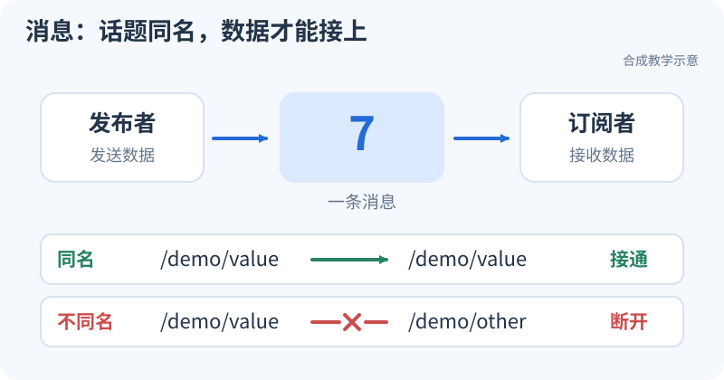

# 教学工作区：从第一次运行到修改代码

<small>整理与维护：24cst朱鑫鹏</small>

先认识里面的两个人：一个发数字，一个收数字。名字对上，消息才能送到；先在图里试一遍，再运行下面的节点。

<div data-nav-visuals="查看发布与订阅示意图"></div>



<iframe src="../../visuals/playground.html?scene=messages" title="先用消息传球认识发布订阅" width="100%" height="620" loading="lazy" style="border:0;border-radius:12px"></iframe>

[单独打开演示](../visuals/playground.html?scene=messages)。先运行，再把名字切成不同，最后改回来。能解释“发了但没收到”，就可以去下面的“获取与首次运行”，在自己的电脑做同一件事。

<link rel="stylesheet" href="../../visuals/reader.css">
<script src="../../visuals/reader.js" defer></script>
<div data-nav-fold></div>

## 先选哪种运行方式

本课提供[可下载的教学代码][kit]，对应 T0–T2、T7 和 T9 的练习。它是独立小系统：计数发布订阅、可配置 launch、理想全向运动、Odometry/TF、目标反馈与取消。主代码位于知识库 `training/`，比赛导航仓库保持原样。

**先确认使用哪条路径**：普通 Windows/macOS/Linux + Python 3.10 可完成数学、数据重算和两个 Debug 模型；Ubuntu 22.04 + ROS2 Humble 可进一步完成真实节点、DDS、TF 和 Action。最新实际验证记录见[验证状态](validation.md)，不是仅凭环境名字判定已跑通。

这次增加三个衔接练习，入口和资产都在 `docs/navigation/training/`，Python 3.10+ 标准库即可运行其离线部分。按当前学习阶段选一个，不需要一次做完：

| 学到哪里 | 下一步 | 需要说明的结果 |
|---|---|---|
| 通信、Action 与理想运动完成 | [轻量巡逻](patrol-workshop.md) | 谁决定目标、谁输出速度；等待、取消和断流如何结束运动 |
| 理解四邻接、g/h/f | [A* 两步练习](astar-workshop.md) | 先补框架再独立实现；路径合法且代价与独立参照一致 |
| 会算坐标或差分 | [TF、地图与滤波对照](controlled-experiments.md) | 同输入只变一项，先预测偏差，再运行、解释并恢复 |

新文件尚未发布到 GitHub `main`，本预览先提供真实的相对文件下载；下载时保留该页列出的配套输入。已有教学代码和本队源码仍给出可打开的 GitHub 蓝链接。合入后维护者再为新资产登记提交 SHA，避免读者跳到尚不存在的远程文件。

## 1. 获取与首次运行（约 30 分钟）

教学代码已在组织知识库提供。以下命令在准备存放练习的目录执行，`navigation-training-kb` 应是尚不存在的新目录；已经克隆者直接进入对应仓库即可：

```text
git clone https://github.com/Navigator-Vision-Algorithm-Team/knowledge-base.git navigation-training-kb
cd navigation-training-kb
git rev-parse HEAD
```

后续命令均以知识库根目录为起点；完整源文件见[配套目录][kit]，保留当前提交 SHA 作为练习版本。本文教学代码蓝链接指向组织仓库 `main`，阅读时把自己的 SHA 一并记下；主导航源码链接仍固定在审查基线。Ubuntu 若没有 `python` 命令，使用 `python3`。

第一次只要求说明输出中的 `samples`、`predicted_final`、`max_position_error_m` 与 `passed`。前进数据 51 个样本，0.2 m/s 持续 5 秒，预期终点 `(1,0,0)`；最后一个指令为零。重算模型从速度算位置，真值只用于比较和初始位姿，不直接复制后续答案。

先别急着把 `passed=true` 当作理解了。51 个样本包含起点和终点，相邻样本间隔 0.1 秒，所以只有 50 个运动区间：`50×0.1=5 s`。每个区间前进 `0.2×0.1=0.02 m`，累加得到 1 m。第 51 个样本将速度设为零，用于定义从终点时刻开始的指令；它不需要再增加一个运动区间。

代码路径 `training/tools/replay_motion.py` 的 [compare 函数](https://github.com/Navigator-Vision-Algorithm-Team/knowledge-base/blob/main/training/tools/replay_motion.py#L14-L45)按行读取 CSV。重点看 `model.set_command(command, elapsed)` 与紧接着的 `predicted=model.pose`：新时间到达时先按旧指令推进位置，再和当前行真值比较。误差使用 `hypot`，也就是二维距离；预测 `(0.99,0.02)` 与真值 `(1,0)` 的距离约为 0.0224 m，而非只看 x 误差 0.01 m。

```text
python --version
python -m unittest discover -s training/tests -p test_core.py -v
python training/tools/replay_motion.py training/datasets/synthetic-v1/forward/ground_truth.csv
```

接着把路径里的 `forward` 改为 `lateral`、`rotation`、`stationary`。侧移终点为 `(0,0.5,0)`，旋转终点为 `(0,0,1 rad)`，静止保持原点。数据采样、单位和地图说明见[数据包页](datasets.md)。

## 2. Ubuntu/Humble 编译（约 30–60 分钟，不含安装）

这一段的原理是“构建产生安装结果，加载环境使运行工具找到结果”。教学包路径 `training/ros2_ws/src/nav_training/setup.py` 的 [data_files 与 console_scripts](https://github.com/Navigator-Vision-Algorithm-Team/knowledge-base/blob/main/training/ros2_ws/src/nav_training/setup.py#L10-L28)分别安装 launch 等资源、登记可执行入口。因此 `ros2 run nav_training ideal_model` 最终进入 `nav_training.ideal_model:main`；`ros2 launch` 查找的是安装后的 launch 资源。若包存在却没有期望的 executable，沿这个映射检查，比到处寻找一个叫 `ideal_model` 的源文件更直接。

先按[环境页](../onboarding/environment.md)准备 Humble。在**全新终端**操作，只 source Humble 和本教学工作区；如果以前创建过同名 `nav_training` C++ 包，不能叠加那份 install。配套 Python 节点用于尽早观察运行，原路线的 C++ 编程训练仍需完成。

```bash
source /opt/ros/humble/setup.bash
sudo apt install python3-colcon-common-extensions ros-humble-launch-ros \
  ros-humble-tf2-ros ros-humble-action-tutorials-interfaces ros-humble-rosbag2 \
  ros-humble-geometry-msgs ros-humble-nav-msgs ros-humble-std-msgs ros-humble-tf2-msgs
cd training/ros2_ws
colcon build --symlink-install --packages-select nav_training
source install/setup.bash
ros2 pkg prefix nav_training
ros2 pkg executables nav_training
```

最后两步应指向当前教学工作区，并列出配套可执行程序。只有在这个小包正常后，才继续讨论完整导航工程缺包、地图或硬件问题。包目录和入口说明见[ROS 测试说明][ros-testing]。

## 3. 观察小系统（T1，约 45 分钟）

**你应看到的关系**：`sequence_source` 发布递增计数，`sequence_sink` 收到后发布到 `received`；`ideal_model` 在无速度输入时持续发布静止位姿。看见 Topic 名称不等于订阅链路正确，下一课会专门构造这种情况。

现在打开路径 `training/ros2_ws/src/nav_training/nav_training/sequence.py`，对照 [发布端](https://github.com/Navigator-Vision-Algorithm-Team/knowledge-base/blob/main/training/ros2_ws/src/nav_training/nav_training/sequence.py#L10-L25)和[订阅端](https://github.com/Navigator-Vision-Algorithm-Team/knowledge-base/blob/main/training/ros2_ws/src/nav_training/nav_training/sequence.py#L28-L39)。构造函数负责读取参数、建立通信端点和定时器；`publish_next` 由定时器反复执行，`receive` 则由收到消息这一事件触发。比如发布端发 `7`，订阅端收到后原样转发 `7`，它没有自己的递增计数。两端日志出现不同数字，先比较时间窗口和漏接消息，不能直接断言算术出错。

启动参数在路径 `training/ros2_ws/src/nav_training/nav_training/presets.py` 的 [description](https://github.com/Navigator-Vision-Algorithm-Team/knowledge-base/blob/main/training/ros2_ws/src/nav_training/nav_training/presets.py#L10-L28)中传给节点。这里 `ParameterValue(..., value_type=float)` 把启动时的字符串变成频率数值。参数的读取在 `runtime.py` 的 [startup_parameter](https://github.com/Navigator-Vision-Algorithm-Team/knowledge-base/blob/main/training/ros2_ws/src/nav_training/nav_training/runtime.py#L8-L11)，明确设为只读；改频率要修改启动参数并重启，不能用 `ros2 param set` 的失败反推程序坏了。

每个训练终端设置同一个空闲 domain，并限制当前机器通信；下面的 87 是示例，组内有冲突时统一换号。教学 launch 不启动底盘，输出只进入教学模型和观察器。

```bash
export ROS_DOMAIN_ID=87
export ROS_LOCALHOST_ONLY=1
ros2 launch nav_training healthy.launch.py
```

在另一终端加载相同环境后，逐条检查：

```bash
ros2 node list
ros2 topic list -t
ros2 topic echo /nav_training/sequence --once
ros2 topic echo /nav_training/received --once
ros2 topic info /nav_training/sequence --verbose
ros2 topic echo /nav_training/odom --once
```

交一张实际接口表：节点名、Topic 全名、类型、发布/订阅方向、QoS、频率。记录实测结果；这里的结构描述不能代替自己的日志。

## 4. 给模型输入速度并检查 TF（T2，约 60 分钟）

### 4.1 先手算直行和转弯，再看积分公式

速度是“每秒走多少”，位置变化是速度在一段时间内的累积。这里 `vx,vy` 属于机器人自身坐标系，朝向 `yaw` 决定它们在世界里指向哪。机器人朝北，即 `yaw=π/2` 时，身体的前进速度 `vx=0.2 m/s` 持续 1 秒，世界坐标的 y 增加 0.2 m，x 不变。

下面是用于理解的瞬时公式，不是复制自源码的完整积分实现：

```text
世界 vx = cos(yaw) × 身体 vx - sin(yaw) × 身体 vy
世界 vy = sin(yaw) × 身体 vx + cos(yaw) × 身体 vy
yaw 的变化 = wz × dt
```

同时转弯时，朝向在区间内一直变。设初始朝向为零、`vx=1 m/s`、`vy=0`、`wz=1 rad/s`，运动 `π/2 s`：转过 90°，圆弧半径 `vx/wz=1 m`，终点应为 `(1,1)`。若全程按初始朝向直线累加会算成 `(1.571,0)`，这就是为什么直行测试通过还不够。

真实实现路径 `training/ros2_ws/src/nav_training/nav_training/core.py` 的 [integrate_body](https://github.com/Navigator-Vision-Algorithm-Team/knowledge-base/blob/main/training/ros2_ws/src/nav_training/nav_training/core.py#L29-L47)使用区间中间朝向和 `sinc` 系数计算恒定身体速度的精确圆弧位移。`sinc=sin(half)/half`，接近零时用极限展开避免除以零和数值损失。完成直行算例后，再用路径 `training/tests/test_core.py` 的[四分之一圆测试](https://github.com/Navigator-Vision-Algorithm-Team/knowledge-base/blob/main/training/tests/test_core.py#L35-L40)对照刚才的手算。

### 4.2 超时为何要截断区间

在模型时间 `t=0` 收到 `vx=0.2 m/s`，超时为 0.5 秒，下一次 `step` 到 `t=0.8`。有效运动只持续到 0.5 秒，位移应为 `0.2×0.5=0.1 m`。把整段 0.8 秒积分会多走 0.06 m；看见指令已经过期就整段不积分，则会漏掉原本有效的 0.1 m。

路径 `training/ros2_ws/src/nav_training/nav_training/core.py` 的 [TimedModel.step](https://github.com/Navigator-Vision-Algorithm-Team/knowledge-base/blob/main/training/ros2_ws/src/nav_training/nav_training/core.py#L93-L109)取 `min(当前时间, 指令时间+超时)`，把区间在失效点截断。`set_command` 先推进旧指令，再更新缓存；时钟回跳则保留已算位置，清掉旧指令并重建时间起点。你应能从代码解释这三种处理为什么不同，而不是只记“超时会停”。

ROS 适配位于 `training/ros2_ws/src/nav_training/nav_training/ideal_model.py`：[receive_command 与 tick](https://github.com/Navigator-Vision-Algorithm-Team/knowledge-base/blob/main/training/ros2_ws/src/nav_training/nav_training/ideal_model.py#L45-L80)。前者从 Twist 取数、限幅并记录回调时间，后者调用模型并发布 Odometry/TF。数学核心不依赖 ROS，这也是普通 Python 能先验证运动原理的原因。

### 4.3 输入速度，观察位姿与 TF

以下命令只发到教学 Topic，`--times 20` 在 10 Hz 下发送有限次；停止发消息后模型按 0.5 秒教学超时规则停止积分。运动时间需按实际事件计算，不能把终端运行时间直接作为精确参考。

```bash
ros2 topic pub /nav_training/cmd_vel geometry_msgs/msg/Twist \
  '{linear: {x: 0.2, y: 0.0, z: 0.0}, angular: {x: 0.0, y: 0.0, z: 0.0}}' \
  --rate 10 --times 20
```

在另一终端检查模型输出和命名空间内 TF：

```bash
ros2 topic echo /nav_training/odom --once
ros2 run tf2_ros tf2_echo training_odom training_base --ros-args \
  -r /tf:=/nav_training/tf -r /tf_static:=/nav_training/tf_static
```

动态边为 `training_odom→training_base`；静态边为 `training_base→training_lidar`，平移 `(0.2,0,0.1) m`，无旋转。静态边只是坐标教学，没有模拟雷达测量。Odometry 与动态 TF 同次发布应共享 stamp 和位姿。

依次试前进、侧移、旋转，然后观察断流、零命令和无效输入的行为。默认平移模长上限 0.5 m/s、角速度上限 1 rad/s，仅约束教学模型。**这套限制不能作为机器人停车设计或实车许可速度。**

精确运动公式和超时边界使用[核心测试][core-test]验证，读 [core.py][core] 的 `integrate_body`、`set_command`、`step`：哪段时间使用旧指令、何时失效、时钟回跳后哪些状态保留？

## 5. 目标反馈与取消（T1 巩固，约 45 分钟）

Action 适合“需要一段时间、期间还能问进度和取消”的任务。可以把它理解为下一个计算订单：请求被接受只是开始，反馈是中途进度，结果才是终态。路径 `training/ros2_ws/src/nav_training/nav_training/fibonacci_server.py` 的 [accept_goal、accept_cancel、execute](https://github.com/Navigator-Vision-Algorithm-Team/knowledge-base/blob/main/training/ros2_ws/src/nav_training/nav_training/fibonacci_server.py#L29-L61)分别处理接单、允许取消和执行；路径 `training/ros2_ws/src/nav_training/nav_training/fibonacci_client.py` 的 [run](https://github.com/Navigator-Vision-Algorithm-Team/knowledge-base/blob/main/training/ros2_ws/src/nav_training/nav_training/fibonacci_client.py#L38-L65)展示客户端如何等响应和结果。读的时候给这些事件各画一个时间点，别把取消请求被接收和任务已经结束画成同一点。

启动配套 `fibonacci_server`，再用 `fibonacci_client` 的默认受控目标练习反馈和取消；确切参数与运行命令见[ROS 测试说明][ros-testing]。它是已有标准接口的教学任务，不会使模型运动。

观察目标接受、至少两次反馈、发起取消、取消响应和最终状态；再做自然完成与非法目标被拒绝。用目标 ID 串起日志，区分取消请求发送成功与最终 `CANCELED`。随后回到本队 NavigateToPose：取消导航 Action 还需检查哪些下游速度和底盘状态？

## 6. 从可运行基线开始做六个改动

在自己的练习分支修改，不更改知识库基线数据来迎合结果。每次按“基线→单项变化→观察→恢复”提交记录。

| 练习 | 具体改动 | 交付与检查 | 对应本队 |
|---|---|---|---|
| E1 参数 | 修改教学发布频率并重启；确认有效参数和 60 秒计数 | 两组频率、端点、命令和差异解释；T1 的 5/10 Hz 两组仍照常完成 | 参数声明、YAML/launch 传递 |
| E2 名字 | 跑 bad_topic 预设，再只修 sink_topic | [完整案例一](../debug-real/case-topic-mismatch.md)的证据与回归 | loam 输入参数、namespace/remap |
| E3 运动 | 在独立练习文件实现二维积分，与核心解析测试比较 | 前进/侧移/转弯至少各一个固定输入；解释自己用的离散或解析方法 | odometry 与 fake 速度旋转 |
| E4 时间 | 将真值 CSV 复制到 output，改一个 stamp 为重复或回跳 | 重算入口退出码 2；解释为什么拒绝这一数据，另查核心回跳测试 | 消息时间与 steady_clock 差分 |
| E5 取消 | 调整受控目标长度与取消时机 | 反馈、取消响应、终态；不以关闭进程代替取消 | NavigateToPose/手柄 Goal 契约 |
| E6 缓存 | 跑旧速度复发模型，再应用最小修复 | [完整案例二](../debug-real/case-stale-command.md)的破坏/修复/正常输入回归 | fake_vel_transform 的缓存路径 |

E3 的学生实现放个人仓库，例如 `student_integrate.py`；先写自己推导的预期，不直接把 `core.py` 的输出当唯一答案。参考实现可用于完成后对照。合格代码不要求结构相同，但接口、单位和边界行为必须能解释。

以 E1 为例，启动时传 `rate_hz:=5.0`，预期源节点周期从 0.1 秒变为 0.2 秒；先读取有效参数，再测输出频率，最后恢复到 10 Hz。若参数已经是 5 而观察仍为 10，检查是否同一 Topic 上还有另一发布者。这个练习检验的是“改动 → 参数传递 → 实际行为”的整条因果链；只展示修改后的源文件不能替代运行证据。启动参数的具体传递仍看前面链接的 `presets.py`，无需为改一次频率到处更改默认值。

## 7. 从教学接口映射回本队

迁移时先找相同的接口职责，再看真实系统多出了什么约束。教学计数只要求名字和类型匹配，真实点云还要求 frame、时间和外参；教学超时只控制积分，真实底盘还涉及多个速度发布源和执行端。这样读下面的表，你带过去的是可复用的分析方法，而不是把教学默认数值逐项抄进比赛配置。

| 教学对象 | 回到哪里读 | 相同点与不同点 |
|---|---|---|
| sequence pub/sub | [loam_interface][loam] | 都有参数化输入与回调；真实节点处理点云和 TF，计数练习没有这些复杂度 |
| ideal_model odom/TF | [sensor_scan_generation][sensor] | 都需要一致的位姿/frame/stamp；教学是真值模型，本队来自 LIO 和外参转换 |
| body twist 与超时 | [fake_vel_transform][fake] | 可理解速度旋转、缓存和时间；本队自旋/同步策略不能用教学超时替代 |
| Action server/client | [Nav2 与控制链](../nav2/README.md) | 接受/反馈/取消/结果契约可迁移；Fibonacci 不包含导航或停车逻辑 |

最后按 [T0–T2](../assignments/README.md)提交代码与证据。通过教学工作区不等于通过真实数据定位、Nav2 闭环或实车准入；标准合成包支持的范围见[数据说明](datasets.md)。

[kit]: https://github.com/Navigator-Vision-Algorithm-Team/knowledge-base/tree/main/training
[ros-testing]: https://github.com/Navigator-Vision-Algorithm-Team/knowledge-base/blob/main/training/ROS_TESTING.md
[core]: https://github.com/Navigator-Vision-Algorithm-Team/knowledge-base/blob/main/training/ros2_ws/src/nav_training/nav_training/core.py
[core-test]: https://github.com/Navigator-Vision-Algorithm-Team/knowledge-base/blob/main/training/tests/test_core.py
[loam]: https://github.com/Navigator-Vision-Algorithm-Team/Navigation-2027/blob/183a4109b0de2030bb8970a54654937c8b039ba9/ros_ws/src/pb2025_sentry_nav/loam_interface/src/loam_interface.cpp
[sensor]: https://github.com/Navigator-Vision-Algorithm-Team/Navigation-2027/blob/183a4109b0de2030bb8970a54654937c8b039ba9/ros_ws/src/pb2025_sentry_nav/sensor_scan_generation/src/sensor_scan_generation.cpp
[fake]: https://github.com/Navigator-Vision-Algorithm-Team/Navigation-2027/blob/183a4109b0de2030bb8970a54654937c8b039ba9/ros_ws/src/pb2025_sentry_nav/fake_vel_transform/src/fake_vel_transform.cpp
